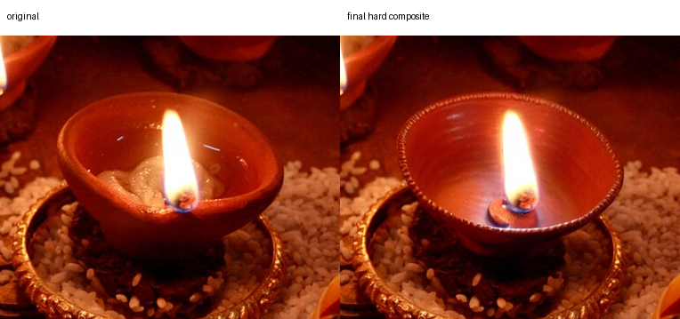
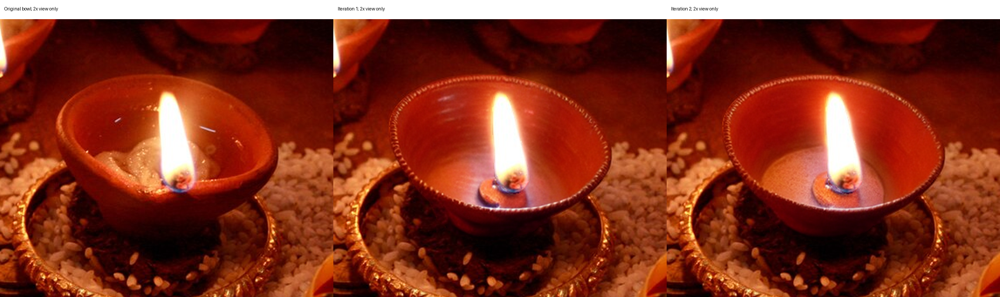
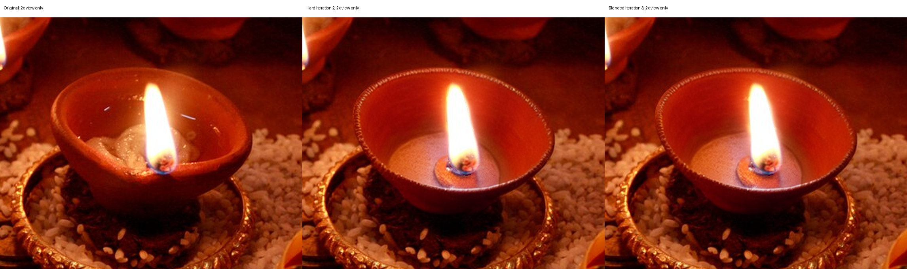
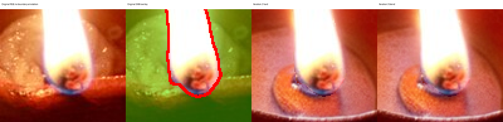

# Phase 6 working report

**Working evidence, not a final phase report. Awaiting external mentor evaluation.**

This file is the single Phase 6 working report. Future mentor-directed corrections should append a labeled iteration here and retain the existing findings and experiment artifacts. Do not publish a polished final Phase 6 report until explicit phase approval.

## Iteration 1 — Localized diffusion-inpainting feasibility

### Outcome

**Technical feasibility: PASS on this one experiment. Visual/material fidelity: NEEDS FIXES; mentor review pending.** The isolated run generated a different central bowl and preserved every decoded source pixel outside the original SAM mask. It did not demonstrate cultural adaptation or an end-to-end transcreation pipeline.



[Full original/mask/final comparison](../results/phase6_inpainting/iteration1/run/comparison.png) · [Original-resolution final PNG](../results/phase6_inpainting/iteration1/run/final.png) · [Raw generated processing crop](../results/phase6_inpainting/iteration1/run/raw_generated_crop.png)

### Objective and selection scope

Test one requested inpainting checkpoint, one predefined prompt, one mask and seed 42 on the existing Diwali photograph. Target: **visible clay bowl/body only**, excluding the flame, wick and unrelated supporting objects. This does not replace the complete lamp.

No genuine human-approved SAM mask was found in the prepared Phase 5 cases: five requests remain PENDING. A segmentation-test acceptance would not authorize cultural image modification anyway. The current user explicitly requested an isolated RESEARCH_ONLY generation when approval is absent; that instruction is the scope of this experiment, not a new reviewer decision.

After inspecting the original and candidate-0 overlay, candidate **0** from the existing point-guided oil-lamp run was explicitly chosen for its bowl coverage and flame exclusion. It was not automatically selected by score. Grounding prediction index is **2**; SAM candidate index is **0**—these identify different stages. No points, masks, review records or previous results were changed. Mask semantics and wick separation remain unverified by a named human.

[Selection/review status](../results/phase6_inpainting/iteration1/review_status.json) · [Frozen request](../results/phase6_inpainting/iteration1/input.json) · [Preregistration](../results/phase6_inpainting/iteration1/preregistration.json) · [Selected mask](../results/phase6_inpainting/iteration1/run/evidence/mask_0.png) · [Saved source overlay](../results/phase6_inpainting/iteration1/run/evidence/overlay_0.png)

### Model access, license and environment

Checkpoint: `stable-diffusion-v1-5/stable-diffusion-inpainting`, resolved and pinned revision **8a4288a76071f7280aedbdb3253bdb9e9d5d84bb**. Hugging Face metadata reported public, ungated access and **CreativeML OpenRAIL-M** licensing. The model card describes research use and usage restrictions; ungated does not mean unrestricted. It identifies this repository as a mirror of the retired original checkpoint. The [model card](https://huggingface.co/stable-diffusion-v1-5/stable-diffusion-inpainting) and [license page](https://huggingface.co/spaces/CompVis/stable-diffusion-license) were consulted before weight download. Their source metadata/card are archived in this iteration.

Downloaded only configuration/tokenizer files and **FP16 safetensors** for UNet, VAE, text encoder and the standard safety checker. No `.bin`/`.ckpt` weights or arbitrary remote Python were loaded. `use_safetensors=True`, `variant=fp16` and local-only pipeline loading make weight fallback explicit rather than silently using pickle. The dedicated UNet's nine input channels are checked.

Diffusers/Accelerate were initially absent. A dry-run showed no existing ML package upgrades; installed **Diffusers 0.35.2**, **Accelerate 1.11.0**, plus required importlib_metadata, zipp, lazy-importer and psutil. Torch **2.15.0+cu132**, Transformers **4.57.6**, safetensors **0.8.0**, huggingface-hub **0.36.2**, Pillow **13.0.0** remain unchanged. `pip check` passed. Optional dependencies are declared under `.[inpainting]`; no blind upgrade of the existing ML stack occurred.

Actual device: NVIDIA GeForce RTX 3050 Laptop GPU, 4 GB, Python 3.11.9 on Windows. The run used a fresh process with initial Torch allocated CUDA memory **0 bytes**. Ollama listed no loaded models, and no captioner, planner, detector or SAM weights were loaded concurrently. CLIP/text/safety components here belong to the requested diffusion pipeline.

[Access and revision check](../results/phase6_inpainting/iteration1/checkpoint_access.json) · [Downloaded files/hashes](../results/phase6_inpainting/iteration1/download.json) · [Installed API signature](../results/phase6_inpainting/iteration1/installed_api.json) · [Dependency installation](../results/phase6_inpainting/iteration1/dependency_install.json) · [Before environment](../results/phase6_inpainting/iteration1/environment_before.json) · [After environment](../results/phase6_inpainting/iteration1/environment_after.json)

### Implementation

- `contracts.py`: append `InpaintingInput`, requiring meaningful prompt/selection text, explicit candidate index, valid source/mask/segmentation SHA-256 values and the exact scope RESEARCH_ONLY. No planner or pending-review JSON can substitute for this request. No new editing-approval fields are added to old contracts.
- `config.py` and `configs/inpainting.yaml`: pinned checkpoint and reproducible processing/generation settings; existing configuration behavior remains intact.
- `stages/inpainting.py`: reuse the existing portable SAM bundle checker; verify selected candidate membership and hashes; prepare a padded local crop; lazily load the dedicated diffusion pipeline; restore and composite; record artifacts, metrics, timings and errors.
- `scripts/inpaint.py`: a separate research command, not automatic planner integration. Existing caption/plan/ground commands are unchanged.
- `tests/test_inpainting.py`: 24 focused offline tests using the existing synthetic mask-review fixture and mocked diffusion pipeline. No weights are downloaded by tests.

Source validation runs before output creation, again after loading and again after inference. It checks the full referenced SAM bundle, original image hash, selected mask hash/membership, dimensions, binary values and foreground bounds/count. Output directories must be new. Errors produce explicit failed output rather than fabricated success. A single sequential CPU-offload retry is permitted only for CUDA OOM, with the same prompt/seed/config; other errors are not retried. This fallback was exercised by mocks, **not needed in the real run**.

### Frozen generation settings

| Setting | Effective value |
| --- | --- |
| Processing input | 512 × 512 local crop with square padding |
| Precision / batch | FP16 / 1 |
| Seed / RNG | 42 / CPU Torch generator |
| Inference steps requested | 20 |
| Strength | 0.9 |
| Actual denoising iterations | **18**, as set by the installed pipeline's strength scheduling |
| Guidance scale | 7.5 |
| Negative prompt | None |
| Scheduler | Checkpoint's DDIMScheduler; effective configuration recorded |
| Offloading | Model CPU offload |
| Safety checker | Retained; returned false flag |
| Conditions / completed calls | One / one; zero retries |

Exact prompt:

> A realistic darker terracotta clay oil-lamp bowl with a subtle carved rim, matching the original position, perspective, scale, lighting, shadows and surrounding photograph.

There was no prompt, seed, model, resolution or threshold sweep. The [installed Diffusers pipeline API](https://huggingface.co/docs/diffusers/v0.35.0/en/api/pipelines/stable_diffusion/inpaint) supports strength and specifies white mask pixels as editable, black as preserved. The installed signature/source was inspected, and only supported arguments were used. Actual scheduler settings and 18-step count are saved in the output JSON.

### Geometry and exact final compositing

The source is **1280 × 842**, not square. Original mask bounds are `[634, 253, 888, 444]` (upper bounds exclusive), with **32,088 foreground pixels**. A 64-pixel context margin gives crop `[570, 189, 952, 508]`, width 382 and height 319. Padding is left/top/right/bottom `[0, 31, 0, 32]`, making a 382 × 382 square. RGB border pixels are edge-replicated; mask padding is black. Both padded inputs are transformed consistently to 512 × 512: LANCZOS for RGB, NEAREST for the binary processing mask. The full photograph is never stretched into a square.

The generated 512-square crop is saved raw, resized back to 382-square, then unpadded to 382 × 319 and mapped to the recorded source coordinates. Generated pixels are composited through **the unchanged original-resolution SAM mask**, not the resized processing mask. No feathering, dilation, erosion or automatic cleanup was applied. Final output is lossless PNG so JPEG recompression cannot corrupt outside-mask equality.

The raw restored crop changed **89,372 of 89,770 noneditable context pixels** within that crop. This includes model reconstruction/resampling effects; the raw crop is not claimed to preserve the photograph. The final hard composite discards those changes and preserves every noneditable source pixel exactly. This distinction is why a raw inpainting result cannot directly be used as the final photograph.

[Processing RGB](../results/phase6_inpainting/iteration1/run/processing_image.png) · [Processing mask](../results/phase6_inpainting/iteration1/run/processing_mask.png) · [Restored generated rectangle](../results/phase6_inpainting/iteration1/run/restored_crop.png) · [Transparent editable region](../results/phase6_inpainting/iteration1/run/generated_region.png) · [Compositing diagnostics](../results/phase6_inpainting/iteration1/composite_diagnostics.json)

### Actual technical measurements

| Check | Measured result |
| --- | ---: |
| CLI status | COMPLETED, exit 0 |
| Final dimensions | 1280 × 842 |
| Original editable pixels | 32,088 |
| Changed pixels inside mask | **32,080** |
| Changed pixels outside mask | **0** |
| Outside pixels independently compared | 1,045,672 |
| Maximum outside-channel difference | 0 |
| Pipeline call time | **12.706670 s** |
| Pipeline load time (cached weights) | 7.380937 s |
| Stage time (model load/call, outputs and cleanup) | 21.364212 s |
| Process wall time | 26.490500 s |
| Peak allocated CUDA memory during call | **2,654,782,464 bytes / 2531.798 MiB** |
| CUDA OOM / fallback | None / not used |
| Source/mask/result artifact hashes | Independently rechecked; all match |

The weight download was completed before timing this generation; its metadata reports about 230 seconds before file hashing. Pipeline call time includes image encoding, denoising, VAE decode, safety checking and CPU-offload transfers, excluding pipeline load. Stage timing starts after validation/evidence/crop preparation; process timing includes Python startup. There was no repeated timing trial.

CUDA peak is PyTorch allocated memory, not total GPU use. Coarse nvidia-smi snapshots were 1,968 MiB before the child process and 1,131 MiB after; these are not peak measurements and are not directly additive with Torch allocator statistics on Windows.

The successful run had no runtime error. Nonfatal logs include a torch_dtype deprecation warning from the current stack; download logs also noted Windows symlink-cache behavior and HTTP fallback because hf_xet was absent. No package upgrade or retry was performed to hide these messages.

[Full structured result](../results/phase6_inpainting/iteration1/run/inpainting.json) · [Independent pixel/hash verification](../results/phase6_inpainting/iteration1/independent_verification.json) · [Actual invocation and hardware snapshots](../results/phase6_inpainting/iteration1/real_invocation.json) · [Runtime log](../results/phase6_inpainting/iteration1/inference_stderr.txt)

### Qualitative visual evaluation

This is assistant inspection of the saved original, overlay, raw crop, local comparison and full final image, **not independent human verification**. Mentor notes remain blank.

| Question | Observation |
| --- | --- |
| Recognizably changed? | Yes: the bowl interior is smoother and the rim has a small repeated decorative texture. |
| Plausible geometry? | It reads as a bowl within the source silhouette, but its interior shape/liquid texture changed substantially. Fixed silhouette is enforced by compositing, not proved by model reasoning. |
| Terracotta / carved-rim fidelity? | Partial. Dark reddish exterior and rim decoration appear, but glossy highlights look closer to polished metal than matte terracotta. A carved clay rim is not convincingly established. |
| Lighting/shadow compatibility? | Broad warm red/orange scene lighting matches; material reflectivity is too glossy to establish the requested material. Existing outer shadows/support are unchanged. |
| Seams? | No broad background corruption; a thin rim transition and the retained wick/flame-base island can look abrupt. No blending was used to conceal this. |
| Unchanged flame compatible? | Flame pixels remain exact outside the mask. Its old base can look like an isolated candle/disc on the new smooth bowl floor; physical attachment and oil/wick continuity are questionable. |
| Blur or distortion? | Some synthetic smoothness inside the bowl; no gross bowl deformation seen. Raw padded crop has border/context artifacts that are removed by unpadding/hard compositing. |
| Unrelated objects? | No obvious unrelated object added in the final bowl region, but the candle-like base impression requires review. |

[Structured visual observations and blank human notes](../results/phase6_inpainting/iteration1/visual_assessment.json). No accuracy, IoU, perceptual quality score or cultural-correctness score is claimed. This appearance change is not evidence of cultural adaptation.

### Regression, provenance and compatibility

Before: **199 tests passed** in 30.136 s. After: **223 tests passed** in 15.391 s, zero failures/errors. Differences in test duration are not a performance benchmark. Added tests cover hash tampering, candidate membership, mask validity, original coordinates/padding/restoration, outside-mask equality, saved original preservation, explicit scope, raw plan rejection, failures, safety flags, strict safetensors loading, no-overwrite and the single OOM fallback. New code uses mocks; tests do not load diffusion weights.

[Before test record](../results/phase6_inpainting/iteration1/tests_before.json) · [After full log](../results/phase6_inpainting/iteration1/tests_after.json) · [Preservation checks](../results/phase6_inpainting/iteration1/preservation_after.json) · [New CLI help](../results/phase6_inpainting/iteration1/inpainting_cli_help.txt) · [Existing CLI help](../results/phase6_inpainting/iteration1/existing_cli_help.txt) · [Git summary](../results/phase6_inpainting/iteration1/git_diff_summary.txt) · [Untracked additions/status](../results/phase6_inpainting/iteration1/git_status_after.txt)

The preservation check covers 156 pre-existing source/config/test/report/Phase 5 evidence files. Only `config.py` and `contracts.py` changed in that set, by appending new types/loaders. Existing stage implementations, tests, model configs and Phase 5 artifacts remain byte-identical. New stage/script/config/test files and this working report are additions; README and optional dependency metadata are updated. No Git commit/push occurred.

Identity anchors:

```text
source image sha256: 321c415a72e47d745949c90170c6342f70dafcbbe47380ff4cfaffbaf2b4dfc2
segmentation JSON:   62c9213bb551f693d620e7bea939fa43e8023616390ee9439fe364cabccf6309
selected mask:       c10336f253c03f2faaf745829b3e79994e5d9acb82773d6cb9583145cf5cbf46
```

The complete source SAM bundle is included alongside the generated artifacts so its local image/detection/point/mask hashes remain independently checkable. It retains all source candidate masks as provenance; this experiment generated only one output.

### Reproduction

From the repository root, with the existing environment:

```powershell
$env:PYTHONPATH = (Resolve-Path .\src).Path
.\.venv\Scripts\python.exe -m pip install -e ".[inpainting]"
.\.venv\Scripts\python.exe -B -m scripts.inpaint --input results/phase6_inpainting/iteration1/input.json --out outputs/inpainting_reproduction_new
```

Exact original run used `--out results/phase6_inpainting/iteration1/run`. Use a new directory for reproduction; do not overwrite the saved result. Seed alone does not guarantee identical images across different software, devices or attention implementations. Pin the recorded versions, weights and request hashes.

The portable package includes `portable_input.json`, which changes only file locations to the included source copies, preserving the exact image/segmentation/mask hashes, candidate, prompt and scope. From its extracted root:

```powershell
python -m pip install -e ".[inpainting]"
python -B -m scripts.inpaint --input portable_input.json --out reproduced_run_new
```

Downloading the same pinned weights is necessary if they are not cached. The review ZIP itself contains no weights, virtual environment, cache or unrelated dataset. Offline tests can be run with `HF_HUB_OFFLINE=1` and `python -B -m unittest discover -s tests -v`; inference is not required merely to inspect the package.

### Attribution, limitations and mentor decision

Source photograph: [Diwali Oil lamps Darjeeling](https://commons.wikimedia.org/wiki/File:Diwali_Oil_lamps_Darjeeling.jpg), Benoy, **CC BY-SA 3.0**. The generated bowl image and comparison figures are marked modifications; source attribution/license obligations remain. [Attribution record](../results/phase6_inpainting/iteration1/ATTRIBUTION.txt).

Remaining issues: one image/one prompt is engineering feasibility only; the mask is not human-approved; hard boundaries and a preserved flame base may be incompatible with the new material/geometry; material fidelity is weak; only one GPU/offload setup was measured. Confidence, valid hashes and exact compositing cannot prove a mask is semantically correct or a visual change culturally appropriate. The request schema deliberately provides no automatic planner/review-to-edit authorization route.

**Mentor status: PENDING. Recommendation: accept the technical locality result for review, request correction/assessment of material and wick/bowl continuity before any broader claim.** No additional prompts, seeds, mask expansion, blending, model changes or follow-up generation were run. No next iteration is implemented.

### Portable review verification

The package copies passed all **223 offline regression tests** with `HF_HUB_OFFLINE=1`. A separate standalone probe validated the included source/mask/SAM bundle, checked both original oil-lamp PENDING records against those source bytes, and reproduced exact outside-mask equality without inference. [Portable test log](../results/phase6_inpainting/iteration1/portable_tests.json) ? [Portable integrity check](../results/phase6_inpainting/iteration1/portable_integrity.json). ZIP CRC and every manifest SHA-256 were verified; the package contains no model weights or environments.


## Iteration 2 — Material Fidelity and Wick Continuity

### Motivation and changed variable

Iteration 1 established exact final-image locality but produced a glossy, metallic-looking bowl, an isolated wick/flame-base impression and abrupt rim transitions. This iteration tests **only a replacement positive prompt**. It is material/continuity research, not cultural transcreation.

The request was cloned from Iteration 1 with only `prompt` changed. Source photograph, SAM candidate **0**, grounding index **2**, all source hashes, mask pixels, crop, padding, seed, model/revision, weights, precision, sampling settings and compositor stayed fixed. No negative prompt was introduced. The supplied prompt was passed exactly:

> A photorealistic traditional oil-lamp bowl made of matte, unglazed reddish-brown terracotta clay. Fine porous earthen texture, subtle handmade imperfections, a gently carved clay rim, and natural warm lighting. Preserve the original bowl geometry and perspective. The existing wick and flame base must appear naturally connected to the oil and clay bowl interior. Match the surrounding photograph's lighting and shadows.

[Frozen input](../results/phase6_inpainting/iteration2/input.json) · [Preregistration](../results/phase6_inpainting/iteration2/preregistration.json) · [Exact settings comparison and independent checks](../results/phase6_inpainting/iteration2/independent_verification.json)

### Experimental setup and implementation freeze

Model remains `stable-diffusion-v1-5/stable-diffusion-inpainting` at `8a4288a76071f7280aedbdb3253bdb9e9d5d84bb`, FP16 safetensors, CUDA, batch 1, model CPU offloading, CPU generator seed 42, DDIM scheduler, 20 requested steps, strength 0.9 and guidance 7.5. The unchanged strength schedule executed **18 denoising iterations**. All 17 cached checkpoint/configuration/tokenizer files matched Iteration 1's recorded SHA-256 receipts. No downloads, installations or model-weight changes were needed.

The local crop is again `[570, 189, 952, 508]`, with left/top/right/bottom padding `[0, 31, 0, 32]` and 512 × 512 processing. Both processing PNGs are **byte-identical** to Iteration 1. Final compositing still uses the original full-resolution binary SAM mask, with no dilation, feathering, mask cleanup or other image correction.

Application, configuration and tests were frozen byte-for-byte. The experiment-only `execute_once.py` harness delegates loading and inference to the existing stage, recording the call count and aborting on OOM instead of permitting a second generation. This guard did not alter successful sampling computations. The actual call count was **one**, with no retry/OOM. It is an audit harness, not an architecture change or new pipeline feature.

Actual command, run from the repository root:

```powershell
.\.venv\Scripts\python.exe -B results/phase6_inpainting/iteration2/execute_once.py
```

The harness checks the pre-run snapshot and uses an exclusive new output directory; it is deliberately not a command to rerun after the working report has been appended. Reviewing this package does not require generation.

[Harness and safeguards](../results/phase6_inpainting/iteration2/execute_once.py) · [Call count and hardware snapshot](../results/phase6_inpainting/iteration2/invocation.json) · [Process result](../results/phase6_inpainting/iteration2/process.json) · [Unchanged weight checks](../results/phase6_inpainting/iteration2/weights_verification.json)

### Prompt-length warning

The fixed CLIP tokenizer counted **81 tokens including special tokens**, while its context limit is **77**. The unchanged pipeline truncated the final phrase **“lighting and shadows.”** The retained text still contains the explicit matte/unglazed/porous material description, geometry request, wick-continuity clause and an earlier “natural warm lighting” phrase.

Thus the full supplied string was passed, but not every word was encoded by the model. No manual shortening, negative prompt, tokenizer change or extra run was attempted. This is a genuine limitation of this predefined condition; continuity failure cannot be attributed solely to truncation because that clause was retained. The raw log also contains the existing nonfatal torch_dtype deprecation warning. No runtime/indexing error occurred; the pipeline handled truncation and completed.

[Token IDs, retained text and removed text](../results/phase6_inpainting/iteration2/prompt_tokenization.json) · [Unedited runtime log](../results/phase6_inpainting/iteration2/stderr.txt)

### Actual measurements

| Measurement | Iteration 1 | Iteration 2 |
| --- | ---: | ---: |
| Completed generation calls | 1 | 1 |
| Final dimensions | 1280 × 842 | 1280 × 842 |
| Original editable pixels | 32,088 | 32,088 |
| Changed pixels inside mask | 32,080 | **32,081** |
| Changed pixels outside mask | 0 | **0** |
| Maximum outside-channel difference | 0 | 0 |
| Pipeline call time | 12.706670 s | **15.255673 s** |
| Cached pipeline load time | 7.380937 s | 8.070095 s |
| Stage time | 21.364212 s | 24.797036 s |
| Peak allocated CUDA memory | 2,654,782,464 bytes | **2,654,782,464 bytes** |
| CUDA OOM / retries | 0 / 0 | 0 / 0 |

The peak is **2,531.798 MiB, approximately 2.47 GiB** in each run; this states the binary units explicitly rather than treating 2.53 as GiB. It is PyTorch allocated memory, not whole-board peak usage. These are single recorded execution observations, **not new performance benchmarking** or evidence that one prompt is inherently slower.

Independent verification decoded source and final PNG directly, without using the generation function's metrics. All **1,045,672 noneditable pixels** matched exactly. Between Iteration 1 and 2, **31,978 editable pixels** differ and **zero noneditable pixels** differ. More changed pixels is not evidence of better visual quality.

Both raw generation and final composite are retained separately. All output artifact hashes match the generation audit. Source, selected mask and segmentation JSON hashes equal Iteration 1. Every effective scheduler setting matches; only order in the private `_use_default_values` metadata list is treated as nonsemantic.

```text
source image: 321c415a72e47d745949c90170c6342f70dafcbbe47380ff4cfaffbaf2b4dfc2
SAM mask:     c10336f253c03f2faaf745829b3e79994e5d9acb82773d6cb9583145cf5cbf46
iteration 1:  948769e32a20fc08672664b8a0fdde709146c926d52896c095e0aee6cec5ea71
iteration 2:  e68c79d3b3ff9efd8a81c47f590666d7b142f2aab8eb8a7ececc30ccf9558cfc
raw crop 2:   063124e64dfd5b20221f39693c2f134c23dfe1e169b0d50ffee1f4f0d79fd08e
```

[Generation JSON](../results/phase6_inpainting/iteration2/run/inpainting.json) · [Independent verification](../results/phase6_inpainting/iteration2/independent_verification.json) · [Raw crop](../results/phase6_inpainting/iteration2/run/raw_generated_crop.png) · [Final image](../results/phase6_inpainting/iteration2/run/final.png)

### Visual comparison



[Full photograph / original mask / Iteration 1 / Iteration 2](../results/phase6_inpainting/iteration2/full_comparison.png) · [Enlarged rim and wick comparison](../results/phase6_inpainting/iteration2/rim_wick_comparison.png) · [Fixed display windows](../results/phase6_inpainting/iteration2/figure_geometry.json)

These are qualitative assistant observations after inspecting the saved images, not independent human approval or material ground truth. Enlargements are labeled view-only resampling; they do not alter inference inputs or final outputs.

| Aspect | Iteration 1 → Iteration 2 observation | Assessment |
| --- | --- | --- |
| Matte clay appearance | Broad glossy streaks are reduced, especially on the floor; sidewalls remain smooth and reddish. | **Partial improvement**, not convincing fully matte unglazed clay. |
| Texture realism | More visible fine grain, but the uniform circular floor/patch can look synthetic. | Mixed; roughness increased, realism unverified. |
| Bowl geometry | Source-mask silhouette stays fixed; the brighter round floor/insert is more prominent. | Outer extent unchanged; interior relation not faithfully preserved. |
| Wick/bowl continuity | The preserved base still reads as a separate small disc/candle above the new interior. | **Not resolved**, possibly more conspicuous. |
| Lighting | Both remain warm red/orange; surrounding pixels and real shadows remain exact. | Broadly unchanged. |
| Rim/boundary seams | Regular dotted/beaded rim persists, rather than a clearly hand-carved clay rim. The fixed flame/base boundary still looks abrupt. | Not resolved. |
| Unwanted objects | No obvious unrelated new object; the disc-like insert impression remains. | No demonstrated improvement in that artifact. |
| Surrounding photograph | No noneditable pixel changed in either image. | Preserved by measurement. |

[Structured visual assessment and blank human notes](../results/phase6_inpainting/iteration2/visual_assessment.json)

### Failure analysis and geometric limitation

The stronger material wording altered texture but did not reliably control physical composition. A text instruction about connection does not constrain the model to preserve the source bowl's internal depth, oil surface and relationship to the existing wick.

Hard compositing locks every black-mask pixel, including the protected flame/base cutout. This experiment cannot move, reshape or redraw those fixed pixels; it can only generate compatible surrounding white-mask pixels. An incompatible new interior therefore meets an immovable original boundary and may look like a detached disc or pasted element. The fixed source silhouette likewise can clip a differently imagined bowl at the rim. No blending or mask expansion was used to conceal these effects.

This is a constraint on the available degrees of freedom, **not proof that all prompt-only continuity is impossible**. A compatible surrounding rendering could in principle fit the fixed base. This one predefined prompt did not produce convincing continuity, and no further prompt variant was generated. The CLIP tail truncation is a separate limitation, not a complete explanation for the failure.

### Tests and preservation

**All 223 existing offline tests passed**, zero failures/errors, in **14.990 seconds**. The same application/configuration/test bytes were used for generation; no new feature or test changes were necessary. Tests include research-only scope, candidate/hash integrity, crop restoration, exact outside-mask compositing, transport/error behavior and planner/review safeguards. No model weights were loaded by regression tests.

[Full regression log](../results/phase6_inpainting/iteration2/tests.json) · [Before preservation manifest](../results/phase6_inpainting/iteration2/preservation_before.json) · [Final preservation check](../results/phase6_inpainting/iteration2/preservation_after.json) · [Initial Git status](../results/phase6_inpainting/iteration2/git_before.json) · [Final Git summary](../results/phase6_inpainting/iteration2/git_after.json)

Iteration 1's entire result directory and review ZIP remain byte-identical. The existing working report's previous bytes are retained as an exact prefix and backed up in this iteration; this section is appended only. Old negative findings are not removed or reworded. Existing user modifications were preserved; no commit/push occurred.

### Remaining limitations and recommendation

**Recommendation: NEEDS FIXES. Mentor evaluation is pending.** The technical locality check passes, and material appearance partly improves, but the unglazed/clay-rim request is not fully realized and the wick/oil/bowl connection remains unconvincing. The prompt also exceeds the unchanged encoder context limit.

No human-approved mask or editing authorization was fabricated. This remains RESEARCH_ONLY material/continuity research, not cultural adaptation, a completed pipeline or phase sign-off. One pair of images supports these limited observations, not general quality or performance claims. Future changes require mentor direction; no further prompt adjustment, mask editing, blending, sampling change, model switch, fine-tuning or Phase 7 work was performed.


## Iteration 3 — Mask-Boundary Blending

### Objective and hypothesis

Investigate whether one narrow, mask-constrained transition reduces the visible seam between generated bowl pixels and preserved photograph pixels. Iteration 2's **saved final hard composite** is the generated-content source; its raw diffusion crop is not used for this blend. This is a single CPU postprocessing condition, **not new image generation**.

All previous source/mask/output artifact hashes were verified first. No diffusion inference, model loading, checkpoint/prompt/seed/sampling change, mask modification or planner/review policy change occurred. The two earlier iterations' entire directories and review ZIPs remain unchanged. This section appends to the same working report and does not constitute phase approval.

### Exact blending operation

At **original-image resolution**, let `M` be the original binary SAM mask normalized to 0 or 1. The fixed operation is:

```text
blurred = Pillow GaussianBlur(original_uint8_mask, radius=5) / 255
alpha = M * blurred
inside:  mixed = alpha * iteration2_final + (1 - alpha) * original
RGB = uint8(clip(rint(mixed), 0, 255))
outside: RGB = original
```

Arithmetic uses float64 RGB values, nearest rounding with NumPy's ties-to-even rule, explicit clipping and uint8 conversion. Pillow 13.0.0 produces an 8-bit softened mask; [alpha.png](../results/phase6_inpainting/iteration3/run/alpha.png) is the exact encoded coefficient map: applied alpha is each sample divided by 255. The original mask is separately copied unchanged as `original_mask.png`. No erosion, dilation, sharpening, denoising, color correction or mask enlargement was applied.

Radius 5 is the Pillow GaussianBlur parameter, not a promise that every fractional coefficient lies within a strict five-pixel-wide band. Restricting by `M` prevents any outside alpha, but does not force alpha to approach zero at the first editable boundary pixel. In this mask the minimum inside coefficient is **114/255 ≈ 0.447**. A step from zero outside to nonzero inside can therefore remain; the operation reduces some contrast rather than mathematically eliminating every seam.

Implementation is a small independent `scripts/blend_mask.py` utility. It imports only standard libraries, NumPy and Pillow, validates three pinned input hashes and mask/matching image dimensions, rejects an invalid hard input that changes outside-mask pixels, and requires a new output directory. It does **not** replace the application's default hard compositor or integrate the planner. Nine focused tests were added in `tests/test_mask_blending.py`.

Actual command:

```powershell
.\.venv\Scripts\python.exe -B -m scripts.blend_mask --input results/phase6_inpainting/iteration3/input.json --out results/phase6_inpainting/iteration3/run
```

This condition was executed once. The utility has no radius override. [Input pins](../results/phase6_inpainting/iteration3/input.json), [preregistration](../results/phase6_inpainting/iteration3/preregistration.json), [actual invocation](../results/phase6_inpainting/iteration3/invocation.json), [processing metadata](../results/phase6_inpainting/iteration3/run/blending.json).

### Source identities and output hashes

```text
Original photograph: 321c415a72e47d745949c90170c6342f70dafcbbe47380ff4cfaffbaf2b4dfc2
Original SAM mask:   c10336f253c03f2faaf745829b3e79994e5d9acb82773d6cb9583145cf5cbf46
Iteration 2 hard:    e68c79d3b3ff9efd8a81c47f590666d7b142f2aab8eb8a7ececc30ccf9558cfc
Iteration 3 blended: 36f94ee1be574e4a5a2ae249330da966ec11cc60253c444020abffed1bf8b13f
Applied alpha PNG:  df9deb79da1176c53bf17c1b8cfd25ebd76c72c91e5a3b98dc28116e5e7107dd
```

The mask remains SAM point-guided oil-lamp candidate **0**, corresponding to grounding prediction **2**. It has not become human-approved. Source photograph, original mask and hard-image copies match those pins exactly. The final blend is a new lossless PNG and never overwrites those inputs.

### Numerical results and independent verification

| Check | Actual result |
| --- | ---: |
| Source/final dimensions | 1280 × 842 |
| Original mask dimensions | 1280 × 842 |
| Original editable pixels | 32,088 |
| Nonzero alpha footprint | **32,088 pixels**, exactly the original editable support |
| Nonzero alpha outside original mask | **0** |
| Fractional-alpha pixels | 12,502 |
| Full-alpha pixels | 19,586 |
| Pixels changed from original inside mask | **32,080** |
| Pixels changed from original outside mask | **0** |
| Maximum outside-mask channel difference | **0** |
| Pixels differing from Iteration 2 hard composite | **9,630** |
| Hard-versus-blended differences outside mask | **0** |
| CPU blend time, excluding reading/writing files | **0.241807 s** |
| Process wall time | 0.827799 s |
| Model inference calls | **0** |

Independent verification reopens the saved source, mask, hard output, alpha and new PNG. It checks both alpha support and actual RGB differences, rather than merely trusting the forced outside assignment. It reconstructs radius-5 alpha from the original mask and verifies the entire RGB output using separate integer arithmetic:

```text
uint8((alpha_byte * hard + (255 - alpha_byte) * original + 127) // 255)
```

For these 8-bit coefficients the denominator is odd, so exact half-ties cannot occur; this independently reproduces the float64 nearest-rounded result. Both the alpha reconstruction and every output RGB value match. Artifact hashes were rechecked. The real processing child reports Torch, Transformers and Diffusers absent from `sys.modules`; no GPU or model weights were needed. Runtime is one recorded CPU observation, not a benchmark.

**Technical acceptance: PASS** because both outside-alpha and outside-pixel changes are exactly zero. This does not establish visual improvement or physical correctness. [Independent verification](../results/phase6_inpainting/iteration3/independent_verification.json) · [Raw stdout](../results/phase6_inpainting/iteration3/stdout.txt) · [Error log](../results/phase6_inpainting/iteration3/stderr.txt).

### Visual comparisons



[Full original / binary mask / hard / blended comparison](../results/phase6_inpainting/iteration3/full_comparison.png) · [Rim, wick, interior texture and support close-ups](../results/phase6_inpainting/iteration3/detail_comparison.png) · [Binary mask versus applied alpha](../results/phase6_inpainting/iteration3/alpha_comparison.png) · [Original-resolution blended output](../results/phase6_inpainting/iteration3/run/final.png).

Figure crops/resampling are display-only and recorded in [figure geometry](../results/phase6_inpainting/iteration3/figure_geometry.json). They do not change the experimental source, mask or outputs. Observations below are assistant qualitative inspection, not named-human approval or a perceptual score.

| Aspect | Observation compared with hard Iteration 2 |
| --- | --- |
| Boundary smoothness | Very subtle softening of parts of the rim/cutout transition. The regular rim and protected cutout remain visible; broad seam removal is not demonstrated. |
| Color discontinuity | Some local contrast is reduced by source-color mixing, but a transition remains. |
| Wick/bowl continuity | The disc/candle-like base still appears detached from the bowl interior. It is not repaired by blending. |
| Matte appearance | Much of the generated interior remains essentially unchanged. Edge pixels mix the original surface appearance back in, weakening the purely generated material treatment there. |
| Ghosting | No obvious large doubled object was seen. Subtle mixed colors near the rim/wick can read as a halo; this is not evidence of a correct physical connection. |
| Clay texture | Some edge detail/contrast softens; the inspected central texture patch looks essentially unchanged. All 19,586 full-alpha pixels retain the hard output exactly. |
| Original glossy pixels | Source colors/highlights are reintroduced wherever alpha is fractional, by construction. No large new glossy patch was clearly established visually, but this tradeoff cannot be called automatically beneficial. |
| Surrounding support | All black-mask support/background/flame-cutout pixels remain exact originals. |

[Structured visual findings and blank human notes](../results/phase6_inpainting/iteration3/visual_assessment.json). No alternative radius or technique was tried, and no numeric improvement score is inferred from fewer changed pixels or a softer appearance.

### Failure interpretation

Softening a color boundary and fixing object geometry are different problems. The hard-generated interior still suggests a separate disc/base, while black-mask flame pixels are immovable. Alpha mixing cannot relocate the wick, change the generated bowl depth or establish a new oil/wick/clay relationship. It only mixes two already-fixed images near the boundary.

The hypothesis that hard compositing contributes to contrast discontinuities receives limited visual support, but blending did not resolve physical continuity. The prescribed clipped-Gaussian formula retains a nonzero boundary step and reintroduces source surface content. Neither a perceptual improvement nor a universally worse result is established by this one example.

### Regression and preservation

Before changes: **223 tests passed**, zero failures/errors, in **15.610 s**. After: **232 tests passed**, zero failures/errors, in **14.974 s**. Nine new tests cover mask-restricted alpha including an interior protected island, fixed radius and analytical RGB mixing, exact outside equality, non-square images, invalid/empty masks, input immutability, modified hash rejection, no-overwrite, and saved alpha/result metadata. The existing full suite uses mocks and does not load weights; this difference in test duration is not a performance result.

Existing application modules, diffusion code/configuration, prior tests, prompts and review policies remain byte-identical. Only a standalone research tool and its tests were added. Earlier experiment files and review ZIPs are unchanged. Previous working-report bytes are retained as an exact prefix; this section is appended only. No Git commit/push occurred.

[Before tests](../results/phase6_inpainting/iteration3/tests_before.json) · [After full suite](../results/phase6_inpainting/iteration3/tests_after.json) · [Preservation proof](../results/phase6_inpainting/iteration3/preservation_after.json) · [Git before](../results/phase6_inpainting/iteration3/git_before.json) · [Git after](../results/phase6_inpainting/iteration3/git_after.json).

### Recommendation and remaining limitations

**Recommendation: NEEDS FIXES; mentor review pending.** Retain the original hard composite as the primary baseline/default. Keep this single blended variant as review evidence; the subtle softening is insufficient to justify automatically replacing the hard output, and physical continuity remains unresolved.

This remains isolated RESEARCH_ONLY postprocessing, not an approved mask, cultural edit or full-pipeline integration. One image and one radius cannot establish general seam quality. Exact preservation proves numerical locality, not semantic correctness. No new prompts, generation, model change, automatic cleanup, additional blending technique or Phase 7 work was performed. Stop here for external evaluation.


## Iteration 4 — Mask Geometry and Object Continuity

### Root-cause hypothesis and stop decision

**Recommendation: BLOCKED before alternative-mask construction and diffusion.** The source photograph does not resolve a defensible flame-preserving boundary at the wick/base-to-bowl interface. The explicit stop rule applies. No revised mask was invented and **zero diffusion calls** were made.

The hypothesis was that the original SAM cutout protects part of the contact region that needs to be generated jointly with the bowl. Inspection supports a positional overlap between that cutout and the visible flame/base, but does **not** establish an exact additional non-flame region suitable for editing. The generated disc-like appearance may also arise from the model's invented interior geometry; it is not proof that a specific original pixel was incorrectly protected.

### Original-image observations and uncertainty

Original photograph, original binary SAM mask/overlay, Iteration 2 hard composite, Iteration 3 blend and enlarged details were inspected. The original source—not a generated image—was used to assess whether a boundary could be justified. Coordinate-registered nearest-neighbor enlargements expose the existing pixels without interpolation or new inferred detail.

| Visible region | Observation | What remains uncertain |
| --- | --- | --- |
| Clay bowl | Red/orange rim, dark outer body and surrounding bowl silhouette are visible; much of this area is already white in the SAM mask. | No independent pixel-level bowl annotation exists. |
| Interior / possible oil | A bright reflective/bubbly-looking surface surrounds the contact area. | Appearance alone does not verify the contents, liquid identity or exact oil boundary. |
| Wick / attachment | A small dark reddish/charred-looking feature lies amid the flame-base pixels. | Its material boundary and actual attachment to the bowl/interior cannot be separated confidently from glow, reflections and blur. Calling it a wick is a plausible interpretation, not a verified pixel label. |
| Flame | White/yellow luminous body and a blue/purple lower region are visible. | The lower transition overlaps the apparent wick/contact region; the edge of visible flame versus reflected/bloomed light is unresolved. |
| Support/background | Tray-like metallic surface, grains, coins and nearby objects are visible. | They are unrelated to the proposed contact correction and must not be included. |

The context inspection window is **[720, 320, 820, 410]**; the finer grid is **[738, 350, 806, 398]**, in original-image XYXY coordinates. These are display windows, **not object annotations or proposed edit bounds**. Around rows 365–389 the apparent charred feature, blue/purple band and bright rim/contact pixels overlap. Moving the lower protected boundary upward would risk making visible flame pixels editable. Pixels clearly below/around the cutout are already editable, so adding an arbitrary rectangle there would not establish the missing connection.



[Coordinate-level original/mask grid](../results/phase6_inpainting/iteration4/contact_pixel_grid.png) · [Original contact enlargement](../results/phase6_inpainting/iteration4/contact_original_nearest.png) · [Binary cutout enlargement](../results/phase6_inpainting/iteration4/contact_mask_nearest.png) · [Display geometry](../results/phase6_inpainting/iteration4/inspection_geometry.json)

### Original/revised mask geometry

Original SAM mask: point-guided oil-lamp candidate **0**, from grounding prediction **2**. Original dimensions: **1280 × 842**, editable pixels: **32,088**. The source and mask hashes were rechecked against earlier generation records:

```text
source image SHA-256: 321c415a72e47d745949c90170c6342f70dafcbbe47380ff4cfaffbaf2b4dfc2
original SAM mask:   c10336f253c03f2faaf745829b3e79994e5d9acb82773d6cb9583145cf5cbf46
```

**No defensible revised mask was constructed.** Added pixels: **0**; removed pixels: **0**; modified pixels: **0**. The proposed-mask path/hash and difference-raster fields are explicitly null. Empty added/removed coordinate lists record that no operation took place; they are not a zero-area mask proposal. The comparison's blocked panel is a status label, not a new mask.

[Original mask and blocked design decision](../results/phase6_inpainting/iteration4/mask_decision.png) · [Machine-readable decision and zero-edit record](../results/phase6_inpainting/iteration4/decision.json) · [Exact copied-source hashes](../results/phase6_inpainting/iteration4/source_hashes.json)

The original mask remains unchanged. No global dilation, local fill, erosion or speculative pixel selection was attempted. No new mask is described as SAM-generated, human-approved or visually correct.

### Controlled settings and technical measurements

The requested control would have retained the exact Iteration 2 source image, prompt, model revision `8a4288a76071f7280aedbdb3253bdb9e9d5d84bb`, seed 42, FP16, batch 1, 512-square processing, 20 requested steps, strength 0.9, guidance 7.5, DDIM scheduler, model CPU offload and hard compositing. Existing crop `[570, 189, 952, 508]` and padding `[0, 31, 0, 32]` were not changed. The known prompt truncation limitation from Iteration 2 is also unchanged.

Those settings were **not executed in this iteration** because mask design failed the visual precondition. No altered SAM metadata or bypass of the existing mask-binding/review guards was introduced. This is a visual-evidence block, not a request to weaken the contracts.

| Measurement | Actual status |
| --- | --- |
| Source/mask dimensions | 1280 × 842; matching |
| Existing source, mask and outputs | Hash checks passed |
| Added / removed mask pixels | 0 / 0; no mask designed |
| New mask hash | N/A: no revised mask exists |
| Diffusion calls | **0** |
| New generated result | None |
| New outside-revised-mask differences | **N/A**, not a measured zero: no revised output exists |
| Changes outside original mask in this iteration | No image edit was performed |
| Prior Iteration 2/3 locality | Independently rechecked: prior outputs match original RGB outside the original mask |
| New inference runtime / CUDA peak | N/A: generation not run |

[Verification record](../results/phase6_inpainting/iteration4/verification.json). No new image is substituted with a copied old output and presented as a generation. Prior outputs are explicitly named Iteration 2 and Iteration 3 reference images.

### Visual findings and limitations

The hard and blended outputs still show a disc/candle-like structure beneath the fixed flame. Their failure does not establish that expanding the original cutout is safe or would improve geometry. The original image has blur, saturated highlights and overlapping lower flame/contact colors. Enlarging it does not recover missing information.

A defensible experiment would require a sufficiently resolved, explicitly supported contact boundary while preserving the visible flame. That evidence is unavailable here. Any chosen cutoff would be a guess about exactly the distinction this experiment needs to control. No alternative region, seed, prompt or technique was tried to work around that limitation.

### Regression results and preservation

The complete existing suite was rerun: **232 tests passed**, zero failures/errors, in **14.935 seconds**. No new tests were added because no new mask-generation/provenance behavior was implemented. Existing model stages, configuration, tests, planner/review policies and all previous experiment artifacts/packages remain byte-identical. Source evidence copies match their originals. Previous report bytes remain an exact prefix; this section is appended only.

[Full test log](../results/phase6_inpainting/iteration4/tests.json) · [Before hashes](../results/phase6_inpainting/iteration4/preservation_before.json) · [Final preservation](../results/phase6_inpainting/iteration4/preservation_after.json) · [Git before](../results/phase6_inpainting/iteration4/git_before.json) · [Git after](../results/phase6_inpainting/iteration4/git_after.json)

### Recommendation and final planned-example stop

**BLOCKED for the alternative-mask comparison.** Recommend closing this bowl example's **technical inpainting milestone with the unresolved wick/bowl-continuity limitation**, subject to mentor evaluation. Previous experiments demonstrate localized generation, exact final compositing and controlled blending; they do not demonstrate convincing physical continuity or cultural transcreation.

This is not Phase 6 approval and no polished final phase report was written. A new automatic optimization loop is not recommended. Any future higher-resolution or independently annotated contact evidence would require a separate mentor decision; none was invented or requested as permission to continue now. No generation, fine-tuning, model/prompt/seed change, full-pipeline integration, Phase 7, Git commit or push occurred. **Stop for mentor evaluation.**
