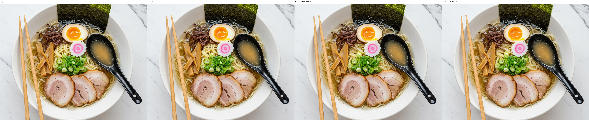

# Culture-Aware Image Transcreation: integration and visual review

## Objective and final status
Adapt visible ramen noodles toward Indian-style masala noodles while preserving the original scene. **PARTIALLY COMPLETE.** Components, source-bound execution and exact pixel preservation work. The two permitted V3 generations removed V2's text-like failure, but neither produced a convincing, visibly seasoned masala-noodle transformation. **Visual quality: FAIL.** No full cultural adaptation is claimed.

## Actual architecture and safety boundaries

```text
AUTOMATED: photograph -> SmolVLM -> Qwen -> deterministic validation
           REVIEW / ABSTAIN -> stop
           PROPOSE -> explicit edit-intent review -> reviewed grounding test
           -> box-review boundary; no automatic editing permission

GUIDED RESEARCH: explicit operator objective -> original-object localization
                -> selected box -> SAM -> explicitly selected/pinned mask
                -> research inpainting -> original-resolution composite
                -> independent saved-pixel verification

REFINED RESEARCH: verified source + genuine SAM reference + manual polygons
                 + protected-region exclusions -> separate refined-mask validation
                 -> the same diffusion/crop/restoration/compositing implementation
```

Implemented models remain SmolVLM-500M-Instruct, Qwen2.5-3B via Ollama, Grounding DINO Tiny, SAM ViT-Base and Stable Diffusion v1.5 Inpainting. Checkpoints/configurations are pinned; models execute sequentially on an RTX 3050 Laptop GPU, 4 GB. Diffusion uses FP16 and CPU model offload.

A research specification is not an accepted Qwen proposal. Raw/final planner outputs, rejected candidates and genuine human reviews are immutable. The automated ramen result still ends in **REVIEW with zero released candidates**. Sayan's **MATERIAL_UNRESOLVED** decision remains unchanged. No approval, cultural correctness or complete mask ground truth was fabricated.

## Preserved evidence and V2 diagnosis

Source: `data/ramen.jpg`, actual WEBP, 1408 x 1120, SHA-256 `37e9b669cac70fb782a7ea7637c27ffd20726dcb1e88ad3f3d54c2f7f38ffee0`. Dish identity/source culture are user-provided evidence, not independent proof of origin.

The saved SmolVLM caption remains "A bowl of food with chopsticks and a spoon." Source-anchored Qwen correctly separated original ramen from desired masala noodles but retained an uncertainty. The validator quarantined the edit. Six original SAM masks included protected ceramic/utensil pixels; none became an accepted editing mask. No captioning, Qwen, Grounding DINO or SAM inference was repeated for V3.

V2 used a separate manually refined 4,224-pixel patch (0.267857% of the photograph), approximately 2.10% of the imperfect 200,805-pixel SAM reference. It generated text-like label markings instead of food. Its source, mask, annotations, raw crop, final image, logs and V2 review ZIP are preserved unchanged.

Measured geometry: V2 used a 234-square padded crop and 20,255 white pixels in the 512-grid processing mask. V3 uses a 717-square padded crop and 10,473 processing-mask pixels. Thus a larger original-resolution mask does **not** imply a larger masked area after preprocessing. Both crops contain noodle context; preserved toppings fragment that context and the editable strands. Fragment size, scale/context and model prompt-following are plausible contributors to the failure, **not individually proven causes**. This is a bounded comparison, not a causal ablation or performance benchmark.

[Prior Qwen/audit](final_demo/automated), [original six SAM masks](final_demo), [historical human decision](iteration8/ramen_uncertainty_review/human_decision.json), [V2 failure](refined_demo/generation/final.png), [V2 annotations](refined_demo/annotations.json), [geometry diagnosis](visual_v3/geometry_diagnosis.json), [previous complete report preserved verbatim](visual_v3/report_before_v3.txt).

## Improved mask methodology and validation

Origin remains **RESEARCH_MASK_MANUALLY_REFINED / RESEARCH_ONLY**. The assistant traced three separate exposed noodle regions from native photograph crops. This was not SAM dilation, threshold adjustment or scaling of V2's polygon. Original box-only SAM candidate 1 remains a genuine geometric reference; no derived mask was labeled as a SAM prediction or human-approved selection.

| Region | Editable pixels | Source-image location |
| --- | ---: | --- |
| Central fan | 12,012 | Between tan/dark strip toppings, pink-white topping and green garnish |
| Below-spoon wedge | 3,170 | Exposed strands between spoon, garnish and upper meat boundary |
| Lower-left pocket | 5,302 | Strands and immediate sauce gaps between chopstick and meat |
| Total | **20,484** | Overall bounds `[356,379,945,860]`, exclusive upper bounds |

The mask covers **1.298955% of the photograph**, 4.849 times V2's original area. It retains an area equivalent to 10.20% of the imperfect SAM reference; this is descriptive, **not measured noodle coverage**. No independent whole-noodle annotation exists.

Full-region exclusion polygons protect the ceramic/bowl rim and surrounding scene, whole spoon including its contents, both chopsticks, egg, meat slices, seaweed, tan/dark/pink-white toppings and green garnish. Conservative margins remove ambiguous contacts. The saved binary mask must exactly reconstruct from editable polygons minus exclusions and have zero protected-region intersection. All coordinates and labels are explicit in the annotation JSON. These are operator research annotations, not independent semantic ground truth.

Full/native overlays were inspected before inference. The three regions visibly contain noodle strands and immediate sauce gaps with margins from protected objects. No obvious topping, ceramic or utensil inclusion was seen. Source/SAM hashes, 1408 x 1120 dimensions, binary 0/255 values, nonempty foreground and **zero intersections with full protected regions** passed. All original masks remain unchanged.

[Exact editable/protected coordinates](visual_v3/annotations.json), [binary research mask](visual_v3/research_mask.png), [full protected mask](visual_v3/protected_regions.png), [full overlay](visual_v3/mask_overlay.png), [native boundary view](visual_v3/central_overlay.png), [protection overlay](visual_v3/protected_overlay.png), [checks/hash](visual_v3/mask_geometry_checks.json).

## Predeclared experiments and effective settings

Both conditions use `stable-diffusion-v1-5/stable-diffusion-inpainting`, revision `8a4288a76071f7280aedbdb3253bdb9e9d5d84bb`, safetensors FP16 variant, dedicated 9-channel UNet, DDIM scheduler, batch 1, CPU model offload, seed 42, 512 x 512 processing, 20 requested steps, strength .9 and guidance 7.5. Strength .9 yielded **18 effective denoising steps** in both runs. Source and improved mask/protection/annotation hashes are identical in A/B.

Derived crop: `[292,315,1009,924]`, 717 x 609, padding `[0,54,0,54]`. The crop algorithm/context margin remain unchanged; changing mask geometry automatically changed the crop relative to V2. The full photograph was not stretched. Original-resolution hard compositing used the actual binary research mask, without blending, dilation or unrecorded cleanup.

**A: V2 positive prompt unchanged; no negative prompt.**

> Photorealistic Indian-style masala noodles with reddish-brown spiced seasoning, natural noodle texture, matching the original food position, perspective and warm lighting.

A removed the text artifact but retained waxy/flattened strands, seams and weak target seasoning. Its assessed deficiencies were recorded before dispatching the one predefined corrective condition.

**B: same improved mask and settings; prompting condition changed.**

> Photorealistic cooked noodle strands coated in reddish-brown Indian masala spices and sauce, with visible individual noodles, natural food texture, matching the original camera perspective and warm light.

Negative:

> text, letters, words, numbers, labels, packaging, logo, watermark, printed graphics, signs

Installed tokenizer counts including special tokens: A positive **31**, B positive **37**, B negative **23**, all within the supported **77**. Both B prompts changed together; differences cannot be attributed to the negative prompt or a single phrase alone.

**Actual budget: two calls total, one A and one B; zero retries, zero OOM events.** B explicitly disables OOM retry because only one call remained. No alternative masks/seeds/models/prompts were tried after this pair. All failures and outputs are retained.

[Preregistration](visual_v3/preregistration.json), [V2/A input comparison](visual_v3/input_comparison_to_v2.json), [A/B input comparison](visual_v3/A_B_input_comparison.json), [A assessment before B](visual_v3/A_visual_assessment.json).

## Actual numerical results

| Condition | Load s | Inference s | Stage s | CLI wall s | Peak CUDA GiB |
| --- | ---: | ---: | ---: | ---: | ---: |
| A | 18.424 | 97.281 | 120.427 | 131.647 | 2.472 |
| B | 19.471 | 85.138 | 109.007 | 120.922 | 2.472 |

Each peak was **2,654,782,464 allocated CUDA bytes**, excluding driver/desktop/other-process memory. These are individual observations, not controlled timing comparisons. Ollama idle was confirmed before each fresh diffusion process; no other project model was loaded.

| Independent saved-image check | A | B |
| --- | ---: | ---: |
| Final dimensions | 1408 x 1120 | 1408 x 1120 |
| Changed inside actual mask | **20,484** | **20,484** |
| Changed outside mask | **0** | **0** |
| Maximum outside-mask channel difference | **0** | **0** |
| Changed in full protected regions | **0** | **0** |
| Editable/protected intersection | **0** | **0** |

The standalone verification tool imports no model/generation code. It reopens PNG/WEBP files, verifies hashes and compares every decoded RGB pixel, including all protected pixels and each edited region. Source identity and all historical files were checked separately. A and B differ at **20,469 pixels**, with maximum channel difference 128: the prompting condition had a numerical effect despite visually similar weak adaptation.

[A raw/final/metadata](visual_v3/A), [B raw/final/metadata](visual_v3/B), [A execution log](visual_v3/A_execution.json), [B execution log](visual_v3/B_execution.json), [A independent verification](visual_v3/A_pixel_verification.json), [B independent verification](visual_v3/B_pixel_verification.json).

## Visual evaluation and honest decision

| Criterion | Actual assessment |
| --- | --- |
| Recognizable noodle strands | Central/right areas are food-like, but some bands are flattened/waxy; the lower-left noodle loop is largely erased in both outputs |
| Masala seasoning appearance | **FAIL:** predominantly pale/yellow ramen; no convincing reddish-brown spice/sauce coating |
| Food realism | Mixed; local synthetic banding and loss of strand continuity remain |
| Bowl, spoon/contents, chopsticks | Original RGB preserved outside the edit; no visible damage |
| Egg, meat, seaweed, other toppings and background | Original RGB preserved |
| Seams | Local tone/continuity transitions visible, especially central fan and below-spoon wedge |
| Text/labels/unrelated objects | No obvious text artifact or unrelated new object in inspected A/B areas; V2's label-like failure is absent |
| Normal-view transformation | Modest local rearrangement; not clearly recognizable as a different food preparation |
| Coverage | Three limited exposed noodle groups; **PARTIAL LOCAL TRANSFORMATION ATTEMPTS**, not an entire adapted dish |
| Guided visual demonstration | **FAIL in both A and B** |

The lower-left close-up is an important negative result: obvious original U-shaped strands become an empty-looking brown broth/sauce patch in both outputs. More editable pixels and a text-free output do not establish quality. Brown coloration alone is not evidence of cultural adaptation. No quantitative accuracy or cultural-authenticity score is fabricated.



[Native central comparison](visual_v3/central_native_comparison.png), [native lower-left failure](visual_v3/lower_left_native_comparison.png), [complete assessment](visual_v3/visual_evaluation.json).

Image complexity and protected overlapping toppings fragment the editable strands. Sparse disconnected regions at 512-grid scale and model/prompt-following limitations may contribute; this experiment does not isolate them. If a convincing broader adaptation is required, this photograph is a poor next optimization target under the protection constraints. Recommend a **separate** researcher-supplied or appropriately licensed photograph of unoccluded noodles with minimal toppings and no overlapping utensils. Record its exact source, license, hash and scope first. No substitute photograph was selected or used here.

## Minimal code changes, tests and preservation

The refined research input now accepts an optional explicit `negative_prompt`, default null. The shared pipeline passes it only when supplied; original SAM/automated contracts still cannot enable it. With null, original pipeline call options remain unchanged. A small refined-only `--max-attempts` override caps actual calls including OOM retry; B used 1. Normal original-path retry behavior/settings remain unchanged. No new framework, approval mechanism or dependency was introduced.

Baseline: **407 passed**, 74.286 s unittest. Final: **412 passed, zero failures/errors**, 71.374 s unittest. Focused suites also passed: original inpainting 24, refined masks including new behavior 20, guided integration 22. Five additions test explicit versus absent negative prompts, invalid prompts, one-call OOM budgeting and invalid attempt limits. Existing policy, review, quarantine, tamper and isolation tests were retained.

The original image, six SAM masks, detector predictions, raw Qwen, final REVIEW, MATERIAL_UNRESOLVED review, V2 outputs and V2 ZIP retain their entry hashes. No configuration/model checkpoint changed. The previous report is preserved as supporting text; this report is the current primary summary. No Git commit/push occurred.

[Complete baseline log](visual_v3/tests_before.json), [complete final suite](visual_v3/tests_after.json), [focused suites](visual_v3/focused_tests_before_B.json), [bounded-prompt tests](visual_v3/bounded_prompt_tests.json), [minimal code diff](visual_v3/implementation.diff), [preservation checks](visual_v3/preservation_after.json).

## Reproduction

Use the existing compatible Python 3.11 CUDA environment and pinned weights. No packages were upgraded. From the repository/extracted ZIP root:

```powershell
$env:PYTHONPATH = (Resolve-Path src).Path
$env:HF_HUB_OFFLINE = "1"
python -B -m scripts.inpaint --refined-input results/phase7_integration/visual_v3/input_A.json --out outputs/ramen_v3_A --max-attempts 1
python -B -m scripts.inpaint --refined-input results/phase7_integration/visual_v3/input_B.json --out outputs/ramen_v3_B --max-attempts 1
```

The copied reproduction commands cap each condition at one call; this tightens A's failure-only retry policy without changing successful sampling settings. Exact original invocations are retained in the execution logs. Do not automatically rerun for quality or overwrite an existing output directory. These commands reproduce recorded failed visual conditions, not an approved cultural edit.

Without inference:

```powershell
python -B results/phase7_integration/visual_v3/verify_results.py
python -B -m unittest discover -s tests -v
```

Input JSONs bind source, genuine SAM reference, research mask, polygons, protected regions and prompts. The portable review ZIP includes relevant old evidence, all A/B raw/final outputs, full/native comparisons, tests, code/configuration and SHA-256 manifest. It excludes weights, caches, environments and unrelated historical ZIPs. Source-image redistribution/license evidence remains unspecified for this user-provided research photograph; no independent external backup or cultural ground truth is claimed.

## Final status

- **Component integration and technical localized generation: PASS.**
- **Protected-object/outside-mask pixel preservation: PASS.**
- **V3 text artifact: absent in inspected outputs.**
- **Credible masala-noodle visual demonstration: FAIL.**
- Automated planner remains REVIEW with zero candidates; historical human review remains MATERIAL_UNRESOLVED.
- **PROJECT STATUS: PARTIALLY COMPLETE.** Stop after two generations for independent mentor evaluation. No further automatic optimization.

Deliverable: `results/archive/final_project_review_v3.zip`.
