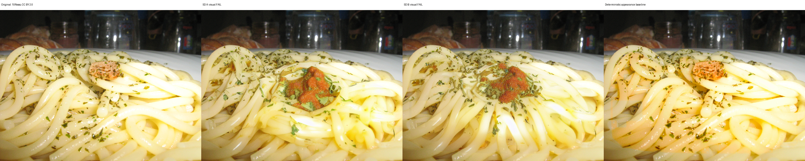

# Culture-Aware Image Transcreation ? Final Research Report

## Objective and final assessment

Investigate user-directed cultural reinterpretation of a photograph while protecting its scene. The target was pale spaghetti reinterpreted as reddish-brown Indian-style masala spaghetti, not a claim of universal Indian tradition or cultural authenticity.

**Research deliverable finalized; transformation objective remains PARTIALLY COMPLETE.** Engineering capability and locality pass. Generative food transcreation fails visual criteria. One frozen deterministic baseline preserves texture more coherently but does not convincingly achieve the full masala-coating target. Negative findings are retained; no further tuning was performed.

## Architecture and implemented components

```text
Automated: image -> SmolVLM -> Qwen raw draft -> deterministic validator
           -> REVIEW/ABSTAIN stop; PROPOSE still needs real review
Guided RESEARCH_ONLY: explicit scope -> DINO source-object box -> SAM/refined mask
           -> provenance/protection checks -> SD OR classical appearance transfer
           -> original-resolution output -> independent saved-pixel verification
```

| Stage | Actual model / resolved revision |
| --- | --- |
| Caption | SmolVLM-500M-Instruct `a7da5b986cb59b408707209984f360a5f4ad7e47` |
| Planner | Ollama `qwen2.5:3b`, digest `357c53fb659c5076de1d65ccb0b397446227b71a42be9d1603d46168015c9e4b` |
| Grounding | Grounding DINO Tiny `a2bb814dd30d776dcf7e30523b00659f4f141c71` |
| Segmentation | SAM ViT-Base `70c1a07f894ebb5b307fd9eaaee97b9dfc16068f` |
| Inpainting | SD v1.5 Inpainting `8a4288a76071f7280aedbdb3253bdb9e9d5d84bb` |
| Appearance baseline | Pillow LittleCMS CIELAB; no learned model |

Models describe, plan, localize, segment and generate respectively. Typed contracts, quarantine, review records, provenance validation and resource cleanup connect them. Stabilization adds only a separate appearance module, CLI and eight tests. Existing stages, prompts, configuration, validator and review policies were not modified. Prior working-tree changes were preserved. No commit or push occurred.

## Automated and guided execution

All five models actually executed sequentially in V4. SmolVLM completed 93 tokens; its ingredient identities remain predictions. Qwen returned raw PROPOSE but localized the future `masala-coated spaghetti strands` and falsely attributed some scene information to user verification. The unchanged validator returned **REVIEW with zero released candidates**.

Issues: `UNVERIFIED_SOURCE_OBJECT`, `SOURCE_LOCALIZATION_MISMATCH`, `USER_CONSTRAINTS_UNRESOLVED`, `EDIT_UNCERTAINTY_UNRESOLVED`. The automated route stopped. Guided research used the separate user-defined experiment, never a repaired/released Qwen candidate. No human acceptance was fabricated. [Actual automated evidence](v4_completed/automated).

## Source attribution

**Spaghetti aglio e olio**, **10Rosso**, [Wikimedia Commons](https://commons.wikimedia.org/wiki/File:Spaghetti_aglio_e_olio.jpg), [original Flickr source](https://www.flickr.com/photos/29768027@N07/4345842519/), **[CC BY 2.0](https://creativecommons.org/licenses/by/2.0/)**. Dish origin is the source's label, not visually established cultural proof. Original JPEG: **2272 ? 1704**, SHA-256 `062eb9f18e0175dec675f9e1edefd3ef1238837e627727e58b9d9c309fa49d0e`.

The [source](v4_completed/source.jpg) is unchanged. Baseline/generated images, overlays and comparisons are modifications; attribution/license retained, no endorsement implied. [License evidence](v4_completed/source_and_license.json), [credit](v4_completed/ATTRIBUTION.md).

## Experiments and failures

Historical ramen runs demonstrated safe blocking/locality but failed coherent food transformation. A 4,224-pixel edit produced text-like marks. V3's 20,484-pixel multi-region mask avoided text but lost noodle structure and did not yield credible seasoning. Sayan's MATERIAL_UNRESOLVED decision and historical REVIEW results remain immutable. No ramen or model experiment was rerun during stabilization.

V4 DINO queried `spaghetti noodles`, thresholds .30/.25. One plausible food box `[3.6668,394.7537,2266.1372,1698.0287]`, confidence .918594, also contained plate margins. SAM masks had 2,476,478 / 1,316,995 / 328,765 pixels, predicted scores .907188 / .786805 / .364945 (not measured IoU). Candidate 0 was a visually inspected reference, not accepted by score.

The existing manually refined mask has **1,846,716 pixels**, 47.7004% of the photograph, zero protected-mask overlap. An inward food polygon and **116 conservative rectangular gap exclusions** preserve uncertain gaps without claiming their identity. This is operator research geometry, not ground truth or human-approved SAM. [SAM bundle](v4_completed/sam/segmentation), [annotations](v4_completed/annotations.json), [mask](v4_completed/research_mask.png), [protected regions](v4_completed/protected_regions.png), [overlay](v4_completed/mask_overlay.png).

V4 SD A/B: fixed seed 42, FP16, CPU offload, batch 1, 512-square padded crop, 20 requested/18 effective steps, strength .9, guidance 7.5, DDIM. B added the predefined negative prompt only. Both produced implausible reddish-orange inserts, weak coating and lost strand continuity. Protected rectangular gaps added seams. Geometry, prompt following and model capability were not independently isolated. [A request](v4_completed/reproduce_input_A.json), [B request](v4_completed/reproduce_input_B.json). All failed outputs remain unchanged.

## One frozen appearance-transfer baseline

**DETERMINISTIC_APPEARANCE_TRANSFER_BASELINE / RESEARCH_ONLY.** One configuration was saved before processing; no parameter search. The same source, refined editable/protected masks and original SAM provenance were validated. There is no resampling, synthesis, ingredient creation or geometry rearrangement.

1. Convert sRGB to CIELAB D50 with Pillow LittleCMS.
2. Keep L unchanged; add chromatic offsets delta-a 14, delta-b 26, strength .75.
3. Reduce the chroma effect linearly from L=70 to L=95, reaching .35 of the effect on highlights. Original chroma variation remains.
4. Convert to RGB; blend with `alpha = binary_mask * GaussianBlur(binary_mask, radius=12 original pixels)`.
5. Explicitly restore all outside-mask pixels; round/clip to uint8 and save PNG.

Positive-a/b warming is a documented operator palette cue, not a reference dish or proof of authenticity. Pre-conversion LAB L is unchanged; RGB gamut clipping, quantization and blending cause small final lightness differences. This is not an opaque painted layer. [Frozen settings](../appearance_transfer_baseline/run/frozen_settings.json), [execution](../appearance_transfer_baseline/run/execution.json), [alpha](../appearance_transfer_baseline/run/alpha.png).

## Numerical evaluation

Independent code reopened saved source/masks/final PNGs, checked hashes and every RGB pixel. Deterministic reproduction uses the same frozen settings, not another experimental condition.

| Method | Changed inside | Changed outside | Changed protected | Visual result |
| --- | ---: | ---: | ---: | --- |
| SD A | 1,846,657 | 0 | 0 | FAIL: insert, geometry/seams |
| SD B | 1,846,686 | 0 | 0 | FAIL: insert, weak coating |
| Appearance baseline | 1,846,716 | 0 | 0 | Better coherence; full masala target FAIL |

All outputs: 2272 ? 1704. Baseline mean absolute L difference inside **0.2713** (0?100 scale); mean a/b changes **+1.6685 / +9.5193**. These decoded changes differ from requested pre-gamut offsets. Luminance gradient-magnitude correlation inside **.99697**. These describe appearance/structure, not realism, cultural quality or segmentation accuracy. [Independent verification](../appearance_transfer_baseline/pixel_verification.json).

## Actual visual evaluation

Full-frame and native-resolution comparisons were inspected. The baseline preserves continuous strands, edges, surface detail and highlights, avoiding diffusion's invented insert and flattened noodle shapes. Warming is visible at normal size, particularly in midtones. A small central orange-looking detail is present in the original; it is not newly generated by the baseline.

However, the result is mainly yellow/orange and oily, not a convincing reddish-brown masala coating. Herbs can shift toward warm/olive colors. Plate/background and lighting structure remain intact; faint uneven transitions and rectangular protected-island boundaries remain. Smoothing reduces their contrast without solving semantic mask quality.

**Verdict:** better structural coherence than SD; PASS for deterministic texture-preserving appearance editing and locality; **FAIL for full cultural-food transcreation**. No recipe transformation, expert authenticity or whole-dish success is claimed.



[Native noodles](../appearance_transfer_baseline/noodles_native.png), [native boundaries](../appearance_transfer_baseline/boundaries_native.png), [full native original/baseline](../appearance_transfer_baseline/original_baseline_native.png), [final PNG](../appearance_transfer_baseline/run/final.png).

## Tests, preservation and runtime

Before: **412 passed**, 36.415 s. After: **420 passed, zero failures/errors**, 34.868 s. Eight new synthetic tests cover locality/alpha, nonsquare determinism, unchanged inputs, research-only isolation, invalid masks, protected overlap, texture-ramp order and output overwrite refusal. Existing planner/hash/review/integration tests remain intact. Offline tests are distinct from real-model evidence.

New baseline: **0.7512 s transform**, **1.6928 s internal process including provenance/I/O**, CPU. No CUDA allocation or new model invocation. Python 3.11.9, Pillow 13.0.0, LittleCMS 2.19. Interpreter startup is outside that timer.

Historical V4 SD inference A/B: **10.984 / 10.153 s**, peak **2.472 GiB** each; wall **29.033 / 28.180 s**. DINO/SAM inference **1.085 / .862 s**, peaks **1.705 / 1.924 GiB**. These are prior measured runs, not rerun during stabilization. [Tests](../appearance_transfer_baseline/tests_after.txt), [prior environment](v4_completed/environment.json).

## Reproducibility

From the repository/extracted package root, use Python 3.11 and the recorded dependencies. No weights are needed for the classical baseline. Use Pillow 13.0.0 / LittleCMS 2.19 for bitwise PNG reproduction; different color engines are not promised identical bytes.

```powershell
python -m pip install -e ".[inpainting]"
$env:PYTHONPATH = (Resolve-Path src).Path
python -B -m scripts.appearance_transfer --refined-input results/phase7_integration/v4_completed/reproduce_input_A.json --out outputs/appearance_reproduction
python -B results/appearance_transfer_baseline/verify_saved.py
$env:HF_HUB_OFFLINE = "1"
python -B -m unittest discover -s tests -v
```

Use a fresh output directory. The reused request retains the historical diffusion prompt as provenance, but the classical CLI ignores that text. No approval inference occurs. Verification checks the included saved baseline; compare a reproduction's final PNG SHA-256 against the recorded hash. Package verification additionally runs an independent CLI reproduction from an extracted copy.

## Limitations and honest final status

- **Engineering capability:** implemented, executed and regression-tested; provenance and locality work.
- **Automated pipeline:** safe stopping demonstrated, real final REVIEW/zero candidates; no approved Qwen-to-image success.
- **Generative quality:** SD v1.5 ramen/spaghetti food transformations failed visual criteria. Stop tuning this approach on these examples.
- **Appearance baseline:** better geometry/texture coherence, limited warm recoloring; not convincing masala recipe transformation.
- **Human review:** historical MATERIAL_UNRESOLVED and all saved decisions unchanged. No new approval was fabricated.
- **Research status:** final deliverable closed with measured positive engineering and negative visual results. Successful culturally verified end-to-end transcreation remains unestablished.

Masks are conservative operator geometry, not pixel ground truth. Color transfer cannot add ingredients or establish cultural reasoning. One image/condition does not measure broad model performance. Historical V2/V3/V4 evidence remains unchanged locally; the final package includes relevant failures/current baseline rather than duplicate ZIPs.
