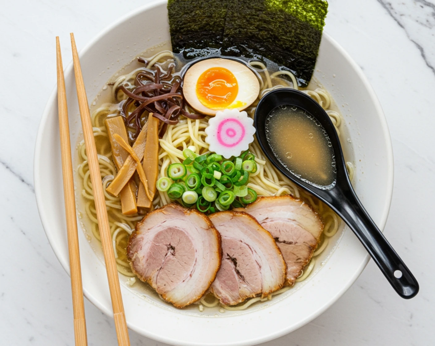

# PENDING human uncertainty triage

Classification only. Original final decision remains REVIEW with zero released candidates.
No decision here authorizes grounding, segmentation or image editing.



[Original byte-identical image](original.webp)

## Exact bound case

```json
{
  "original_image_sha256": "37e9b669cac70fb782a7ea7637c27ffd20726dcb1e88ad3f3d54c2f7f38ffee0",
  "original_dimensions": [
    1408,
    1120
  ],
  "planning_input_sha256": "f6f92654e5cee49c8340580de772d85d0211dbe4e503ad101d822fed09466e65",
  "planner_audit_sha256": "5dee35147680522f7cd2bc6f6702171d21a0f85081525cbd95edf401e68ea2fc",
  "raw_response_sha256": "b17dd8dd1b6213e9926e183e155ae740f1c8ce082cb408705e1dd65dcebc5ecb",
  "raw_message_sha256": "8bd74ca43f6038b12653c4a77d40083a9bb57d54271efc5614428b72cbd414ec",
  "validated_review_sha256": "0d187494ac277ae35c72360ca427b39583c9c3dd03ceb1f529c04c4951590c56",
  "original_raw_candidate_index": 0,
  "verified_object": {
    "object_id": "ramen-food-1",
    "description": "Japanese ramen noodles in a white bowl"
  },
  "original_raw_candidate": {
    "object_description": "Japanese ramen noodles in a white bowl",
    "localization_phrase": "Japanese ramen noodles in a white bowl",
    "proposed_change": "change the noodles to masala noodles",
    "cultural_reason": "Transforming the Japanese ramen into Indian-style masala noodles is a contextually justified adaptation of the scene to the target culture, Indian.",
    "identity_uncertain": false,
    "verified_object_id": "ramen-food-1"
  },
  "original_scene_summary": "The caption reports a bowl of food with chopsticks and a spoon. The user verified a Japanese ramen noodles in a white bowl.",
  "source_culture": "Japanese",
  "target_culture": "Indian",
  "user_instructions": "Original visible object, as declared by the user:\n\"Japanese ramen noodles in a bowl\"\n\nTransform the ramen into Indian-style masala noodles.\n\nPreserve the bowl, table, camera angle, lighting, and background.",
  "must_preserve": [
    "bowl",
    "table",
    "camera angle",
    "lighting",
    "background"
  ],
  "original_uncertainties": [
    "The user instruction to transform the ramen into masala noodles is a cultural adaptation, which may require visual verification beyond the provided caption and verified object description."
  ],
  "raw_verification_requirements": [
    "Visual confirmation of the transformation from Japanese ramen to Indian-style masala noodles."
  ],
  "validated_verification_requirements": [
    "Resolve uncertainties material to the proposed edits; relevance is not automatically proven.",
    "Review the original-scene summary and any paraphrased identities against the image.",
    "Human review must check protected content and preservation; text checks cannot prove semantic correctness."
  ],
  "validation_issues": [
    {
      "code": "USER_CONSTRAINTS_UNRESOLVED",
      "message": "Check all proposals against supplied user instructions/protected constraints; text validation cannot prove compatibility.",
      "candidate_index": null,
      "severity": "human_verification"
    },
    {
      "code": "EDIT_UNCERTAINTY_UNRESOLVED",
      "message": "Resolve uncertainties material to the proposed edits; relevance is not automatically proven.",
      "candidate_index": null,
      "severity": "review"
    }
  ],
  "original_issue_codes": [
    "USER_CONSTRAINTS_UNRESOLVED",
    "EDIT_UNCERTAINTY_UNRESOLVED"
  ],
  "original_raw_decision": "PROPOSE",
  "original_validated_decision": "REVIEW",
  "original_released_candidate_count": 0,
  "triage_eligible": true,
  "eligibility_basis": "Exact coded uncertainty-only profile; not proof of semantic or cultural correctness.",
  "evidence_scope": "REAL_SAVED_PLANNING_EVIDENCE"
}
```

## Required human questions

1. Does the proposed edit target the original noodles/object, rather than a future replacement?
2. Is the original source identity supported by the image and supplied user verification?
3. Does the edit preserve the requested bowl/protected object and scene?
4. Is the adaptation reasonable for this user-directed objective?
5. Does the exact uncertainty identify a material problem, or only a normal pre-edit verification requirement?
6. Is the proposed change sufficiently specific for a later, separately authorized localization review?

Read the full original instructions, raw proposal, uncertainty and raw/final audit. Record a specific explanation. ROUTINE_VERIFICATION_REQUIRED records only your classification; it does not satisfy other user-constraint checks or release any candidate.
