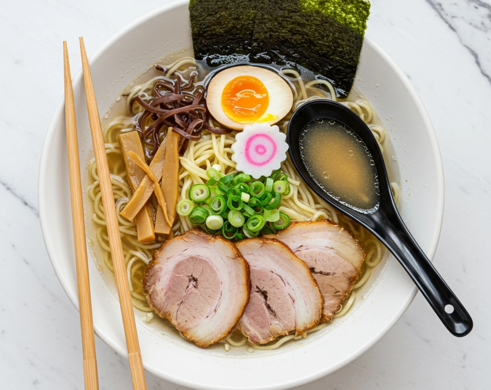

# Iteration 9 - PENDING edit-scope clarification

No classification or scope confirmation has been invented. The prior MATERIAL_UNRESOLVED review and final REVIEW/zero released candidates remain unchanged. No model inference has run.

Source SHA-256: `37e9b669cac70fb782a7ea7637c27ffd20726dcb1e88ad3f3d54c2f7f38ffee0`

## Visual observations (assistant, not human confirmation)

- Noodles are visible through the center and lower parts of the bowl, partly covered by toppings and utensils.
- Broth is visible between food contents and in the black spoon; ingredient composition is not established by appearance.
- A halved egg is visible near the upper center.
- Apparent meat slices overlap the lower food region; their exact composition is not independently verified.
- Dark sheet-like seaweed is visible at the upper edge, overlapping the inner bowl.
- Green sliced garnish, tan strips, dark strips and a white/pink patterned topping overlap the noodles; exact ingredient identities are not all established.
- The white ceramic bowl surrounds the food; its inner surface meets liquid/food along irregular boundaries.
- A black spoon lies over the right interior and extends across the rim; broth inside it is visually continuous in type but not a bowl-region mask.
- Wooden chopsticks overlap the left food region and bowl edge.
- The pale tabletop/background surrounds the bowl.

## Boundary uncertainties

- Food, broth and the curved inner white bowl meet along thin irregular boundaries; a broad food box would also contain protected ceramic.
- Spoon and chopsticks occlude food and cross bowl boundaries. Removing or regenerating food must not imply permission to alter these utensils.
- Seaweed, egg, garnish and other toppings overlap noodles; changing only noodles does not specify permission to remove toppings.
- Broth visible inside the spoon requires explicit scope clarification if broth is editable but the spoon is protected.
- These observations are assistant visual inspection, not user confirmation, verified segmentation boundaries or editing authorization.

## Required actual user response

**editable_food**: State exactly which contents may change: only noodles; noodles and broth; all edible contents including toppings; or a precise custom selection. For egg, meat slices, seaweed, green garnish and other toppings, state whether to keep, replace or remove. No choice is preselected.

**protected_objects**: Confirm the white ceramic bowl, table, camera angle, lighting and background remain protected. Separately state whether the black spoon and wooden chopsticks must remain unchanged. If broth changes, clarify whether liquid visible inside the spoon may change.

**desired_appearance**: Describe the intended final appearance of Indian-style masala noodles in your own words, including retained/replaced/removed toppings and broth/sauce appearance if relevant. Do not rely on an unstated ingredient list.

**image_bound_confirmation**: Explicitly confirm these choices apply to this exact photograph and SHA-256. This is scope evidence only, not permission to execute image editing.

Until the user responds, no confirmed scope specification or new PlanningInput exists. Replanning, validation evaluation and the final iteration review ZIP await that response.
