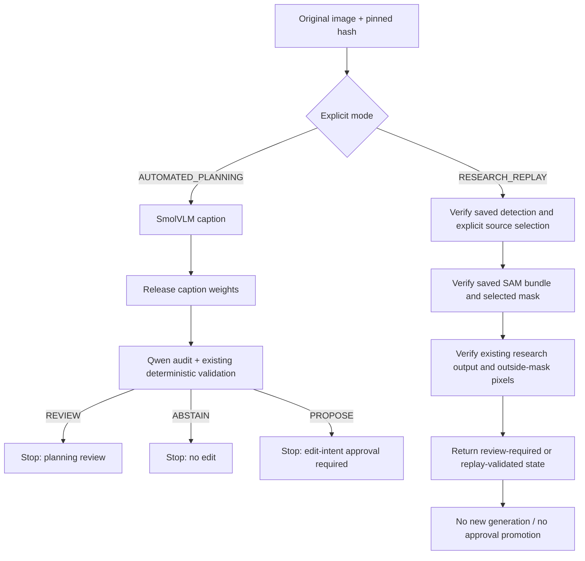

# Phase 7 working report

Working integration evidence; **not a polished final Phase 7 report or mentor approval**. Future targeted corrections should append another labeled iteration and preserve these outcomes.

## Iteration 1 — Pipeline Orchestration and Safety

### Objective and scope

Connect existing data contracts and enforce explicit stopping. Implemented here: **live image → caption → validated plan**, and **read-only replay of independently generated localization/segmentation/inpainting artifacts**. No new diffusion was permitted or performed.

**Recommendation: NEEDS FIXES before full approved live-stage orchestration.** The implemented planning/replay paths and their safety tests pass. However, no edit-intent approval/resume contract exists; box and mask acceptances authorize segmentation testing only; diffusion input is explicitly RESEARCH_ONLY. Those contracts were not weakened. Live grounding/SAM/generation dispatch after approval is not implemented by this coordinator and must not be claimed as completed end-to-end integration.

### Existing interfaces inspected

| Component | Existing interface / output | Boundary |
| --- | --- | --- |
| SmolVLM | `create_captioner(config).caption(PIL_RGB)` → typed caption with completion flags/settings | Caption claims are unverified; no culture or object verification is inferred. |
| Planning input | `PlanningInput.from_caption(...)` | Completion flags, target and optional user context transfer without fabricating verified objects. |
| Ollama | `record_plan(PlanningInput)` → request/raw/final audit, errors and unload status | Exact system/user prompts, model digest and transport outcomes remain archived. |
| Deterministic policy | `parse_model_draft` + `validate_planning_result` | REVIEW quarantines candidates; ABSTAIN releases no edits; PROPOSE is conditional. |
| Grounding | `GroundingDetector.detect(image_path, phrase)` → boxes/scores; standalone saver | Existing detector unchanged. Replay uses `_evidence` to validate saved source hash, dimensions and box contracts, never detector inference. |
| Box review | Existing bound ACCEPT / REJECT / NEEDS_REVIEW records | Accepted record is a segmentation-test candidate. Existing SAM input loader also rejects placeholder identity. |
| SAM | `load_segmentation_input(...)`, `SamSegmenter.segment(...)` → mask bundle | Replay uses existing `_bundle` integrity checks; selected index/hash and detection provenance must agree. No SAM inference. |
| Mask review | `_check`, `read_candidate` | Accepted mask is for a named controlled segmentation experiment; it does not authorize cultural editing. |
| Inpainting | `InpaintingInput` / `run_inpainting(...)` | Current entry is isolated research generation. Coordinator only checks an existing result and exact final locality; never calls it. |

The independent implemented model stages remain functional and unchanged. Their existence is distinct from having an approved live dispatch path through this coordinator.

### New implementation and contract

Three files added: `src/transcreation/orchestration.py`, `scripts/run_pipeline.py`, `tests/test_orchestration.py`. No dependencies, existing stage code, prompts, policies, checkpoints, thresholds or generation settings changed.

`PipelineInput` requires source image path/SHA-256, target culture, a new output directory and explicit execution mode. Optional user fields are source culture, instructions and existing typed `VerifiedObject` records. Research mode additionally requires a `ReplayChain`: explicit source phrase, pinned detection reference, explicit selection indices, bound SAM/mask references and fixed independent generation prompt. Missing selections return review states; malformed contracts are rejected. No request field can enable generation permission.

`PipelineResult` records mode, final state, completed stages, stopped stage/reason, content-hash artifact IDs, transitions, outstanding reviews, errors and whether replay integrity was validated. `image_generation_permitted` is **false in both modes throughout this milestone**. `CAPTION_COMPLETED` is logged as a transition; final states include PLAN_REQUIRES_REVIEW, NO_EDIT_JUSTIFIED, EDIT_PROPOSAL_READY, SOURCE_OBJECT_REQUIRES_REVIEW, MASK_REQUIRES_REVIEW, RESEARCH_REPLAY_VALIDATED and FAILED.

Every run creates a new directory with source copy, input JSON, produced/checked artifacts and `pipeline_result.json`. Existing directories are never overwritten. Validating an old image is labeled `EXISTING_OUTPUT_VERIFIED_NOT_GENERATED`, not generation completed.

### Data flow



Intended future live continuation remains edit-intent review → detection → box review → SAM → mask/edit authorization → generation. The coordinator does **not** currently implement that approved continuation/resume path. No permissive boolean or invented review record was introduced to simulate it.

### Modes and review boundaries

**AUTOMATED_PLANNING:** verify and decode exact image bytes; confirm Qwen is not resident; load unchanged SmolVLM configuration; caption; release model/processor references and CUDA cache; map the actual typed caption into PlanningInput; call the unchanged planner; preserve its audit; revalidate the untouched raw response through existing policy and compare to the saved final. This extra check does not query Qwen again or change its policy.

Final REVIEW stops before localization and exposes no executable candidates. ABSTAIN terminates without editing. PROPOSE stops at edit-intent review. Source-image changes during captioning/planning fail the run. Planning errors remain errors rather than becoming a fabricated successful draft.

**RESEARCH_REPLAY:** no captioner, Ollama, detector, SAM or diffusion model is instantiated. It reads the specified independent chain; compares source/query/index/detection hashes; validates masks and optional reviews using existing helpers; checks saved generation request/prompt/SAM bindings, every recorded output hash and final outside-mask equality. Exact source-query matching prevents silently substituting a future replacement phrase. It cannot prove semantic object identity.

Missing review may coexist with read-only validation of later *existing files*: this is inspection, not downstream model execution. Missing explicit selection, wrong phrases, invalid review bindings or failed integrity checks stop before later evidence inspection as shown in guard evaluations. No stop result triggers further execution.

Research replay is never labeled an LLM-planned cultural transformation. Even synthetic test fixtures with accepted box/mask records still cannot permit generation: segmentation-test acceptance is not cultural-edit authorization. No real acceptance was fabricated.

### Offline evaluation

Archived raw/final planner cases were checked without model inference. Exact original audit bytes are retained in the package; saved decisions were not rewritten:

| Archived case | Raw → validated | Candidate release |
| --- | --- | --- |
| Japanese food → India | PROPOSE → REVIEW | None |
| Durga Puja → Japan | REVIEW → REVIEW | None |
| Bicycle → India | PROPOSE → ABSTAIN | None |

These are planning-fixture regressions, not new image runs. The meal's user-verified ramen is a hypothetical fixture assertion, not new photographic verification. [Planner regression details](iteration1/offline/planner_regressions.json).

The real saved oil-lamp chain was traced from original source hash through detection index **2**, SAM point-guided mask **0**, and Phase 6 Iteration 2's existing research output. All artifact checks passed. Final replay state: **SOURCE_OBJECT_REQUIRES_REVIEW**; outstanding gates: **BOX_REVIEW_MISSING** and **MASK_REVIEW_PENDING**; `replay_validated=true`, `image_generation_permitted=false`. Target culture is a declared common input field only; this replay does not apply it to the old material prompt or claim cultural adaptation.

[Replay input](iteration1/offline/replay_input.json) · [Replay transitions/artifacts](iteration1/offline/oil_lamp_replay/pipeline_result.json) · [Combined offline summary](iteration1/offline/summary.json).

Three additional saved-evidence guards produced the expected stops: replacement query → SOURCE_OBJECT_REQUIRES_REVIEW at grounding evidence; missing instance → SOURCE_OBJECT_REQUIRES_REVIEW at box selection; wrong mask hash → FAILED at segmentation evidence. None read/released an inpainting artifact or invoked a model. [Guard results](iteration1/offline/guard_evaluations.json).

### One actual image-to-caption-to-plan run

Predeclared existing parked-bicycle photograph, target **India**, source culture null, no user instructions and no verified-object assertions. Configuration and input hashes were frozen before execution. One run was performed; no retry, alternative image, planner override or second scenario.

[Predeclaration](iteration1/real_preregistration.json) · [Actual input](iteration1/real_input.json) · [Original image copy](iteration1/real_run/evidence/source/scene_06.jpg).

| Observation | Actual result |
| --- | --- |
| Source SHA-256 | `e0fa05019d587cc62b1d4d5a82d7440216b5d88ef0f2149a69f2eb2ee640fca0` |
| SmolVLM revision | `a7da5b986cb59b408707209984f360a5f4ad7e47` |
| Caption status | EOS reached; **112 generated tokens**, not truncated |
| Caption model load / inference | 2.141017 s / 6.152280 s |
| Caption peak allocated CUDA | 1,178,738,688 bytes |
| Caption handoff | Exact text and COMPLETE status, target India, no invented verified objects |
| Qwen | qwen2.5:3b, 3.1B Q4_K_M |
| Resolved model digest | `357c53fb659c5076de1d65ccb0b397446227b71a42be9d1603d46168015c9e4b` |
| Qwen prompt/output tokens | **768 / 184** |
| Qwen reported generation time | **2.784218 s**; load 6.664519 s; server total 9.899929 s |
| Raw planner decision | **REVIEW**, empty candidate list |
| Final deterministic decision | **REVIEW**, empty candidate list |
| Validation issue | MODEL_REVIEW_REQUESTED |
| Pipeline state / stopped stage | **PLAN_REQUIRES_REVIEW / planning_review** |
| Generation permitted | **false** |
| New grounding / SAM / diffusion calls | **0 / 0 / 0** |
| Process wall time | 28.605055 s |

These are execution observations for integration, not new model benchmarking. Caption claims about graffiti words/colors are unverified. Qwen's raw reason suggested graffiti and a bicycle might be inappropriate for India. This is an **unsupported cultural assumption**, not a research finding about India. Safe stopping worked, but valid JSON and a REVIEW label do not make that reasoning good. No policy/prompt change or forced ABSTAIN was made to improve this result.

[Actual caption with exact prompt/settings](iteration1/real_run/caption.json) · [Derived planning input](iteration1/real_run/planning_input.json) · [Full raw/final Qwen audit](iteration1/real_run/planner_audit.json) · [Revalidated final plan](iteration1/real_run/validated_plan.json) · [Stage transitions and artifact IDs](iteration1/real_run/pipeline_result.json) · [Invocation](iteration1/real_invocation.json).

### Resource management and failures

The coordinator is single-process and sequential. It checks Ollama residency before captioning; it may unload the configured Qwen but fails rather than silently evicting unrelated models. Caption weight/processor references are explicitly released in `finally`; existing SmolVLM has no close method, so the coordinator owns this cleanup without modifying the adapter.

In the real run, Torch allocated CUDA memory was **0 bytes after caption release and before Qwen**. The planner's existing keep_alive=0/unload behavior was retained, and `/api/ps` confirmed Qwen absent afterward. This proves the measured cleanup for this path, not whole-board memory freedom. Qwen peak memory was not measured. Grounding/SAM/diffusion had no live instances to close in this iteration; their future live lifecycle remains outside the implemented continuation path.

Unexpected caption/planner errors release owned references and attempt Qwen cleanup. Cleanup failures are recorded and fail closed; primary stage errors remain in the error list. Runtime failures persist a FAILED result with stage/type/code/message. Malformed requests and existing output paths are rejected before a run can overwrite user work.

### Regression tests

Baseline: **232 passed**, zero failures/errors, in 16.084 s. After: **260 passed**, zero failures/errors, in 19.402 s. The 28 new mocked integration tests passed independently as well. No model weights were downloaded/loaded by offline tests.

Coverage includes successful caption/planning and saved-chain handoffs; truncation; Qwen REVIEW/ABSTAIN; invalid/quarantined candidates; source/replacement phrase confusion; no detections; multiple boxes without selection; wrong/missing box review; invalid/unreviewed mask; source/detection/mask/output hash mismatches; **saved** inpainting failure; error propagation; stage order; blocked-state behavior; no research-to-approved promotion; cleanup and no-overwrite.

Important test limit: inpainting failure tests validate a **historical failed result**, not a live inpainting dispatch from this coordinator. Existing inpainting unit tests still cover its own mocked runtime failures. No claim is made that an approved live downstream chain was exercised.

[Before tests](iteration1/tests_before.json) · [After full suite](iteration1/tests_after.json) · [Environment/dependency check](iteration1/environment.json) · [Preserved old files](iteration1/preservation_after.json).

### Git summary and reproducibility

Only three implementation/test files were added, plus Phase 7 evidence and this working report. All **47 inventoried existing source/script/test/config/report files** remain byte-identical. Pre-existing uncommitted Phase 6 changes are preserved and are not attributed to this iteration. No dependency, model/prompt/config, review policy, old report or saved decision changed. No automatic staging, commit or push.

[Git before](iteration1/git_before.json) · [Git after](iteration1/git_after.json). Current relevant code/config snapshots and a content manifest are in the review ZIP. It excludes weights, caches, environments and unrelated datasets. Bicycle attribution: Basile Morin / CC BY-SA 4.0; lamp: Benoy / CC BY-SA 3.0. Their original Commons references and modification details are retained in the package attribution record.

Run from the repository root:

```powershell
$env:PYTHONPATH = (Resolve-Path .\src).Path
python -B -m scripts.run_pipeline --input results/phase7_integration/iteration1/real_input.json
```

The exact saved input points to an already-existing output directory and deliberately cannot be rerun in place. To intentionally reproduce later, use a new output directory. Review does not require another model call. The portable package instead provides a path-remapped **read-only replay** input and checker; original audits retain their original bytes/paths as historical provenance.

### Remaining limits and recommendation

**NEEDS FIXES for the full approved live orchestration milestone.** Current safety/data-flow behavior passes its tests and real early-stop evaluation, but the following are explicit blocked integration points:

- No bound edit-intent approval schema or review/resume mechanism exists. Automated PROPOSE always stops before localization.
- Existing box/mask acceptance scopes cannot authorize cultural editing; the independent inpainting interface remains research-only.
- Live detector/SAM/inpainting dispatch after approval is intentionally absent, not hidden behind a successful test label.
- Semantic identity, mask adequacy, physical continuity and cultural appropriateness are not proved by hashes or types. The ordinary bicycle's unsupported cultural REVIEW remains a model-quality limitation.
- Review identities/inspection declarations are not authenticated signatures. Existing reviewed test fixtures are synthetic and do not fabricate real approvals.
- Reused review helpers live under scripts and assume repository-root execution; wheel-only packaging is not addressed.

This is safe planning plus artifact-chain validation, **not successful culturally verified end-to-end image generation**. No new image was generated. Mentor evaluation should decide the next narrow authorization/resumption correction. No Phase 8 or polished final Phase 7 report was created. **STOP.**


## Iteration 2 — Edit-Intent Review and Grounding Handoff

### Objective and recommendation

Add a review gate between a final validated PROPOSE and a controlled localization test. This iteration implements the gate and grounding-only continuation, without changing any model stage or planning policy.

**Recommendation: NEEDS FIXES before live handoff sign-off.** The requested offline contract and safety checks pass. A genuine eligible image-bound PROPOSE and an actual reviewer acceptance are still absent, so a live accepted-plan handoff has not been established. This is an evidence limitation, not a reason to override REVIEW or manufacture an approval. Stop here for mentor evaluation. No polished final Phase 7 report is created.

### Implementation changes

- `scripts/review_edit_intent.py`: prepare a PENDING request, display the original and proposed objects, record one explicit human decision in a new file, and reverify the saved evidence. It follows the existing immutable-file review conventions.
- `src/transcreation/orchestration.py`: additive `GROUNDING_TEST` mode and `IntentReference(review_file, review_sha256)`. The existing automated-planning and read-only replay modes remain available. A continuation consumes the saved plan rather than rerunning captioning or Qwen.
- `scripts/run_pipeline.py`: parse the optional typed intent reference through the existing JSON-input CLI.
- `tests/test_edit_intent.py`: 39 offline tests using synthetic reviewer declarations and mocked models. These declarations are test data, not real approvals.

No checkpoint, prompt, threshold, seed, precision, preprocessing, planner decision rule, existing box/mask contract or dependency changed. SAM and diffusion are never dispatched in this continuation. See [exact source changes](iteration2/iteration2_changes.patch) and [change summary](iteration2/change_summary.json).

### Review contract and evidence checks

The record supports PENDING preparation and decisions `ACCEPT_FOR_GROUNDING_TEST`, `REJECT`, `NEEDS_REVIEW`. A specific candidate index is always supplied, even when only one candidate exists. There is no highest-ranked or highest-score selection.

Each request stores the source image SHA-256; source/target cultures; user instructions and supplied verified objects; exact `validated_plan.json` file SHA-256; canonical planning-result SHA-256; original planner-audit and pipeline-result SHA-256; selected candidate index and all its original fields; preservation constraints; verification requirements; reviewer identity, reason, time and explicit original-image/edit-proposal inspection flags. The audit SHA-256 is its content identity, binding the untouched raw response and original model metadata.

The preparer copies exact evidence bytes and rechecks caption-to-planning context, artifact hashes, raw/final agreement and the existing deterministic validator. Only an original automated run in EDIT_PROPOSAL_READY with a final PROPOSE and actionable candidates is eligible. REVIEW, ABSTAIN, parse failures, quarantined/rejected entries and mismatched input are refused. A later review cannot change the candidate, cultures, constraints, evidence scope or original pending request. Placeholders such as YOUR_NAME and an identity without both inspection declarations are rejected.

Acceptance means **grounding test only**. `sam_authorized`, `image_edit_authorized`, `diffusion_authorized` and `cultural_transformation_authorized` remain false for every decision. A hash detects changed bytes relative to the recorded evidence; it is not a digital signature or independent proof that a person inspected the image.

### Original versus replacement

`object_description` and `localization_phrase` identify the original source object. `proposed_change` describes the intended future replacement/modification. `cultural_reason` is the proposal's rationale, not a verified cultural fact. All are bound exactly; review never rewrites Qwen's output.

The synthetic demonstration uses original phrase **synthetic object**, replacement **a different surface material**. The mock detector receives only `synthetic object`. Its two boxes remain separate; neither is selected for SAM. This checks data flow, not cultural suitability or detection quality.

### Commands and continuation input

Run from the repository root with the existing Python 3.11 environment and `src` on PYTHONPATH. These first commands are instructions for a **future eligible real run**; they were not used to invent a real positive record:

```powershell
$env:PYTHONPATH = (Resolve-Path src).Path
python -m scripts.review_edit_intent prepare --run <eligible-run>/pipeline_result.json --image <original-image> --index <explicit-index> --out <new-review-folder>
python -m scripts.review_edit_intent verify --review <new-review-folder>/pending.json
# After actual inspection, supply the real person's name and explanation:
python -m scripts.review_edit_intent decide --pending <new-review-folder>/pending.json --out <new-review-folder>/decision.json --decision ACCEPT_FOR_GROUNDING_TEST --reviewer "<actual reviewer>" --reason "<actual assessment>" --inspected-original --inspected-edit
python -m scripts.review_edit_intent verify --review <new-review-folder>/decision.json
python -m scripts.run_pipeline --input <grounding-continuation-input.json>
```

Replace angle-bracket examples; placeholder reviewer names are refused. Use `REJECT` or `NEEDS_REVIEW` when appropriate. Each decision is a new file beside its bound pending evidence. Nothing modifies the original audit.

Continuation JSON uses existing image/context fields with `execution_mode: "GROUNDING_TEST"` and `edit_intent: {"review_file": ".../decision.json", "review_sha256": "<exact-file-hash>"}`. Copy cultures, instructions and verified objects exactly from the original planning input; do not add a replay chain. The selected candidate is already pinned by the review; the continuation cannot substitute another index or phrase.

A safe, saved synthetic input is [synthetic_block_input.json](iteration2/synthetic_block_input.json). Running it through the ordinary CLI must stop with EDIT_INTENT_REQUIRES_REVIEW: synthetic approvals cannot dispatch a live detector. The Python test-only `grounding_factory` seam permits a mock solely for evidence marked SYNTHETIC_TEST_ONLY; no CLI switch exposes that seam. This is a developer test mechanism, not a security boundary against a caller who can alter application code.

### Stage transitions and resource boundary

```text
Original automated run -> final PROPOSE -> PENDING edit-intent request
  PENDING / NEEDS_REVIEW -> EDIT_INTENT_REQUIRES_REVIEW; stop
  REJECT                -> EDIT_INTENT_REJECTED; stop
  changed evidence      -> FAILED; stop
  explicit accepted intent + exact revalidated evidence
    -> confirm Qwen not resident (live route only)
    -> Grounding DINO(original localization phrase)
    -> release detector in finally
    -> retain every box / record no detections
    -> PENDING box review; SOURCE_OBJECT_REQUIRES_REVIEW; stop
```

SmolVLM and Qwen are not rerun or loaded by this continuation. The live route reuses the existing Ollama residency check and fails if an unrelated resident model prevents safe sequential use. The detector uses unchanged grounding configuration and closes after success or failure. No SAM or diffusion branch exists here. Production-route ordering was exercised with all verification/service/model boundaries mocked; actual GPU residency, latency and memory were **not** measured in this iteration.

### Offline evaluation: actual saved demonstrations

| Synthetic case | Outcome | Mock detect / close calls | Live calls |
| --- | --- | --- | --- |
| Accepted, two boxes | SOURCE_OBJECT_REQUIRES_REVIEW; both boxes retained, no selection | 1 / 1 | 0 |
| Accepted, no detections | SOURCE_OBJECT_REQUIRES_REVIEW; no box can be accepted | 1 / 1 | 0 |
| PENDING | EDIT_INTENT_REQUIRES_REVIEW | 0 / 0 | 0 |
| REJECT | EDIT_INTENT_REJECTED | 0 / 0 | 0 |
| NEEDS_REVIEW | EDIT_INTENT_REQUIRES_REVIEW | 0 / 0 | 0 |
| Plan bytes changed after review | FAILED at edit-intent validation | 0 / 0 | 0 |
| Synthetic acceptance through normal live CLI route | EDIT_INTENT_REQUIRES_REVIEW | 0 / 0 | 0 |

[Evaluation summary](iteration2/synthetic_evaluation.json). Representative [PENDING record](iteration2/synthetic/accepted_multiple/intent/pending.json), [synthetic acceptance](iteration2/synthetic/accepted_multiple/intent/decision.json), [original validated plan](iteration2/synthetic/accepted_multiple/run/validated_plan.json), [raw/final audit](iteration2/synthetic/accepted_multiple/run/planner_audit.json), [continuation transitions](iteration2/synthetic/accepted_multiple/continuation/pipeline_result.json), [two mock boxes](iteration2/synthetic/accepted_multiple/continuation/grounding/comparison.png), [pending box review](iteration2/synthetic/accepted_multiple/continuation/box_review/pending.json).

The synthetic image is a small blank fixture and boxes are mock outputs; it contains no demonstrated cultural adaptation or real detection. Test reviewer strings explicitly identify synthetic declarations. The changed-plan case deliberately contains inconsistent disposable synthetic evidence to demonstrate rejection; it is not a successful approved run. Native planning input/output JSONs preserve their recorded paths, including temporary fixture paths. Verification uses bundled relative evidence and hashes; tests regenerate fresh paths when reproduced.

### Real-world evidence and positive-candidate search

Inspected 32 saved planner audits with input/response/final-result fields and 20 standalone plan JSONs. **Zero saved audit final decisions are PROPOSE; zero eligible current final PROPOSE candidates were found.** Seven audits carry the current raw-result field; legacy formats were not silently upgraded into eligible approval evidence. Two early current-format records cannot reproduce their saved final under the present validator; their errors and unchanged hashes are preserved in the survey. They remain historical evidence, not continuation inputs.

The three final policy cases still revalidate as Japanese food REVIEW, uncertain/truncated Durga REVIEW, bicycle ABSTAIN, all with zero released candidates. Copies of their [food audit](iteration2/real_evidence/01_japanese_food.audit.json), [Durga audit](iteration2/real_evidence/02_durga_uncertain_incense.audit.json), [bicycle audit](iteration2/real_evidence/03_bicycle_no_change.audit.json) retain raw responses, exact prompts, validated decisions, issue codes and rejected proposals unchanged. The food's verified identity is a hypothetical fixture assertion, not an approved source photograph.

The actual Iteration 1 bicycle run remains REVIEW with no candidates. The new preparer rejected it before producing any pending intent: [real boundary check](iteration2/real_review_boundary.json). No real pending edit-intent request or genuine acceptance was created. Earlier pending box/mask reviews remain pending and confer no new authority.

Source-image inventory/provenance was inspected. The cooking photograph `scene_07.jpg` visibly shows a person near vessels and a fire, but vessel contents cannot be confidently identified. A title or assistant observation is not user-provided verified food identity. The tea-ceremony source is context-sensitive; a target country alone does not justify replacing its objects. No arbitrary replacement was prescribed. [Image suitability and existing attribution metadata](iteration2/image_suitability.json); [complete audit survey with hashes/errors](iteration2/real_candidate_survey.json).

**New Qwen runs: 0. New live grounding runs: 0. SAM runs: 0. Diffusion runs: 0.** No real image was generated. Avoiding another unsupported condition preserves the validator and the one-condition research budget.

### Regression tests and compatibility

Command actually run before and after: `python -B -m unittest discover -s tests -v`, with HF_HUB_OFFLINE=1 and no checkpoint downloads.

| Run | Passed | Failed/errors | unittest time | Full subprocess wall time |
| --- | --- | --- | --- | --- |
| Before | 260 | 0 | 19.744 s | 23.568 s |
| After | 299 | 0 | 24.612 s | 28.468 s |

All 260 existing tests remain, plus 39 focused tests for pending/accepted/rejected/needs-review decisions, explicit first/second candidate binding, original/replacement phrases, REVIEW/ABSTAIN/quarantine, modified image/plan/audit/raw response, missing evidence, invalid index, placeholders, inspection flags, output immutability, model-construction/inference failure, cleanup order, zero/multiple detections, portable copied review bundles, typed CLI input and editing prohibition. Eight CLI help checks passed, including existing stage and review commands. [Before test log](iteration2/tests_before.json), [after full test log](iteration2/tests_after.json), [CLI checks](iteration2/cli_checks.json), [environment](iteration2/environment.json).

These tests establish the exercised contracts and stop behavior; they do not prove cultural correctness, live-model performance or actual human identity. No additional timing or GPU benchmark is implied by test runtimes.

### Git and preservation

Two application/tool files added and two existing integration files changed: 692 added / 8 removed lines in the snapshot diff, excluding report/evidence generation. At entry, Iteration 1 orchestration, runner, tests and evidence were already untracked user work. Ordinary `git diff` therefore omits them; the provided patch compares against byte-hash-matched original Iteration 1 ZIP source snapshots, not an invented clean Git baseline. No commit, push, reset or clean was run.

Existing stage implementations, configs, prior tests and Iteration 1 artifacts retain their baseline hashes. The working report's entire previous byte sequence is preserved as a prefix; this section is appended. [Baseline preservation manifest](iteration2/preservation_before.json), [final preservation verification](iteration2/preservation_after.json), [Git entry status](iteration2/git_before.json), [Git exit summary](iteration2/git_after.json).

### Remaining limitations and mentor decision

1. Live grounding from a genuinely accepted cultural-edit proposal remains untested because no eligible real positive exists. A real source-object verification and a defensible Qwen final PROPOSE are prerequisites; neither may be fabricated.
2. Reviewer identity and inspection are explicit declarations without authentication or signatures. A malicious editor able to rewrite all evidence/manifests is outside this local research tool's trust model. Hashes cannot prove semantic truth or reviewer expertise.
3. Acceptance is narrowly scoped to testing source localization. Confidence cannot certify semantic correctness; returned boxes still need explicit box review. SAM, mask selection and generation approval are out of scope.
4. Legacy audits preserve old schemas/policies. The tool deliberately accepts the native automated-run bundle rather than arbitrary historical standalone plan files; older or manually assembled chains are not promoted into approvals.
5. A failed or incomplete review preparation/continuation may leave a partial new directory for diagnosis; exclusive creation prevents silently overwriting it. Use a new output directory after correcting evidence.
6. Native detector behavior and sequential resource cleanup are covered by existing tests and new mocked handoff tests; this iteration adds no new measured GPU or cultural-quality evidence.

The narrow implementation is ready for independent code and synthetic-evidence review. **Do not claim a culturally verified end-to-end transformation or proceed to another milestone automatically.**

Portable-package verification: extraction into a separate temporary directory passed all 39 new tests (9.500 s) and verification of the copied synthetic accepted review. All 303 initially manifested payloads matched their hashes. No original repository paths or live models were needed. [Extraction test evidence](iteration2/extraction_verification.json).


## Iteration 3 — Real Positive Planning Feasibility

### Objective, execution status and recommendation

Determine whether the current image-captioning/Qwen/validation path can produce one meaningful, image-grounded cultural proposal without weakening safety. Investigate the bottleneck first, then require actual user verification before at most one live condition.

**Recommendation: BLOCKED — awaiting user source verification, with a confirmed instruction-policy bottleneck.** No new real planning condition was run. The selected source preview and explicit verification request are ready. No new caption, Qwen response, validated plan or edit-intent record exists; null status fields mean not executed, not ABSTAIN or a successful empty response. [Execution status](iteration3/execution_status.json).

Application code, prompts, configurations, model settings, dependencies and review policies are unchanged. No Grounding DINO, SAM or diffusion inference occurred. This remains the same Phase 7 working report; earlier findings remain intact.

### Root cause: the validator cannot release an edit when instructions are present

In `planning.py`, the condition `if request.user_instructions and had_candidates` unconditionally adds the review-severity issue `USER_CONSTRAINTS_UNRESOLVED`. Any review-severity issue changes the final decision to REVIEW and empties candidate_edits. There is no representation of satisfied/reviewed user constraints that exempts this branch, and no edit-intent review can override it: that tool accepts final PROPOSE only.

Therefore **a valid input with nonempty user instructions and any candidate cannot produce final PROPOSE under the current policy**, even if every object field is correct and every instruction is satisfied. Empty/whitespace strings are invalid input, so the supported no-instructions case is `None`. We must not drop or re-encode real instructions to reach that case. This is an application-policy limitation independent of Qwen's quality. The conservative motivation is legitimate—opaque prose cannot be proved safe by string checks—but the blanket implementation prevents positive candidate release for the intended instruction-bearing workflow.

The effect is demonstrated with the *same* synthetic valid draft and verified synthetic identity: no instructions produces PROPOSE; adding `Keep the background unchanged.` (already consistent with must_preserve) produces REVIEW solely for USER_CONSTRAINTS_UNRESOLVED. A general non-preservation instruction has the same effect. These are validator diagnostics, not Qwen generations, user verification or proposed cultural substitutions. [All 14 diagnostic inputs/outputs](iteration3/policy_diagnostics.json), [reproduction utility](iteration3/reproduce_policy_diagnostics.py), [unchanged policy source and line anchors](iteration3/policy_source_anchors.json).

### Exact conditions for final PROPOSE

For the current parser/validator, a structurally valid PROPOSE requires all of the following together:

1. A well-formed raw planning result whose decision is PROPOSE, with at least one valid candidate; correct field types and nonempty text; no rejected candidate/schema issue requiring batch review. Placeholders and an empty PROPOSE cannot create a positive candidate.
2. Caption status COMPLETE. TRUNCATED and UNKNOWN produce CAPTION_INCOMPLETE, including a no-edit case. COMPLETE does not prove the caption visually true.
3. `user_instructions is None`. Any genuine nonempty instructions plus candidates blocks PROPOSE; this finding is not permission to omit them.
4. Every candidate has a verified_object_id actually supplied by the user, an object_description **exactly equal** to that verified description, and identity_uncertain=false. A missing or unknown identity blocks release. A caption or assistant observation is not user verification.
5. The localization phrase satisfies the 16-word / 160-character contract and retains the entire original description as a contiguous label after case/punctuation normalization. It must locate the source, not the replacement. Verified descriptions must be short enough to fit that requirement.
6. The normalized source description differs from proposed_change. The source-scene summary must not contain the exact future-change label when that label is absent from caption/verified-source text.
7. The raw must_preserve list is nonempty and no statement contains the full source-object label or full replacement label under the validator's matching rule. This can block a legitimate instruction to preserve only the object's position; the validator does not understand that distinction.
8. The uncertainties list is empty when edits exist. Any listed uncertainty currently blocks candidates; materiality is not semantically evaluated. No other review-severity initial or model-review issue exists.

The validator then appends preservation defaults and human/visual verification requirements. PROPOSE remains a conditional draft, never permission to edit or a proof of cultural appropriateness. Several conditions are lexical checks with known blind spots; a valid schema and zero codes do not establish scene truth or meaningful adaptation.

### Blocker classification

| Issue / behavior | Main origin | Interpretation |
| --- | --- | --- |
| USER_CONSTRAINTS_UNRESOLVED | Blanket policy over opaque user prose | Legitimate caution implemented as an unconditional barrier for all instruction-bearing candidate plans. |
| UNVERIFIED_SOURCE_OBJECT / UNKNOWN_VERIFIED_OBJECT_ID | Missing actual verified information or an invented/missing model ID | Legitimate source-identity boundary. Do not infer verification from caption or photo titles. |
| SOURCE_OBJECT_MISMATCH | Model describes a different object, or strict exact-string comparison | A real identity mismatch should block. A capitalization-only difference also blocks in the diagnostic, demonstrating sensitivity beyond semantics. |
| SOURCE_LOCALIZATION_MISMATCH | Replacement used as source, or lexical paraphrase | Legitimate source/replacement distinction; exact full-label retention is conservative and cannot prove semantics. |
| PRESERVATION_CONFLICT | Contradictory proposal or broad label matching | Preserving the entire object while replacing it is contradictory. Preserving its position can also trigger the same code unnecessarily. |
| CAPTION_INCOMPLETE / SOURCE_IDENTITY_UNCERTAIN | Incomplete evidence / unresolved identity | Legitimate review boundary. Caption completeness alone is still insufficient. |
| EDIT_UNCERTAINTY_UNRESOLVED | Any uncertainty string alongside edits | Conservative blanket behavior; the unrelated wall-color diagnostic also blocks. No automatic materiality reasoning exists here. |
| SOURCE_REPLACEMENT_IDENTICAL / FUTURE_SCENE_CONTAMINATION | Incorrect model field separation, or lexical collision | Blocks detectable contradictions; does not detect every semantic paraphrase. |
| MODEL_REVIEW_ONLY / MODEL_REVIEW_REQUESTED | Qwen itself requested review | Validator correctly refuses to promote a model REVIEW into PROPOSE. The model's reason can still be unsupported. |
| ABSTENTION_CONTEXT_UNVERIFIED | Known different source/target, verified objects, instructions and no candidates | Requests review of an unassessed request. It does not prove that an edit is necessary or that abstaining was culturally wrong. |

### Existing real evidence: model errors and policy limitations coexist

The unchanged saved survey contains **32 audit records: 27 final REVIEW, 5 final ABSTAIN, 0 final PROPOSE**. Their recorded raw decisions are 6 PROPOSE, 7 REVIEW and 19 ABSTAIN. These span overlapping/copied historical experiments and different policy/schema versions; they are not 32 independent evaluations or an accuracy estimate. Structured issue-code counts cover only the records that recorded those fields. [Per-audit analysis and hashes](iteration3/historical_bottleneck_analysis.json).

| Preserved final-policy case | Raw → final | Interpretation |
| --- | --- | --- |
| Japanese food fixture | PROPOSE → REVIEW, no candidates | SOURCE_OBJECT_MISMATCH, SOURCE_REPLACEMENT_IDENTICAL and USER_CONSTRAINTS_UNRESOLVED. This candidate is not shown to be valid: model field errors coexist with the unconditional instruction gate. The ramen identity is a hypothetical fixture assertion, not a newly verified photograph. |
| Durga uncertain/truncated fixture | REVIEW → REVIEW, no candidates | CAPTION_INCOMPLETE and MODEL_REVIEW_REQUESTED. Missing/uncertain source evidence is a legitimate stop; no religious identity is newly certified. |
| Bicycle final-policy fixture | PROPOSE without edits → ABSTAIN, no candidates | PROPOSE_WITHOUT_EDITS and ABSTENTION_NORMALIZED. No candidate was invented to repair the empty proposal. |
| Iteration 1 real bicycle | REVIEW → REVIEW, no candidates | MODEL_REVIEW_REQUESTED. Qwen's cultural/graffiti concerns were not independently established; the validator correctly retains the stop rather than inventing a meaningful replacement. |

The actual saved raw/final audits remain available in the previous iteration package folders: [food](iteration2/real_evidence/01_japanese_food.audit.json), [Durga](iteration2/real_evidence/02_durga_uncertain_incense.audit.json), [bicycle fixture](iteration2/real_evidence/03_bicycle_no_change.audit.json), [actual bicycle run](iteration1/real_run/planner_audit.json). Earlier revalidation incompatibilities stay recorded; old results are not rewritten using today's policy. These observations cannot establish that Qwen is incapable of proposing an adaptation—the application can block proposals independently.

### Source selection and pending human verification

Selected **for inspection only**: `data/vlm_collection/scene_06.jpg`, 1280 × 966, SHA-256 `e0fa05019d587cc62b1d4d5a82d7440216b5d88ef0f2149a69f2eb2ee640fca0`. A small 640 × 483 preview is provided without changing the original photograph. The bicycle is an ordinary, visually identifiable object; no plausible cultural replacement is assumed. Other existing food/cooking imagery did not provide a user-verified food identity, and religious/ceremonial objects were avoided.

[Original source copy](iteration3/original.jpg), [small preview](iteration3/source_preview.jpg), [source hashes and attribution](iteration3/source_provenance.json), [pending verification request](iteration3/pending_source_verification.json).

The actual user was asked to inspect the displayed photograph and supply: precise original description; target culture and source culture if actually known; intended change and contextual reason; elements/features/relationships that must remain unchanged. **No such verification has been supplied at this stop.** No verified object ID, cultural fact, target, instruction or acceptance is fabricated. Source title/location metadata is not used to invent source culture. No change being justified is an acceptable response.

The pending source-verification request is not a PlanningInput, a final plan or an edit-intent review. There is no candidate to accept. Previous box/mask approvals or research-only selections cannot substitute for this verification.

### Predeclaration and real-run status

A complete one-condition preregistration is **not possible yet** because the user has not confirmed the object, target, intended change and preservation requirements. The [configuration snapshot](iteration3/configured_future_run_settings.json) freezes only the unchanged source identity and configured model settings for inspection; it is explicitly not an executed/predeclared complete condition.

Current configured planner: qwen2.5:3b, local `/api/chat`, temperature 0, seed 42, num_ctx 4096, num_predict 1024, timeout 180 seconds, keep_alive 0. SmolVLM remains the configured pinned 500M model with its existing prompt/generation behavior. The exact current system prompt, config and last recorded Ollama digest are archived; the digest is historical, not a newly queried runtime identity. Genuine instructions will be retained if a subsequent user-confirmed condition is run. No alternate image/prompt or repeated trial was used to seek a positive result.

| Requested new evidence | Actual status |
| --- | --- |
| VLM caption / completion status | NOT RUN; no new caption created |
| Actual PlanningInput / raw Qwen / validated final | NOT RUN; no new planning response created |
| Rejected candidates / source phrase / replacement | No new model output to evaluate |
| Inference timing / CUDA peak | Not measured; no inference occurred |
| PENDING edit-intent review | Not created; no genuine final PROPOSE exists |
| Grounding / SAM / diffusion | Zero calls, as required |

This stop follows the explicit user-verification requirement. It must not be described as a failed Qwen generation, ABSTAIN or a successful cultural proposal.

### Regression results and unchanged safeguards

Full current command: `python -B -m unittest discover -s tests -v` with HF_HUB_OFFLINE=1. **299 passed, 0 failures/errors**, unittest time 24.388 s; subprocess wall time 28.394 s. No application edits required a second regression run. [Actual complete test log](iteration3/tests.json), [environment](iteration3/environment.json).

All 299 existing tests remain, including 39 intent/handoff tests. The 14 additional offline diagnostic cases are saved analysis, not new unit tests, model outputs or fabricated human confirmations. To reproduce diagnostics from the repository/package root, use a new output filename:

```powershell
$env:PYTHONPATH = (Resolve-Path src).Path
$env:HF_HUB_OFFLINE = "1"
python -B results/phase7_integration/iteration3/reproduce_policy_diagnostics.py --output policy_diagnostics_reproduced.json
python -B -m unittest discover -s tests -v
```

No code, configuration, model prompt or validator change was made; no dependencies added; no model downloaded, commit or push performed. The only new executable file is the isolated reproducible diagnostic in this iteration's evidence directory, using the existing parser/validator. [Entry Git status](iteration3/git_before.json), [preservation verification](iteration3/preservation_after.json). Existing untracked integration work was preserved.

### Remaining blocker and mentor recommendation

There are two separate unresolved conditions: **missing actual user verification** blocks the real experiment now; **the unconditional user-instruction gate** guarantees REVIEW for any later instruction-bearing candidate, irrespective of its cultural merit. Fixing the latter would require a separately authorized policy milestone and tests; it is intentionally unchanged here. Omitting instructions or inserting a manual plan would defeat this experiment.

After verification, at most one unchanged live condition can measure Qwen's raw proposal quality, even if final REVIEW is expected. It cannot demonstrate eligible final PROPOSE under the current instruction-bearing policy. A valid result must still be assessed for source identity, original localization, contextual rationale and preservation, and only an actual final PROPOSE may receive a PENDING intent request. **BLOCKED; stop for user verification and mentor evaluation.**


## Iteration 4 — Planning Policy and Review Deadlock Correction

### Objective, root cause and recommendation

**Recommendation: PASS for this scoped offline correction; stop for mentor evaluation.** Instruction-bearing, technically eligible raw PROPOSE drafts can now reach PENDING edit-intent review. No programmatic claim is made that their instructions are satisfied, and no draft automatically executes a downstream stage. All 331 regression tests pass. No real model inference or actual human acceptance occurred.

Iteration 3 identified a blanket review-severity USER_CONSTRAINTS_UNRESOLVED whenever nonempty instructions accompanied candidates. That made technically correct drafts indistinguishable from invalid ones and emptied their candidate lists before the explicit human gate could be reached. Opaque prose still cannot be validated semantically by string matching; this correction moves its resolution to the already mandatory human-review boundary.

### Exact changes and responsibilities

1. `planning.py`: retain USER_CONSTRAINTS_UNRESOLVED and its exact warning text, but use severity **human_verification**, not review. Include the warning in PROPOSE verification_requirements. No other issue severity or blocking rule changes. No instruction text is dropped, rephrased or declared satisfied. Existing model-facing contracts/schemas stay unchanged.
2. `review_edit_intent.py`: new review **schema version 2** binds planning_issues, uncertainties and user_constraints_status to the actual native run, in addition to all existing hashes, candidate fields and exact original instructions. Instructions produce REQUIRES_HUMAN_VERIFICATION; absence produces NOT_APPLICABLE. A PENDING request cannot claim inspection or instruction checking.
3. Acceptance of an instruction-bearing draft additionally requires `checked_user_instructions: true`, both existing inspection declarations, non-placeholder reviewer identity, explanation and timestamp. This is an explicit human declaration, never automated proof of compatibility. The complete instruction string remains unchanged in both pending and decision records.
4. CLI output now shows original-image path, verified descriptions, source localization, replacement, full instructions, preservation requirements, cultural reason (within candidate), issues/uncertainties and review requirements. Added `--checked-user-instructions` to the existing decide command.
5. Coordinator: pass the bound review schema version when taking the second planning-evidence snapshot. Its existing acceptance/hash/context/scope checks and stop at box review are retained. No new execution route or manual-plan bypass was introduced.

Legacy schema-1 reviews without instructions remain verifiable and usable within their original narrow scope. Schema-1 instruction-bearing records are refused: they cannot prove the new required declaration. Existing stored plans whose final validation differs under today's policy are not silently upgraded by the review tool. The new severity and schema version are intentional compatibility changes for external consumers; no field in PlanningInput, CandidateEdit or PlanningResult was renamed.

[Exact source/test diff](iteration4/changes.patch), [change summary](iteration4/change_summary.json). SmolVLM, Ollama adapter/system prompt, checkpoints, configurations, Grounding DINO, SAM, diffusion and existing box/mask-review implementations are unchanged.

### Before/after policy and permissions

| Case | Before decision / candidates | After decision / candidates | Issue and human boundary | Grounding without accepted review | SAM / inpainting |
| --- | --- | --- | --- | --- | --- |
| Valid verified draft, no instructions | PROPOSE / 1 | PROPOSE / 1 | PENDING intent still required | No | No / No |
| Same draft, compatible preservation instruction | REVIEW / 0 | PROPOSE / 1 | USER_CONSTRAINTS_UNRESOLVED: review → human_verification; PENDING intent required | No | No / No |
| Same draft, general instruction | REVIEW / 0 | PROPOSE / 1 | Same warning; compatibility not certified | No | No / No |
| Missing verified identity | REVIEW / 0 | REVIEW / 0 | UNVERIFIED_SOURCE_OBJECT remains blocking | No | No / No |
| Incorrect verified description | REVIEW / 0 | REVIEW / 0 | SOURCE_OBJECT_MISMATCH remains blocking | No | No / No |
| Replacement used for source localization | REVIEW / 0 | REVIEW / 0 | SOURCE_LOCALIZATION_MISMATCH remains blocking | No | No / No |
| Placeholder / malformed candidate | REVIEW / 0 | REVIEW / 0 | Parse issue + BATCH_REVIEW_REQUIRED; quarantine | No | No / No |
| Detected preservation conflict | REVIEW / 0 | REVIEW / 0 | PRESERVATION_CONFLICT remains blocking | No | No / No |
| Truncation / unresolved identity / uncertainty | REVIEW / 0 | REVIEW / 0 | Existing independent review codes remain blocking | No | No / No |
| Raw REVIEW with candidates | REVIEW / 0 | REVIEW / 0 | MODEL_REVIEW_ONLY; never promoted | No | No / No |
| Complete ordinary raw ABSTAIN, no edits | ABSTAIN / 0 | ABSTAIN / 0 | No-edit normalization; never promoted | No | No / No |

The full **18-case** [before/after replay](iteration4/replays/synthetic_before_after.json) records typed inputs, unchanged raw synthetic drafts, final JSON, codes/severities, candidate counts, human-review requirements and all three permission fields per case. Only two instruction-bearing valid synthetic cases change decision, as intended. This is not model generation or cultural verification.

Raw REVIEW/ABSTAIN is never promoted to PROPOSE. Existing independent reasons can still make a raw ABSTAIN require REVIEW (for example a truncated caption or the pre-existing unassessed-context rule); these conservative rules were not removed. No change permits editing from either decision.

### Human review and stopping behavior

```text
Raw PROPOSE + verified original + no independent blocking issue
  -> final PROPOSE draft, full instructions unchanged
  -> PENDING intent, constraints REQUIRE HUMAN VERIFICATION
  -> no grounding while pending/rejected/needs-review
  -> accepted decision requires image + proposal inspection
       and explicit complete-instruction check when instructions exist
  -> reverify image, audit, plan, exact candidate, instructions and pending hash
  -> grounding TEST using ORIGINAL localization phrase only
  -> keep all boxes; stop at PENDING box review
```

ACCEPT_FOR_GROUNDING_TEST does not authorize SAM, image editing, diffusion or cultural transformation; all those fields remain false. The coordinator never selects a box automatically and releases the detector in finally. The ordinary CLI continues to block SYNTHETIC_TEST_ONLY approvals from real-model dispatch. No actual accepted review exists or was fabricated; accepted records below are explicitly synthetic test fixtures.

| Saved synthetic flow | Actual result | Mock detector calls | SAM / diffusion |
| --- | --- | --- | --- |
| No instructions → pending | EDIT_INTENT_REQUIRES_REVIEW | 0 | 0 / 0 |
| Complete compatible instructions → pending | EDIT_INTENT_REQUIRES_REVIEW | 0 | 0 / 0 |
| Acceptance attempted without instruction declaration | Refused; pending remains blocked | 0 | 0 / 0 |
| Explicit synthetic acceptance with all declarations | SOURCE_OBJECT_REQUIRES_REVIEW after two retained mock boxes | 1, then close | 0 / 0 |
| REJECT / NEEDS_REVIEW | Rejected / review-required state | 0 | 0 / 0 |
| Invalid source description / raw REVIEW | PLAN_REQUIRES_REVIEW | 0 | 0 / 0 |
| Raw ordinary ABSTAIN | NO_EDIT_JUSTIFIED | 0 | 0 / 0 |
| Instructions altered after acceptance | FAILED before grounding | 0 | 0 / 0 |

[Flow summary](iteration4/review_flow_summary.json), [instruction-bearing PENDING](iteration4/review_flow/instructions_pending/intent/pending.json), [synthetic checked acceptance](iteration4/review_flow/accepted_grounding_only/intent/decision.json), [native raw/final synthetic audit](iteration4/review_flow/accepted_grounding_only/run/planner_audit.json), [grounding-only stage transitions](iteration4/review_flow/accepted_grounding_only/continuation/pipeline_result.json).

The synthetic image is a blank fixture; neither boxes nor reviewer strings represent genuine visual/cultural validation. Full native bundles and original hashes are retained to exercise actual review validation, not a manual execution-plan bypass.

### Review commands

Prepare/display commands are unchanged. A future **actual** reviewer accepting an instruction-bearing real proposal must use all three declarations and supply a genuine explanation:

```powershell
python -m scripts.review_edit_intent prepare --run <eligible-run>/pipeline_result.json --image <original-image> --index <explicit-index> --out <new-review-folder>
python -m scripts.review_edit_intent verify --review <new-review-folder>/pending.json
python -m scripts.review_edit_intent decide --pending <new-review-folder>/pending.json --out <new-review-folder>/decision.json --decision ACCEPT_FOR_GROUNDING_TEST --reviewer "<actual reviewer>" --reason "<actual assessment of full instructions>" --inspected-original --inspected-edit --checked-user-instructions
```

Placeholder names are refused. Do not run this example to invent an acceptance. REJECT and NEEDS_REVIEW do not require claiming a successful instruction check, and neither permits dispatch. [Actual CLI help check](iteration4/cli_check.json).

### Revalidation of historical raw responses

Seven exact saved raw-response audits were replayed through both the SHA-matched pre-correction policy and the corrected policy: the latest three final-policy scenarios, their earlier decision-policy counterparts and the historical malformed Durga proposal (placeholder object, whole-scene phrase and unsafe headdress/jewelry suggestion). Original audit bytes and saved final decisions were preserved. Replay files are explicitly POLICY_REPLAY_ONLY, not accepted native pipeline runs or executable edit plans.

| Historical case | Original saved final | Baseline → corrected replay | New released candidates | Corrected issues |
| --- | --- | --- | --- | --- |
| earlier/01_japanese_food | REVIEW | REVIEW → REVIEW | 0 | SOURCE_OBJECT_MISMATCH [review], SOURCE_REPLACEMENT_IDENTICAL [review], USER_CONSTRAINTS_UNRESOLVED [human_verification] |
| earlier/02_durga_uncertain_incense | REVIEW | REVIEW → REVIEW | 0 | CAPTION_INCOMPLETE [review], MODEL_REVIEW_REQUESTED [review] |
| earlier/03_bicycle_no_change | None | ABSTAIN → ABSTAIN | 0 | PROPOSE_WITHOUT_EDITS [info], ABSTENTION_NORMALIZED [info] |
| final/01_japanese_food | REVIEW | REVIEW → REVIEW | 0 | SOURCE_OBJECT_MISMATCH [review], SOURCE_REPLACEMENT_IDENTICAL [review], USER_CONSTRAINTS_UNRESOLVED [human_verification] |
| final/02_durga_uncertain_incense | REVIEW | REVIEW → REVIEW | 0 | CAPTION_INCOMPLETE [review], MODEL_REVIEW_REQUESTED [review] |
| final/03_bicycle_no_change | ABSTAIN | ABSTAIN → ABSTAIN | 0 | PROPOSE_WITHOUT_EDITS [info], ABSTENTION_NORMALIZED [info] |
| malformed legacy/02_durga_uncertain_incense | REVIEW | REVIEW → REVIEW | 0 | PLACEHOLDER_OBJECT_FIELD [review], LOCALIZATION_NOT_OBJECT_PHRASE [review], BATCH_REVIEW_REQUIRED [review], CAPTION_INCOMPLETE [review], USER_CONSTRAINTS_UNRESOLVED [human_verification] |

**No historical replay decision changes and no new historical PROPOSE.** The ramen candidate still fails source identity and identical-replacement checks; changing the blanket instruction gate does not make it valid. The malformed Durga record still fails placeholder/localization/batch validation and truncation; its raw REVIEW is not promoted. One early bicycle audit has no saved planning_result because its old parse failed; the table labels that saved value None, and both replay policies resolve its raw empty PROPOSE only to no-action ABSTAIN. This is not a rewritten historical measurement.

[Replay summary](iteration4/replays/summary.json), [latest ramen replay](iteration4/replays/planner_decision_policy_20261108_final_01_japanese_food.replay.json), [latest Durga replay](iteration4/replays/planner_decision_policy_20261108_final_02_durga_uncertain_incense.replay.json), [latest bicycle replay](iteration4/replays/planner_decision_policy_20261108_final_03_bicycle_no_change.replay.json), [historical malformed proposal replay](iteration4/replays/planner_quality_review_20261108_final_02_durga_uncertain_incense.replay.json). Every replay includes its original audit path/hash, raw payload and separate new result. No current positive real plan or actual human approval is claimed.

### Tests and reproducibility

| Check | Actual result |
| --- | --- |
| Complete baseline | 299 passed, 0 failures/errors; 26.485 s unittest time, 30.391 s wall time |
| Complete corrected suite | 331 passed, 0 failures/errors; 30.399 s unittest time, 34.300 s wall time |
| New focused regressions | 32 tests; synthetic fixtures and mocked calls |
| Before/after diagnostics | 18 cases, only the two expected valid instruction-bearing decision changes |
| Historical raw replay | 7 cases, zero decision changes, zero PROPOSE |
| New live model calls | 0 across SmolVLM, Qwen, Grounding DINO, SAM and diffusion |

Two earlier test assertions encoded unconditional rejection of every instruction-bearing candidate. Their expectations were deliberately updated to require PROPOSE-as-draft, the retained human warning and explicit verification requirements; the tests were retained. Integration tests now separately check pending/reject/unchecked stopping, instruction tampering, explicit checked acceptance, original localization, all false editing permissions, schema downgrade rejection and legacy no-instruction compatibility. All other baseline tests remain unchanged.

Additional tests preserve missing/unknown identities, source mismatch, replacement localization, placeholders/extra fields, preservation conflict, uncertainty, truncation, raw REVIEW/ABSTAIN behavior, exact instruction display, image/plan/context hashes and no automatic SAM/diffusion. The initial post-change baseline run exposed just those two obsolete assertions; after their scoped correction, the full suite passed. No test was removed to obtain the count.

[Before full log](iteration4/tests_before.json), [after full log](iteration4/tests_after.json), [environment/no-inference record](iteration4/environment.json). Run from repository/package root with the existing Python 3.11 environment:

```powershell
$env:PYTHONPATH = (Resolve-Path src).Path
$env:HF_HUB_OFFLINE = "1"
python -B -m unittest discover -s tests -v
python -B results/phase7_integration/iteration4/replay_policy.py --out replay_reproduced
```

The replay utility uses the exact saved pre-change planning.py snapshot alongside current unchanged contracts, records both policy hashes and never loads models. Prior working-report sections describe historical code; use this new replay utility for an explicit old/new comparison rather than expecting an old diagnostic script imported against today's policy to reproduce yesterday's result.

### Git, preservation and limitations

Three application files modified (`planning.py`, `review_edit_intent.py`, the single coordinator call); one existing policy-test file updated; one focused test file added. No dependencies or model-facing contracts/configs/prompts changed. Existing untracked integration files were protected; ordinary Git diff does not include untracked files. The supplied patch compares baseline byte-hash-matched snapshots to current contents. No commit, push, reset or clean was run. The entire previous working-report byte sequence is preserved as a prefix.

[Entry Git status](iteration4/git_before.json), [exit Git summary](iteration4/git_after.json), [baseline hashes](iteration4/preservation_before.json), [preservation verification](iteration4/preservation_after.json).

This correction distinguishes review eligibility from confirmed compatibility. A human can still make a mistaken declaration; identity is not authenticated, and hashes are not signatures. Existing lexical detectors cannot prove semantic/cultural correctness or detect every paraphrase. Conflicts present only in opaque instructions must be resolved by the required human inspection, never inferred absent because no substring matched. The regression explicitly demonstrates a contradictory free-text request staying unapproved and being rejected by a synthetic reviewer.

The real source verification requested in Iteration 3 remains pending; no new Qwen run, genuine positive cultural proposal, actual acceptance or live grounding has been established. GPU performance and cultural output quality were not measured. **PASS for the requested policy/review correction only. Stop here for mentor evaluation; no automatic next iteration or polished final Phase 7 report.**

Portable-package check: after extraction into a separate temporary folder, all 32 new tests passed (7.408 s); all 16 reproduced replay JSONs matched their saved content; both the new instruction-bearing schema-2 review and the historical no-instruction schema-1 review verified. All 546 tested payload hashes matched, without original repository paths or live models. [Portable verification evidence](iteration4/portable_verification.json).


## Iteration 5 — First Real Cultural-Edit Planning Experiment

### Objective and actual status

Evaluate one unchanged real image → SmolVLM → Qwen → deterministic-validation condition, but only after actual user verification of its source object, context, intended adaptation and preservation requirements.

**Recommendation: BLOCKED — source verification is pending.** The required stop occurred before preregistration or model inference. No new caption, Qwen proposal, validated decision or edit-intent request exists. This is a pending-verification packet, not a failed model experiment or an ABSTAIN/REVIEW result. No synthetic approval was promoted to real approval.

### Source-photograph inspection and provisional selection

Inspected the existing source-image collection visually, including the Japanese ceremonial scene, cooking scene, ordinary bicycle and market illustration. No uncomplicated, clearly identifiable Japanese-food photograph was established. The historical ramen case remains a hypothetical text fixture. Scene_05's visible food/fruit belongs to an altar; scene_09 is a painting; scene_07 shows cooking but not confidently identifiable food contents. These were not converted into verified food identities.

Provisional non-sensitive fallback **for user inspection only**: `C:/Users/sayan/PycharmProjects/MiniProject/data/vlm_collection/scene_06.jpg`. Original dimensions: 1280 × 966. Original SHA-256: `e0fa05019d587cc62b1d4d5a82d7440216b5d88ef0f2149a69f2eb2ee640fca0`. The assistant observes a bicycle in front of a facade; that observation is explicitly not human verification, a VLM caption or cultural evidence. Source culture, target culture, intended adaptation and preservation constraints have not been supplied by the user. India was only a suggested target for a hypothetical Japanese-food photograph in the task; it is not silently assigned to the bicycle. An everyday bicycle may require no cultural adaptation at all.

[Readable source preview](iteration5/source_preview.jpg), [original byte-for-byte copy](iteration5/original.jpg), [hashes and attribution](iteration5/source_provenance.json), [source-selection reasoning](iteration5/source_selection_analysis.json), [inspected file inventory](iteration5/source_inventory.json). The preview is 800 × 604, with aspect ratio preserved. Source photo attribution: Basile Morin / CC BY-SA 4.0; the recorded Commons source link and attribution are retained in provenance. The inventory contact sheet remains local; unrelated religious-scene thumbnails are not included in this review ZIP.

### Genuine user verification

Displayed the original bicycle image and asked the actual user to reject it/provide a preferred local food-image path, or explicitly confirm all five required items: original description; personally verified identity; target/source context; intended adaptation and justification; preservation requirements. **No explicit answers have been received at this stop.** The user can reject the fallback or say no change is justified.

The exact question and its pending status are recorded in [pending_source_verification.json](iteration5/pending_source_verification.json). `user_response`, `verified_object`, target/source cultures and per-image instructions remain null because they are unknown. This file is a verification request, not an existing PlanningInput, acceptance record or fictional reviewer confirmation. No verified-object ID has been assigned and no object identity has been inserted into the planner contract.

### Experimental settings and predeclaration

A complete frozen one-condition request cannot be created until those answers arrive. [Configuration snapshot](iteration5/configuration_snapshot.json) records the current settings and source hash only; its status explicitly says NOT_FROZEN_EXPERIMENT. No pipeline request was submitted. Genuine instructions will not be omitted, shortened or rewritten to influence the decision.

The configured captioner remains pinned SmolVLM-500M (revision a7da5b986cb59b408707209984f360a5f4ad7e47), configured float16 with automatic device selection, seed 42 and the existing 128-token generation ceiling. Qwen remains qwen2.5:3b, temperature 0, seed 42, context 4096, output ceiling 1024, timeout 180 s and keep_alive 0. No runtime device, live model digest or effective inference settings were measured in this iteration. Exact config, current system prompt and validator/review source hashes are archived.

Iteration 4's corrected policy remains unchanged: technically eligible instruction-bearing PROPOSE drafts may reach PENDING human review, with USER_CONSTRAINTS_UNRESOLVED at human_verification severity. That correction does not substitute for actual source verification or imply compatibility/approval.

### Actual caption, Qwen output and final decision

| Requested evidence | Actual result |
| --- | --- |
| New SmolVLM caption | NOT RUN; none created |
| Caption completion status | Not available; no caption inference |
| New actual PlanningInput / raw Qwen output | NOT RUN; none created |
| Raw Qwen decision | Not available; no request sent |
| Validator decision / new issue codes | Not evaluated; no new model draft |
| Candidate eligible for edit-intent review | No candidate exists |
| PENDING edit-intent request | Not created; would misleadingly imply a valid final PROPOSE |
| Source verification / editing approval | Source verification pending; no editing approval |
| Grounding / SAM / diffusion | Zero live calls |

[Execution-status record](iteration5/execution_status.json) uses explicit null values and execution state BLOCKED_PENDING_USER_VERIFICATION. Missing outputs are not filled with old captions, previous fixture decisions, synthetic examples or invented successful responses. No accepted proposal was manufactured.

### Interpretation and cultural relevance

The current limiting condition is **missing human evidence**, not an observed VLM, LLM or validator failure in this iteration. There is no new model output with which to assess recognition, caption completeness, direction, replacement geometry, preservation or validator correctness. Cultural relevance is unestablished; a source location, file title, target country or valid JSON would not prove that changing this bicycle is meaningful.

No actual inference time, CUDA allocation or inference CPU utilization was measured because no inference occurred. Regression-test duration below is not model latency. No alternative live image/prompt attempt or model invocation after a blocked state occurred.

### Regression checks and preservation

Command actually run: `python -B -m unittest discover -s tests -v`, HF_HUB_OFFLINE=1. **331 passed, 0 failures/errors**, unittest time 32.818 s, full subprocess wall time 38.991 s. [Complete test log](iteration5/tests.json), [environment](iteration5/environment.json).

No application code, policy, prompt, model settings, configuration, tests or dependencies changed. Existing review/hash/source-identity safeguards remain as tested, including pending/reject/unchecked blocking and no automatic SAM/diffusion dispatch. Model calls in this iteration are all zero; thus no pending or synthetic evidence was used to authorize a real execution. Source images and all previous research artifacts remain byte-identical. The previous working report is preserved as an exact prefix; this section is appended.

[Entry Git status](iteration5/git_before.json), [exit Git summary](iteration5/git_after.json), [baseline preservation hashes](iteration5/preservation_before.json), [preservation verification](iteration5/preservation_after.json). Existing uncommitted and untracked work from earlier iterations was retained. No Git commit, push, reset or clean occurred.

### Remaining requirement and stop

The actual user must confirm the fallback or identify a suitable food photograph, then provide the exact object identity, intended target/context, actual adaptation goal and unchanged scene elements. Only then can the single allowed condition be frozen and run. A result of REVIEW or ABSTAIN must stop unchanged; a real final PROPOSE may receive only a PENDING edit-intent request.

**BLOCKED. No real positive cultural proposal, accepted intent or completed transformation is claimed. Stop for genuine user verification and mentor evaluation; do not proceed to grounding or another phase.**


## Iteration 5 — Verified Ramen-to-Masala-Noodles Planning Experiment

### Objective, scope and recommendation

Continuation of the earlier blocked Iteration 5. The actual supplied photograph was found and inspected, and exactly **one** unchanged live coordinator condition ran. The requested title is retained; "verified" here must not be read as an independently human-approved object or edit. Photographic support, user declarations and human-review evidence remain separate.

**Recommendation: NEEDS FIXES for the first valid review-eligible cultural proposal.** Technical execution succeeded, but Qwen's raw PROPOSE uses the replacement as the original localization phrase and lacks a verified source identity. The unchanged validator returned **REVIEW**, quarantined the one raw candidate and released **zero** candidates. The native pipeline stopped at planning_review. No edit-intent request, grounding, SAM, diffusion or edited image was produced. No retries or alternate conditions were run.

### Actual photograph and separate observations

Source: `C:/Users/sayan/PycharmProjects/MiniProject/data/ramen.jpg`. SHA-256: `37e9b669cac70fb782a7ea7637c27ffd20726dcb1e88ad3f3d54c2f7f38ffee0`. Dimensions: **1408 × 1120**. Pillow identifies the actual encoding as **WEBP**, despite the .jpg filename. The supplied bytes were preserved; no source rename/re-encoding or substitute image was used. The package provides a byte-identical `original.webp` copy with an accurate suffix. Pillow and the existing pipeline read the supplied file successfully.

Direct assistant inspection supports visible noodle strands in a white bowl, liquid, toppings and utensils. The food is in the bowl interior; the white vessel/rim is separate from its contents; the pale veined tabletop is outside it. Chopsticks lie on the left and a black spoon overlaps the right interior. A half-egg-like topping, green garnish, dark sheet, pink/white disk and brown slices/strips are visible. Exact meat species, recipe, flavor and origin cannot be established from pixels. Japanese source culture is the user's declared context, not a deduction from the bowl.

[Original image copy](iteration5_ramen/original.webp), [readable preview](iteration5_ramen/source_preview.png), [photographic observations, uncertainties and source hash](iteration5_ramen/source_verification.json). The image is user-supplied; creator/public URL/license were not provided. It is included for the requested mentor review without claiming an open redistribution license.

### User requirements and the verified-object contract

Exact user declaration: **"Japanese ramen noodles in a bowl"**. Source culture: **Japanese**. Target culture: **Indian**.

Exact transformation: **"Transform the ramen into Indian-style masala noodles."**

Exact preservation: **"Preserve the bowl, table, camera angle, lighting, and background."**

[User requirement/provenance record](iteration5_ramen/user_requirements.json). All three strings appear intact in the actual pipeline user_instructions, using the user's declaration label and the two exact sentences. No additional transformation or preservation constraint was invented.

The current message explicitly establishes the declared identity and intention but **does not establish that the actual user checked this image**. `VerifiedObject` is documented as information from a user who checked the image, never a model. Assistant visual support cannot satisfy that human provenance. Therefore the frozen request honestly has **verified_objects=[] and no verified ID**. The declared identity is still provided in user_instructions, not discarded. No fictional reviewer, human signature or inspection declaration was created. This is a recorded limitation of this real condition, not a validator bypass or a demand to repeat already supplied instructions.

### Frozen condition before inference

[Frozen experiment](iteration5_ramen/experiment_frozen.json), [actual pipeline input](iteration5_ramen/pipeline_input.json), [invocation-start record](iteration5_ramen/invocation_started.json). Freeze timestamp precedes process launch; the start record hashes the immutable preregistration. The original source hash is rechecked before launch. Only the supplied ramen file was used; no additional source-image search or alternate experiment followed.

SmolVLM remains HuggingFaceTB/SmolVLM-500M-Instruct, revision a7da5b986cb59b408707209984f360a5f4ad7e47, existing default prompt, seed 42, max_new_tokens 128, one beam, greedy generation. Actual device/precision: CUDA / float16. The exact formatted prompt, processor settings and requested/resolved revision are in the caption artifact.

Qwen remains qwen2.5:3b, digest **357c53fb659c5076de1d65ccb0b397446227b71a42be9d1603d46168015c9e4b**, Q4_K_M, 3.1B parameters, local Ollama `/api/chat`, stream=false, temperature 0, seed 42, num_ctx 4096, num_predict 1024, timeout 180 s, keep_alive 0. Ollama version reported 0.40.15. Existing JSON schema/system prompt, configs and validator hash were archived before the run, unchanged. The raw/final audit retains the actual request, exact system/user messages, response, installed-model metadata and unload status.

Predeclared checks included readable/consistent source, completion status, original-object localization, source/target direction, full instructions, no invented verified ID, preservation, uncertainty and no downstream execution. The declaration explicitly anticipated that absent image-bound human verification could produce REVIEW; no positive result was required.

Actual command, invoked once from the repository root with the existing environment:

```powershell
$env:PYTHONPATH = (Resolve-Path src).Path
$env:HF_HUB_OFFLINE = "1"
.venv/Scripts/python.exe -B -m scripts.run_pipeline --input results/phase7_integration/iteration5_ramen/pipeline_input.json
```

This command is recorded for reproducibility, not an instruction to rerun the condition during review. [Invocation result and stdout/stderr](iteration5_ramen/invocation_result.json).

### Actual SmolVLM result

> A bowl of food with chopsticks and a spoon.

**12 generated tokens, EOS reached, token ceiling not reached.** The caption correctly describes the visible bowl, food, chopsticks and spoon. It does **not** specifically recognize noodles/ramen, identify visible ingredients or describe the tabletop/background. No unsupported cultural or ingredient detail was detected in this short caption by visual comparison. It is generic rather than a confusion with a different named food. EOS completion is not proof of visual detail or factual completeness.

[Complete native caption/metadata](iteration5_ramen/run/caption.json), [derived real PlanningInput](iteration5_ramen/run/planning_input.json). No old caption or hypothetical ramen fixture was substituted.

### Actual raw Qwen result

**Raw decision: PROPOSE. Raw candidates: 1.** The model understood the declared Japanese → Indian direction and repeated the requested masala-noodles goal. It listed exactly bowl, table, camera angle, lighting and background as must_preserve.

The untouched raw candidate was:

```json
{
  "object_description": "Japanese ramen noodles",
  "localization_phrase": "Indian-style masala noodles",
  "proposed_change": "Indian-style masala noodles",
  "cultural_reason": "Indian masala noodles are a common dish in Indian cuisine and can be served in a similar manner to Japanese ramen.",
  "identity_uncertain": false,
  "verified_object_id": null
}
```

The localization phrase names **Indian-style masala noodles**, the future replacement—not the original ramen/noodles. `identity_uncertain=false` is unsupported by a verified ID; the ID is actual JSON null. Original object_description is a shortened form of the user's declaration, not an exact verified-object reference.

Raw scene_summary:

> A bowl of food with chopsticks and a spoon. The caption reports a Japanese bowl of ramen noodles, but the scene is adapted to an Indian-style masala noodle dish.

It incorrectly describes an already adapted scene and attributes a Japanese ramen description to SmolVLM, whose actual caption only said bowl of food. This is an LLM attribution/source-versus-future error. The cultural_reason's general common-dish/similar-serving assertion is model-generated, not independently verified cultural knowledge. It follows the user's requested objective but does not establish necessity, recipe authenticity, dietary suitability or cultural correctness. No dietary instruction or ingredient replacement beyond the user's words was added by this experiment.

[Exact raw model message text](iteration5_ramen/raw_qwen_message.txt), [complete native raw/final audit and exact prompts](iteration5_ramen/run/planner_audit.json). No raw text was repaired before validation.

### Validator decision, issues and review eligibility

| Item | Actual outcome |
| --- | --- |
| Raw decision / candidates | PROPOSE / 1 |
| Final decision / released candidates | REVIEW / 0 |
| Quarantined raw candidates | 1, retained in the original audit |
| UNVERIFIED_SOURCE_OBJECT | Blocking review: no supplied image-bound human verified identity |
| SOURCE_LOCALIZATION_MISMATCH | Blocking review: replacement used where the original object label is required |
| USER_CONSTRAINTS_UNRESOLVED | human_verification warning; does not itself cause the old deadlock |
| Source verification state | User declaration + assistant photographic support; verified_objects empty |
| Edit-intent review possible | No, final REVIEW has no released candidate |
| Pipeline state | PLAN_REQUIRES_REVIEW; stopped at planning_review |
| Grounding / SAM / diffusion | 0 / 0 / 0 |

[Native validated plan and issues](iteration5_ramen/run/validated_plan.json), [validation/quarantine summary](iteration5_ramen/validation_summary.json), [stage transitions and artifact registry](iteration5_ramen/run/pipeline_result.json).

The final REVIEW is appropriate under the existing contract and the wrong localization independently prevents release even if future human verification were supplied. The application correctly retained raw evidence, released nothing, and did not prepare a misleading PENDING intent. No candidate was manually reconstructed or promoted.

**Remaining validator limitation:** the incorrect future-scene/false-caption-attribution text is retained in final scene_summary and was not separately assigned FUTURE_SCENE_CONTAMINATION. The raw summary uses a paraphrased future phrase, while that detector relies on literal label matching. Structural validity and those string checks do not prove semantics. The overall REVIEW stop is still safe because other independent issues blocked all candidates. No validator rule was changed to address this here.

### Performance and sequential resources

Hardware reported: NVIDIA GeForce RTX 3050 Laptop GPU, 4096 MiB, driver 592.00; Python 3.11, Torch 2.15.0+cu132, Transformers 4.57.6. [Preflight](iteration5_ramen/preflight.json), [environment](iteration5_ramen/environment.json).

| Measurement | Actual value |
| --- | --- |
| Coordinator process wall time | 26.873 s |
| Coordinator final transition time | 25.431 s |
| SmolVLM recorded model loading | 2.624 s |
| SmolVLM recorded inference | 1.956 s |
| SmolVLM peak allocated CUDA memory | 1,178,738,688 bytes / 1.098 GiB |
| SmolVLM tokens | 12 |
| Qwen adapter elapsed | 11.334 s |
| Ollama server total / load | 11.260 / 6.400 s |
| Qwen prompt tokens / output tokens | 718 / 266 |
| Qwen prompt evaluation / output generation | 0.413 / 4.421 s |
| Sampled total-device framebuffer maximum | 3423 MiB across 24 samples |
| Sampled total-device GPU utilization maximum | 96% |

Process wall time includes imports/preprocessing/cleanup; per-stage recorded timings are not expected to sum exactly to that wall time. Framebuffer samples include the desktop and other applications, are not a continuous peak, and are not Qwen-specific allocated memory. Reliable inference CPU utilization and Qwen per-model allocation were not measured; no values are invented.

SmolVLM model references were released and Torch reported **0 allocated bytes before Qwen planning**. The coordinator confirmed Qwen unload after the response; post-run `/api/ps` reported no resident models. Exactly one SmolVLM caption generation and one Qwen planning generation ran; an Ollama unload request is not a second planning experiment. There were zero retries.

[Performance summary](iteration5_ramen/performance_summary.json), [raw device samples](iteration5_ramen/gpu_samples.json), [post-run residency](iteration5_ramen/post_run_residency.json).

### Regression results, provenance and preservation

The complete current suite ran before the single live condition: **331 passed, 0 failures/errors**, unittest time **33.561 s**, subprocess wall time **39.293 s**. Command: `python -B -m unittest discover -s tests -v`, HF_HUB_OFFLINE=1. No application/config/prompt/test code changed afterward; hash verification and revalidation of the saved native audit were performed without models. No redundant second model experiment or policy adjustment followed.

[Complete test log](iteration5_ramen/tests.json), [baseline source/evidence hashes](iteration5_ramen/preservation_before.json), [post-run preservation checks](iteration5_ramen/preservation_after.json), [Git entry](iteration5_ramen/git_before.json), [Git exit](iteration5_ramen/git_after.json). Existing uncommitted and untracked earlier work was protected. No Git commit, push, reset or clean occurred.

The source hash binds the original file, byte-identical native source copy, frozen input and pipeline artifact registry. Every native registered artifact is hash-checked, and the review ZIP has its own content manifest. Earlier blocked Iteration 5 findings and all prior sections remain unchanged as an exact report prefix. There is no fabricated accepted intent, checked_user_instructions flag or reviewer identity.

### Error attribution and remaining limitations

1. **Missing human evidence:** image-bound user inspection was explicitly not asserted. Assistant observations do not satisfy VerifiedObject's human provenance. No identity ID was fabricated.
2. **VLM limitation:** the actual caption is complete but fails to identify noodles/ramen and visible toppings. This leaves weak source evidence for planning.
3. **LLM errors:** source localization names the replacement; scene_summary mixes future output with the original and invents what the caption said; certainty exceeds the supplied verified facts.
4. **Validator behavior:** correctly blocks unverified identity/localization and quarantines the candidate; does not separately catch the paraphrased scene-summary error. The corrected instruction warning works as intended and is not the reason for REVIEW.
5. **Cultural/visual quality:** a user-directed masala-noodles goal is recorded, but culturally appropriate ingredients, composition fit and bowl preservation were not independently established or tested by generation. No cultural success is claimed from valid JSON or a raw PROPOSE.

**NEEDS FIXES.** The first actual supplied ramen planning condition generated a raw cultural-edit proposal but no valid final review-eligible candidate. Preserve this outcome and stop for mentor evaluation. Do not repair the proposal, rerun another condition, prepare acceptance, localize, segment or edit an image in this milestone.

Portable verification: the ZIP was extracted to a separate temporary folder; all 592 tested payload hashes matched. The actual saved raw/final audit revalidated to REVIEW with zero candidates, and source dimensions/WEBP format, exact raw message and every native artifact hash verified without original repository paths or any model call. Also, 92 original Phase 3 evidence files match their previously recorded hashes. [Portable verification](iteration5_ramen/portable_verification.json); [historical planner preservation](iteration5_ramen/historical_planner_preservation.json).


## Iteration 6 — Verified Source Identity and Planner Re-evaluation

### Objective and actual status

Test whether adding one genuinely user-verified source object improves Qwen planning, while reusing the exact saved Iteration 5 caption and holding every other PlanningInput field, model setting and validator rule fixed.

**Recommendation: BLOCKED — awaiting the required actual user confirmation of this exact photograph.** The image was shown and the requested confirmation was asked, but no confirmation reply is available at this stop. No VerifiedObject or new PlanningInput was created and **no Qwen call ran**. No SmolVLM rerun, grounding, SAM or diffusion occurred. The section title names the intended milestone, not an achieved verified identity.

### Exact photograph and human-verification boundary

Original: `data/ramen.jpg`; actual encoding WEBP; dimensions 1408 × 1120; SHA-256 `37e9b669cac70fb782a7ea7637c27ffd20726dcb1e88ad3f3d54c2f7f38ffee0`. It remains readable and byte-identical to the Iteration 5 source. The original photograph was displayed to the actual user again. [Original copy](iteration6_verified_source/original.webp), [preview](iteration6_verified_source/source_preview.png).

The question asks the actual user to confirm personal inspection of **this hash-bound image**, the exact description "Japanese ramen noodles in a bowl", editable noodles/relevant food contents, protected white bowl, Indian target, Indian-style masala noodles replacement and preservation of bowl, tabletop, camera angle, lighting and background. It explicitly clarifies that preserving the bowl does not necessarily preserve its contents. These are requested confirmations, not fabricated answers.

[Exact pending verification request](iteration6_verified_source/pending_verification.json). `reviewer_supplied_confirmation`, reviewer identity, verification timestamp and assigned object ID are all null. The packet creation time is the system's file-assembly time, not an invented human inspection time. Assistant image interpretation and the user's experiment instructions are not substituted for the separately requested "I inspected this exact photograph" confirmation.

### Controlled input and invariants

The actual saved caption is copied byte-for-byte, including completion metadata:

> A bowl of food with chopsticks and a spoon.

Caption status remains COMPLETE, with EOS reached and no token-ceiling truncation. [Saved caption/metadata](iteration6_verified_source/saved_caption.json), [exact before PlanningInput](iteration6_verified_source/planning_input_before.json). These are archival copies of the real previous run, not a new caption result.

[Invariant checks](iteration6_verified_source/unchanged_conditions_check.json) confirm the current validator, Qwen system prompt, caption/planner configurations, caption bytes, before-input bytes and completion status match Iteration 5. The source/target cultures remain Japanese/Indian, and the complete original instruction string is retained exactly. It is not expanded with the clarification request or rewritten to influence Qwen.

The [baseline snapshot](iteration6_verified_source/invariants_snapshot.json) preserves the required model/settings/prompt/digest reference. It is explicitly not a complete preregistration or a claim that a new runtime model digest was queried. If confirmation arrives, the only allowed PlanningInput change is adding a genuinely confirmed VerifiedObject; a required change to any other field would stop this experiment. No such object or stable ID was fabricated ahead of confirmation.

[Machine-readable input comparison](iteration6_verified_source/input_comparison.json): **actual_changed_input_fields=[]**, after input null, verified objects added 0. The allowed future change is only verified_objects. A before/after verified-input comparison cannot truthfully be supplied yet.

### Real output and Iteration 5 comparison

| Field | Iteration 5 actual result | Iteration 6 actual status |
| --- | --- | --- |
| Source caption | A bowl of food with chopsticks and a spoon. | Saved unchanged for reuse; no new submission |
| Caption status | COMPLETE | Preserved COMPLETE metadata |
| Verified source object | None; verified_objects=[] | Not created; actual confirmation pending |
| Raw decision | PROPOSE | NOT RUN |
| Qwen original-object description | Japanese ramen noodles | No new output |
| Localization phrase | Indian-style masala noodles | No new output |
| Verified object ID | JSON null | Not assigned |
| Final decision | REVIEW | Not evaluated |
| Released candidates | 0 | N/A; no new final result |
| Issues | UNVERIFIED_SOURCE_OBJECT; SOURCE_LOCALIZATION_MISMATCH; USER_CONSTRAINTS_UNRESOLVED (human_verification) | Not computed |

[Machine-readable comparison](iteration6_verified_source/iteration5_vs_iteration6.json), [execution status](iteration6_verified_source/execution_status.json). Missing Iteration 6 results are not filled with Iteration 5 decisions or synthetic predictions. NOT RUN is neither REVIEW nor ABSTAIN.

No claim can be made that verification fixed missing identity, localization or the misleading scene summary: verification has not been obtained and the controlled Qwen condition has not run. The known Iteration 5 raw/final errors remain preserved in [the original audit](iteration5_ramen/run/planner_audit.json). Adding identity later would not by itself prove that model reasoning or source localization is corrected.

### Review status and safeguards

No edit-intent review was prepared because there is no new final PROPOSE candidate. The pending file is a **source-confirmation request**, not ACCEPT_FOR_GROUNDING_TEST, not a PENDING edit-intent record and not editing authority. No synthetic confirmation, checked_user_instructions flag or named reviewer was introduced.

If a later confirmed condition returns PROPOSE, only a genuine eligible candidate may receive a PENDING intent review. REVIEW/ABSTAIN must stop unchanged; rejected candidates may not be reconstructed. No downstream dispatch or another automatic experiment is authorized by this packet.

### Regression checks and preservation

The full existing suite ran: **331 passed, 0 failures/errors**, unittest time **38.145 s**, subprocess wall time **45.548 s**. Command: `python -B -m unittest discover -s tests -v` with HF_HUB_OFFLINE=1. [Actual test log](iteration6_verified_source/tests.json), [environment](iteration6_verified_source/environment.json).

No application, prompt, validator, configuration, test or dependency changed. There were no real model calls or new model downloads; inference timings and CPU/GPU usage are not measured because no inference occurred. Existing hash/review/source-identity/no-downstream guards remain as tested. Old results and the actual source remain unchanged; the prior working report is preserved as an exact prefix.

[Entry Git status](iteration6_verified_source/git_before.json), [exit Git summary](iteration6_verified_source/git_after.json), [baseline preservation manifest](iteration6_verified_source/preservation_before.json), [post-collection preservation verification](iteration6_verified_source/preservation_after.json). Earlier uncommitted/untracked work was retained; no commit, push, reset or clean occurred.

### Limitation and recommendation

The only current execution blocker is the missing explicit image-bound human confirmation required by Task 1. The photograph and intended adaptation are known; the assistant did not ask for a different source or invent new cultural requirements. Confirmation must come from the actual user rather than the assistant, a fixture or the task description's request to obtain confirmation.

**BLOCKED. Stop before Qwen and await actual confirmation/mentor evaluation.** No claim of a new verified-source planning result, eligible edit candidate or cultural transformation is made. Do not proceed to another experiment, grounding, segmentation or diffusion.


## Iteration 6 — Verified Source Identity and Planner Re-evaluation (confirmed execution)

### Objective, actual confirmation and recommendation

Continuation of the earlier blocked Iteration 6 packet. The actual user has now explicitly confirmed personal inspection of the exact ramen photograph and supplied the editable-food/protected-bowl distinction. **Exactly one real Qwen planning call ran**, using the unchanged saved Iteration 5 caption. The only changed PlanningInput field was verified_objects.

**Recommendation: NEEDS FIXES for a correct review-eligible cultural-edit proposal.** Qwen again returned raw PROPOSE, but the unchanged validator returned REVIEW and released **zero** candidates. Verified identity evidence resolved the missing-ID condition; it did not resolve the model's original-versus-replacement confusion. The one raw candidate remains quarantined. No PENDING edit-intent request, grounding, SAM, diffusion, automatic approval or edited image was produced.

The prior pending verification record and blocked report section remain unchanged as historical evidence. They are superseded for the source-confirmation prerequisite by [the actual user confirmation](iteration6_verified_source/verified_run/human_confirmation.json), not rewritten into retroactive approval. [Confirmation-to-pending linkage](iteration6_verified_source/verified_run/confirmation_linkage.json).

### Source and provenance of the VerifiedObject

Source remains `data/ramen.jpg`, actual WEBP, **1408 × 1120**, SHA-256 `37e9b669cac70fb782a7ea7637c27ffd20726dcb1e88ad3f3d54c2f7f38ffee0`. [Original byte-identical copy](iteration6_verified_source/verified_run/original.webp), [preview](iteration6_verified_source/verified_run/source_preview.png).

The user's exact confirmed description is **"Japanese ramen noodles in a white bowl"**. The existing VerifiedObject contains internal ID **ramen-food-1** and that exact description. The ID is an internal reference, not a fabricated reviewer name. The full confirmation is preserved verbatim, including editable noodles/relevant food contents, the protected white bowl, Indian target, masala-noodles transformation and preservation of bowl/tabletop/camera/lighting/background.

The record's recorded_at_utc is the system's time of recording the received message, **not an invented time of personal inspection**. No named identity or inspection timestamp was supplied by the user, so those values remain null. This confirmation supplies the human provenance required by VerifiedObject; it is not independent proof of the recipe/cultural origin and is explicitly **not permission to edit**. All edit-intent acceptance fields remain uncreated.

### Frozen input: one field changed

[Exact before/after comparison](iteration6_verified_source/verified_run/input_comparison.json) proves **changed_fields=["verified_objects"]**. Source caption, caption status, source culture, target culture and user_instructions are exactly equal. The user-confirmed "white bowl" wording appears only in the new verified-object entry; the older instruction text is intentionally not updated or paraphrased. No new instruction was added to the model's system prompt.

```json
[
  {
    "object_id": "ramen-food-1",
    "description": "Japanese ramen noodles in a white bowl"
  }
]
```

The reused actual SmolVLM caption is still:

> A bowl of food with chopsticks and a spoon.

Its COMPLETE/EOS status and full original metadata are copied byte-for-byte from Iteration 5. No new SmolVLM inference occurred. [Saved real caption](iteration6_verified_source/verified_run/saved_caption.json), [new actual PlanningInput](iteration6_verified_source/verified_run/planning_input.json), [immutable preregistration](iteration6_verified_source/verified_run/experiment_frozen.json), [invocation start](iteration6_verified_source/verified_run/invocation_started.json).

The installed qwen2.5:3b digest remained **357c53fb659c5076de1d65ccb0b397446227b71a42be9d1603d46168015c9e4b**, Q4_K_M. The system prompt, structured-output schema, options, temperature 0, seed 42, context 4096, output ceiling 1024, timeout 180 s, stream=false, keep_alive 0 and validator matched Iteration 5. [Actual transmitted request comparison](iteration6_verified_source/verified_run/actual_request_comparison.json) checks both real audits: only verified_objects changes in the user JSON; all other request/configuration fields and system text are unchanged.

### One real planning call and raw preservation

Used the existing **OllamaPlanner.record_plan** with the confirmed PlanningInput, rather than an image-captioning coordinator pass that would rerun SmolVLM. No production implementation or policy was changed. A transparent local transport observer passed the original calls/responses through unchanged and archived the real chat response **before parser/validator processing**. It does not substitute, repair or generate model output.

[Real raw response before validation](iteration6_verified_source/verified_run/raw_response_before_validation.json), [exact raw message text](iteration6_verified_source/verified_run/raw_qwen_message.txt), [native full audit](iteration6_verified_source/verified_run/planner_audit.json), [transport call log](iteration6_verified_source/verified_run/transport_calls.json), [executed driver snapshot](iteration6_verified_source/verified_run/controlled_call_driver.py), [invocation result](iteration6_verified_source/verified_run/invocation_result.json). There was one generation call and one normal unload request; the unload is not another experiment. No retry occurred.

**Raw decision: PROPOSE.** Raw candidate:

```json
{
  "object_description": "A bowl of masala noodles with chopsticks and a spoon.",
  "localization_phrase": "Indian masala noodles in a bowl",
  "proposed_change": "A bowl of masala noodles with chopsticks and a spoon.",
  "cultural_reason": "Indian cuisine often uses masala noodles in a similar manner to ramen, thus the adaptation is contextually justified.",
  "identity_uncertain": false,
  "verified_object_id": "ramen-food-1"
}
```

The model copied **ramen-food-1** correctly, but its object_description describes the **future masala noodles**, not the confirmed original ramen. Its localization_phrase also describes future masala noodles. Its proposed_change equals object_description exactly. A correct ID is therefore insufficient: the model's associated description contradicts the supplied verified identity.

Raw scene_summary:

> A bowl of food with chopsticks and a spoon. The caption reports a Japanese ramen bowl with chopsticks and a spoon, but the bowl contains masala noodles instead of ramen.

This again describes masala noodles already present and attributes ramen detail to a caption that only said "food". The source/future distinction and caption attribution remain wrong. The model repeats the requested bowl/table/camera/lighting/background preservation but does not prove semantic compliance or a food-only editable extent. Broad Indian-cuisine/similar-serving claims in cultural_reason remain generated claims, not independent cultural evidence. Its added uncertainty concerns unspecified future masala preparation; it does not fix the incorrect source fields.

### Unchanged validator and stopping behavior

| Issue | Severity | Meaning in this run |
| --- | --- | --- |
| SOURCE_OBJECT_MISMATCH | review | Correct supplied ID, but the description is not the exact confirmed original object. |
| SOURCE_LOCALIZATION_MISMATCH | review | Future-food phrase fails to retain the original-object description; source localization is invalid. |
| SOURCE_REPLACEMENT_IDENTICAL | review | Source description and proposed change are identical. |
| USER_CONSTRAINTS_UNRESOLVED | human_verification | Required human constraint check, not the earlier unconditional deadlock. |
| EDIT_UNCERTAINTY_UNRESOLVED | review | Existing policy blocks uncertainty accompanying proposed edits. Independent source errors already require REVIEW. |

**Final decision: REVIEW. Raw candidates: 1. Released: 0. Quarantined: 1.** No UNVERIFIED_SOURCE_OBJECT or UNKNOWN_VERIFIED_OBJECT_ID remains: genuine source evidence was supplied and the ID exists. It is now a mismatch between evidence and model content, not missing evidence.

[Final plan and exact issues](iteration6_verified_source/verified_run/validated_plan.json), [validation/quarantine summary](iteration6_verified_source/verified_run/validation_summary.json). The final scene_summary remains the untouched model text; it is not manually corrected. The literal FUTURE_SCENE_CONTAMINATION check again does not separately code the paraphrased summary/false-attribution error. The overall REVIEW is still justified by independent blocking errors, and no candidate can reach intent acceptance or execution.

No PENDING edit-intent record was created because no valid final candidate was released. Source verification is not ACCEPT_FOR_GROUNDING_TEST or checked_user_instructions; this run created neither. No raw/rejected candidate was reconstructed as an executable plan.

### Direct comparison with Iteration 5

| Field | Iteration 5 | Iteration 6 confirmed run |
| --- | --- | --- |
| Source caption | A bowl of food with chopsticks and a spoon. | Exactly unchanged; reused |
| Verified source object | None | Japanese ramen noodles in a white bowl / ramen-food-1 |
| Raw decision | PROPOSE | PROPOSE |
| Model original-object description | Japanese ramen noodles | A bowl of masala noodles with chopsticks and a spoon. |
| Localization phrase | Indian-style masala noodles | Indian masala noodles in a bowl |
| Verified object ID | JSON null | ramen-food-1 |
| Final decision | REVIEW | REVIEW |
| Released candidates | 0 | 0 |
| Blocking issue codes | UNVERIFIED_SOURCE_OBJECT; SOURCE_LOCALIZATION_MISMATCH | SOURCE_OBJECT_MISMATCH; SOURCE_LOCALIZATION_MISMATCH; SOURCE_REPLACEMENT_IDENTICAL; EDIT_UNCERTAINTY_UNRESOLVED |
| Human warning | USER_CONSTRAINTS_UNRESOLVED | Same warning |
| Misleading scene summary | Future-scene/false-caption attribution | Still present |

[Machine-readable comparison](iteration6_verified_source/verified_run/iteration5_vs_iteration6.json), [qualitative error assessment](iteration6_verified_source/verified_run/qualitative_evaluation.json). Supplying genuine identity fixed missing input provenance but **did not automatically fix model reasoning**. With one condition, this is a case observation, not a model accuracy/cultural-quality estimate or proof that all verified-input planning fails.

### Runtime and resource observations

| Measurement | Actual value |
| --- | --- |
| One planner-call wall time, including unload | 39.046 s |
| Adapter elapsed | 38.792 s |
| Ollama server total / load | 38.757 / 16.497 s |
| Prompt tokens / generated tokens | 741 / 327 |
| Prompt evaluation / output generation | 1.564 / 20.673 s |
| Sampled total-device used framebuffer maximum | 3921 MiB, 31 samples |
| Sampled total GPU utilization maximum | 100% |
| Post-run Ollama resident models | Empty list |
| SmolVLM / grounding / SAM / diffusion calls | 0 / 0 / 0 / 0 |

Device samples are total RTX 3050 Laptop GPU usage, including desktop/other processes, not Qwen-only allocated peak or continuous maxima. Per-model allocation, CPU utilization and offloading behavior were not reliably measured. The slower observed call than Iteration 5 also differs in loading time and generated token count; no causal performance claim is made from these single runs or ambient resource differences. [Performance summary](iteration6_verified_source/verified_run/performance_summary.json), [raw GPU samples](iteration6_verified_source/verified_run/gpu_samples.json), [post-run residency](iteration6_verified_source/verified_run/post_run_residency.json).

### Regression results and preservation

After the actual planning call, the complete unchanged suite ran: **331 passed, 0 failures/errors**; unittest time **58.472 s**, subprocess wall time **68.082 s**. Command: `python -B -m unittest discover -s tests -v`, HF_HUB_OFFLINE=1. [Actual test log](iteration6_verified_source/verified_run/tests.json), [environment](iteration6_verified_source/verified_run/environment.json).

No application code, model/prompt, validator, schema, config, dependency or existing test changed. The new records add actual user evidence, one actual planner run and review metadata only. Older blocked packets, source photo and prior decisions remain byte-identical; the entire previous working-report byte sequence is preserved as a prefix. No synthetic approval was promoted and no Git commit/push/reset/clean occurred.

[Entry Git status](iteration6_verified_source/verified_run/git_before.json), [exit Git summary](iteration6_verified_source/verified_run/git_after.json), [baseline hashes](iteration6_verified_source/verified_run/preservation_before.json), [preservation verification](iteration6_verified_source/verified_run/preservation_after.json).

### Remaining limitations and stop

The original caption remains generic by design. The model did not copy the confirmed source description even though it copied its ID, again localized the replacement and contaminated the source summary. The validator blocks these candidates but cannot establish cultural or semantic correctness through string checks. Its uncertainty rule remains conservative; relaxing it would not remove the independent source errors and was not attempted.

**NEEDS FIXES.** This controlled change supplies genuine human source evidence, but no final review-eligible edit exists. Preserve the actual raw PROPOSE → REVIEW result, do not repair it or run another prompt/condition, and stop for mentor evaluation. No grounding, segmentation, diffusion or cultural image modification is authorized.

Portable verification: after extraction into a separate temporary folder, all 643 tested payload hashes matched. The saved-run verifier confirmed that only verified_objects changed, the source/confirmation/caption hashes and exact raw response are intact, and unchanged validation reproduces REVIEW with zero released candidates. No original repository paths or model calls were needed. [Portable verification evidence](iteration6_verified_source/verified_run/portable_verification.json).


## Iteration 7 — Source-Anchored Qwen Planning

### Objective and outcome

Evaluate one focused system-prompt revision against the exact confirmed-source Iteration 6 PlanningInput. **Exactly one real Qwen generation ran; no retries, alternate prompt or other model inference.** The revised prompt improved original-source anchoring in this observed case, but the final validator decision remains REVIEW with zero released candidates because the model listed a verification uncertainty.

**Recommendation: NEEDS FIXES before a review-eligible candidate is established.** Source-description/localization/attribution corrections are demonstrated in this one condition. The remaining uncertainty may represent routine pre-edit verification rather than a concrete unresolved source fact, but the unchanged validator does not classify that distinction. Its blocking outcome is preserved. No edit-intent request or approval was created; no downstream execution occurred.

### Preserved baseline and previous failure

Iteration 6's actual raw PROPOSE described the future masala noodles as the original object, used future food for localization, repeated the same string as proposed_change, and described future contents as already visible. The source ID existed but the description did not match it. The scene_summary falsely attributed ramen detail to the generic SmolVLM caption. The validator correctly quarantined the candidate with SOURCE_OBJECT_MISMATCH, SOURCE_LOCALIZATION_MISMATCH, SOURCE_REPLACEMENT_IDENTICAL and EDIT_UNCERTAINTY_UNRESOLVED; USER_CONSTRAINTS_UNRESOLVED was a separate human warning.

[Baseline evidence/hash/model/config](iteration7/baseline_evidence.json), [unchanged Iteration 6 audit](iteration6_verified_source/verified_run/planner_audit.json). This diagnosis concerns failure to follow existing field instructions, not missing source verification in Iteration 6. No old result was rewritten.

### Exact prompt correction

Changed only the SYSTEM_PROMPT constant in the existing Ollama adapter. Inserted **VERIFIED SOURCE IDENTITY IS READ-ONLY EVIDENCE** near the beginning, followed by the six requested source-copy, ID-copy, original-localization, future-change, original-summary/attribution and material-uncertainty rules. A compact generic red-cup/exterior-color example illustrates mapping source fields versus a future change. It introduces no cultural rule or experiment-specific ramen/India/masala instruction.

The entire previous prompt remains verbatim outside the insertion. Safety, source/target context, cultural restraint, preservation, untrusted user-text handling, decision policy and the original field definitions are retained. Adapter code outside the constant has identical AST structure. No parser, validator, schema, configuration, model, review permission or postprocessing behavior changed. No raw response is repaired.

Old prompt SHA-256: `225239c922face796c1d335a05c50e14ed91da2e825390e1afe10d0e2f3eaf3a`. New prompt SHA-256: `a8f94e6e1f05afc91450b8561fb82d80afa84134d88f5d9b36bd81b483e8a83b`. The insertion is 1448 characters; this is one predefined variant, not a prompt search.

[Exact old prompt](iteration7/old_system_prompt.txt), [exact new prompt](iteration7/new_system_prompt.txt), [prompt diff](iteration7/system_prompt.diff), [prompt/AST/schema checks](iteration7/prompt_change_summary.json), [code/test diff](iteration7/code_changes.patch).

### Frozen experimental conditions

The exact Iteration 6 PlanningInput file was copied byte-for-byte, including **ramen-food-1 / Japanese ramen noodles in a white bowl**, source Japanese, target Indian and the entire original instruction string. Caption remains **"A bowl of food with chopsticks and a spoon."**, status COMPLETE, with its actual old metadata and no new SmolVLM inference.

Source remains `data/ramen.jpg`, actual WEBP, 1408 × 1120, SHA-256 `37e9b669cac70fb782a7ea7637c27ffd20726dcb1e88ad3f3d54c2f7f38ffee0`. The actual user confirmation is copied unchanged; it is identity evidence, not proof of origin or permission to edit. Source, caption, input and confirmation hashes are frozen before invocation.

[Original source](iteration7/original.webp), [source preview](iteration7/source_preview.png), [unchanged human evidence](iteration7/human_confirmation.json), [exact input](iteration7/planning_input.json), [saved caption](iteration7/saved_caption.json), [preregistration](iteration7/experiment_frozen.json), [invocation start](iteration7/invocation_started.json).

Qwen remains qwen2.5:3b, digest **357c53fb659c5076de1d65ccb0b397446227b71a42be9d1603d46168015c9e4b**, Q4_K_M; temperature 0, seed 42, num_ctx 4096, num_predict 1024, timeout 180 s, stream=false, keep_alive 0. Structured JSON format and the deterministic validator are unchanged. The machine-readable [actual request comparison](iteration7/request_comparison_verified.json) proves **only messages[0].content changed**; the complete user message and every other request field match Iteration 6. No user requirement or confirmed description was simplified to obtain PROPOSE. The initial collector metadata compared Python tuples with deserialized JSON arrays and reported a false equality flag; that original diagnostic is retained in request_comparison.json. The separate verified comparison uses the saved actual JSONs, byte-identical frozen input and exact transmitted user string. No model output or condition was repaired or rerun.

### Actual raw Qwen output

Used the existing OllamaPlanner.record_plan. A transparent pass-through transport observer archived the actual response before parsing/validation; requests and replies were not altered. The [executed driver snapshot](iteration7/controlled_call_driver.py) is evidence for inspection, not an instruction to rerun the live condition.

**Raw decision: PROPOSE; raw candidates: 1.**

```json
{
  "object_description": "Japanese ramen noodles in a white bowl",
  "localization_phrase": "Japanese ramen noodles in a white bowl",
  "proposed_change": "change the noodles to masala noodles",
  "cultural_reason": "Transforming the Japanese ramen into Indian-style masala noodles is a contextually justified adaptation of the scene to the target culture, Indian.",
  "identity_uncertain": false,
  "verified_object_id": "ramen-food-1"
}
```

The source description and localization now exactly copy the confirmed original text, and the correct ID is retained. proposed_change names the desired future masala-noodles modification and is distinct from the original. No replacement appears as the source localization.

Raw scene_summary:

> The caption reports a bowl of food with chopsticks and a spoon. The user verified a Japanese ramen noodles in a white bowl.

Qualitative inspection finds original-scene content only: the generic bowl/utensils information is attributed to the caption, and the ramen/white-bowl identity to user verification. No future-food-as-present or false caption attribution was identified. Its grammar is awkward, but the text is retained exactly. This single successful separation is not a general reliability estimate.

[Exact raw message](iteration7/raw_qwen_message.txt), [response saved before validation](iteration7/raw_response_before_validation.json), [complete raw/final audit with actual messages and model metadata](iteration7/planner_audit.json).

### Validator output and uncertainty

**Final decision: REVIEW; released candidates: 0; quarantined raw candidates: 1.**

| Code | Severity | Meaning |
| --- | --- | --- |
| USER_CONSTRAINTS_UNRESOLVED | human_verification | Complete instructions still require human compatibility checking; this is not the former blanket blocking rule. |
| EDIT_UNCERTAINTY_UNRESOLVED | review | The unchanged policy blocks nonempty uncertainties alongside edits. |

The exact raw uncertainty was:

> The user instruction to transform the ramen into masala noodles is a cultural adaptation, which may require visual verification beyond the provided caption and verified object description.

This acknowledges review beyond the generic caption and confirmed identity but does not identify a concrete unknown object/material fact. It could be an ordinary review prerequisite; alternatively additional visual/cultural assessment may be material. No semantic materiality classifier exists here, and the assistant did not strip, reclassify or demote the model's statement. Raw PROPOSE plus this uncertainty does not establish an eligible plan.

The validator correctly follows its unchanged policy and removes candidates. SOURCE_OBJECT_MISMATCH, SOURCE_LOCALIZATION_MISMATCH and SOURCE_REPLACEMENT_IDENTICAL are absent in this record. The old missing-identity issue was already resolved in Iteration 6 and does not recur.

[Final result and exact issues](iteration7/validated_plan.json), [quarantine/decision summary](iteration7/validation_summary.json), [review preparation disposition](iteration7/review_preparation.json). Because final REVIEW releases no candidate, no PENDING edit-intent request was prepared. No human inspection/checked-instructions flag or acceptance was invented.

### Iterations 5, 6 and 7

| Field | Iteration 5 | Iteration 6 | Iteration 7 |
| --- | --- | --- | --- |
| Raw decision | PROPOSE | PROPOSE | PROPOSE |
| Original object_description | Japanese ramen noodles | A bowl of masala noodles with chopsticks and a spoon. | Japanese ramen noodles in a white bowl |
| Verified ID | None | ramen-food-1 | ramen-food-1 |
| Localization phrase | Indian-style masala noodles | Indian masala noodles in a bowl | Japanese ramen noodles in a white bowl |
| Proposed change | Indian-style masala noodles | A bowl of masala noodles with chopsticks and a spoon. | change the noodles to masala noodles |
| Scene summary assessment | Original/future confusion and false caption attribution | Original/future confusion and false caption attribution | Original-only with separate caption/user attribution |
| Final decision | REVIEW | REVIEW | REVIEW |
| Released candidates | 0 | 0 | 0 |
| Intent review | Not prepared; final REVIEW | Not prepared; final REVIEW | Not prepared; final REVIEW |

Issue-code comparison: Iteration 5 had UNVERIFIED_SOURCE_OBJECT and SOURCE_LOCALIZATION_MISMATCH plus the human warning. Iteration 6 replaced missing identity with SOURCE_OBJECT_MISMATCH, added SOURCE_REPLACEMENT_IDENTICAL and EDIT_UNCERTAINTY_UNRESOLVED, retained wrong localization and the human warning. Iteration 7 retains only EDIT_UNCERTAINTY_UNRESOLVED and the human warning. [Full candidate/summary/code comparison](iteration7/iteration5_6_7_comparison.json).

The controlled changes differ by iteration: Iteration 6 added genuine verified identity; Iteration 7 changed only the system prompt. Those comparisons are not repeated independent trials or an accuracy/recall estimate. Previous failures remain visible.

### Preservation and cultural-relevance assessment

The raw plan lists bowl, table, camera angle, lighting and background exactly as preservation elements. The modification is directed at noodles, consistent with the user's requested distinction between protected vessel and editable food contents. No geometry, mask boundary or preserved pixel was tested here; correctness of a future food-only scope still requires human review and later independent stages.

Cultural_reason follows the explicitly user-directed Indian target and avoids the previous broad claim that a whole cuisine commonly uses the dish in a particular manner. It mostly restates the user's goal and asserts contextual justification; it is not independent culinary evidence or proof that every ingredient/serving choice is appropriate. No new dietary/cultural constraints were invented. [Qualitative source/target, preservation and uncertainty assessment](iteration7/source_consistency_evaluation.json).

### Tests, runtime and resource observations

| Check | Actual result |
| --- | --- |
| Full baseline | 331 passed, 0 failures/errors; 50.922 s unittest / 62.637 s wall |
| Full revised suite | 337 passed, 0 failures/errors; 38.221 s unittest / 45.298 s wall |
| Added focused tests | 6 tests, explicitly mocked Qwen outputs |
| Real generation calls / retries | 1 / 0 |
| Planner-call wall time | 30.590 s |
| Qwen server total / loading | 30.430 / 6.643 s |
| Prompt tokens / output tokens | 1030 / 301 |
| Prompt evaluation / generation | 19.133 / 4.617 s |
| Sampled device memory maximum | 3842 MiB across 28 samples |
| Sampled device utilization maximum | 94% |
| Post-run Ollama resident models | Empty list |
| SmolVLM / grounding / SAM / diffusion calls | 0 / 0 / 0 / 0 |

The new tests verify that the anchor rules reach the request with unchanged user data, the existing JSON format is delivered, mocked valid drafts stay unapproved, wrong source/localization or invented IDs stay quarantined, raw messages are not silently repaired, and REVIEW/ABSTAIN are never promoted. They do not measure actual Qwen quality; only the saved real condition above does. All prior unit/integration/review safeguards remain in the full suite. [Baseline log](iteration7/tests_before.json), [revised full log](iteration7/tests_after.json).

GPU samples are total device usage including desktop/other processes, not model-only allocated memory or a continuous maximum. No reliable per-model CPU/offload metric was collected. Longer prompt processing is observed, not benchmarked or attributed solely from one trial. The unchanged keep_alive=0 cleanup unloaded Qwen; no other model was loaded for this condition. [Performance summary](iteration7/performance_summary.json), [raw samples](iteration7/gpu_samples.json), [transport log](iteration7/transport_calls.json), [post-run residency](iteration7/post_run_residency.json), [environment](iteration7/environment.json).

### Git, preservation and limitations

Production code change: one SYSTEM_PROMPT insertion in ollama_planner.py. Added one focused test file; no existing test removed. Validator, JSON schema, review authorization, source evidence, configs and other stage implementations are byte-identical to entry. The previous report remains an exact prefix. Earlier uncommitted/untracked work was protected. No Git commit/push/reset/clean occurred.

[Entry Git status](iteration7/git_before.json), [exit Git summary](iteration7/git_after.json), [baseline hashes](iteration7/preservation_before.json), [preservation verification](iteration7/preservation_after.json).

Source/replacement confusion no longer appears in this particular raw record. The remaining obstacle is uncertainty classification and cultural/visual review evidence, not a missing source ID or incorrect original label. The current validator remains conservative; whether this particular uncertainty belongs in ordinary verification_requirements rather than material uncertainties needs mentor assessment in a separately authorized milestone. No second prompt variant, repair, policy relaxation or structural redesign was attempted.

**NEEDS FIXES before candidate-release sign-off.** Preserve the observed source-anchoring improvement and safe final REVIEW; stop for mentor evaluation. No ground-truth accuracy, cultural correctness, edit approval or completed transformation is claimed. Do not run another condition or begin localization/generation.

Portable verification: after extraction into a separate temporary folder, all six new mocked tests passed, and the saved-run verifier confirmed byte-preserved inputs, only the system-message change, unchanged model/schema/validator, exact verified source fields and final REVIEW with zero released candidates. The verifier also confirms no nonprompt adapter AST change. No original project paths or model calls were needed. [Portable verification](iteration7/portable_verification.json).


## Iteration 8 — Human Uncertainty Triage

### Objective and recommendation

Implement one isolated human classification mechanism for the saved uncertainty-only blocked plan. The tool distinguishes ROUTINE_VERIFICATION_REQUIRED, MATERIAL_UNRESOLVED, REJECT and NEEDS_REVIEW without acting as an automatic semantic classifier or execution permission.

**Recommendation: PASS for this classification-only mechanism and real PENDING packet, subject to mentor evaluation.** The actual ramen case is eligible for triage but remains **PENDING**, unnamed and unclassified. Its original deterministic result is still **REVIEW with zero released candidates**. No model inference, candidate promotion, edit-intent handoff or image modification occurred. Phase 7 is not signed off as a completed cultural transformation.

### Root cause and inspected boundaries

Iteration 7 fixed the observed source/replacement field confusion. Its raw PROPOSE nevertheless listed an uncertainty about further visual verification. The deterministic validator conservatively blocks any uncertainty when edits are present. Text alone cannot establish whether that statement is routine pre-edit verification or a material source/protection/cultural problem.

This milestone leaves planning.py and all model/prompt/schema/settings unchanged. It does not turn uncertainty text into verification_requirements, discard an issue, reinterpret a reviewer name as acceptance or resurrect the quarantined candidate. The original blocked plan and separate human judgment have different record types and roles.

Inspected existing PlanningInput/PlanningResult/CandidateEdit, raw/final audit, user source confirmation, edit-intent/box/mask review tools and coordinator stopping. The existing grounding continuation consumes only an accepted edit-intent record; this new triage record is deliberately rejected by that interface. No new coordinator mode or downstream handoff was added.

### Implementation and review contract

Added only `scripts/review_uncertainty.py` and `tests/test_uncertainty_review.py`. The standalone utility has prepare, verify and decide commands. It reuses existing strict contracts, deterministic revalidation, immutable JSON writing and reviewer identity/timestamp checks; no framework, class hierarchy, dependency or inference implementation was introduced. [Exact new-file diff](iteration8/changes.patch).

Every record binds original image SHA/dimensions; PlanningInput SHA; actual audit, response-envelope and exact raw-message hashes; final validated REVIEW-file SHA; explicit original raw candidate index; verified ID/description; complete raw source/localization/replacement/reason; original scene summary; source/target cultures; full unchanged user instructions; preservation statements; exact original uncertainty array; raw and validated verification requirements; and full issue codes/severities. It also includes reviewer, explanation, time and five explicit inspection declarations when a human decision is recorded.

The bundle preserves exact original bytes of eight evidence files plus the source image, and binds the derived preview and human-readable request too. Validation checks their hashes, frozen input/caption/confirmation provenance, image decode/dimensions/format, actual system/user request, model/config/schema, raw-response agreement and the recomputed original final result. Duplicate JSON keys, nonfinite values, missing evidence and unknown/conflicting record fields are rejected. The original model response must also be complete, stop normally, identify the configured model and contain an assistant message without tool calls; a copied valid-status flag cannot override these independent transport checks. Case eligibility is coded-profile eligibility, not proof of semantic/cultural correctness.

The current scope is intentionally narrow: one schema-valid original **raw PROPOSE** candidate, complete verified source identity and final **REVIEW / zero candidates**, with exactly two issues: EDIT_UNCERTAINTY_UNRESOLVED at review severity and USER_CONSTRAINTS_UNRESOLVED at human_verification severity. Every additional/unknown issue fails closed. Candidate batches, malformed candidates, raw REVIEW/ABSTAIN, incorrect identities/localization, identical source/replacement, preservation conflicts, incomplete captions and other independent blockers cannot use this route. No uncertainty keyword decides a category.

### Classification lifecycle and authorization boundary

| Record decision | Meaning | Original final plan | Released candidates | Grounding / SAM / diffusion |
| --- | --- | --- | --- | --- |
| PENDING | No actual reviewer decision | REVIEW | 0 | Prohibited |
| ROUTINE_VERIFICATION_REQUIRED | Human says this is a normal pre-edit check, with explanation | REVIEW unchanged | 0 | Prohibited |
| MATERIAL_UNRESOLVED | Human identifies an unresolved material concern | REVIEW unchanged | 0 | Prohibited |
| REJECT | Human says the proposal should not advance | REVIEW unchanged | 0 | Prohibited |
| NEEDS_REVIEW | Human cannot determine a disposition from available evidence | REVIEW unchanged | 0 | Prohibited |

All records retain false candidate-release, edit-intent, grounding, SAM, diffusion, image-edit and cultural-transformation authorization fields. There is no candidate accessor/release operation or automatic downstream action. A routine classification remains separate evidence for a **later explicitly authorized** review milestone, which must preserve links to both the original blocked plan and genuine human judgment. This milestone does not implement that handoff.

Recording a decision requires a real reviewer identity, specific non-placeholder justification, timezone-aware system-recorded decision time and explicit inspection of original image, proposal, uncertainties, complete instructions and raw/final audit. These declarations mean inspected/considered, not that the software proved compatibility. A bare classification label, empty reason, missing declaration or conflicting scope is refused. Decisions are new files beside the original pending request and pin its hash; they cannot overwrite the pending request or its evidence.

### Actual ramen PENDING packet

[Human-readable review request](iteration8/ramen_uncertainty_review/review_request.md), [actual PENDING JSON](iteration8/ramen_uncertainty_review/pending.json), [original photo](iteration8/ramen_uncertainty_review/original.webp), [readable preview](iteration8/ramen_uncertainty_review/preview.png), [case/hash/status summary](iteration8/actual_case_summary.json).

- Source: Japanese ramen noodles in a white bowl; verified ID ramen-food-1.
- Original localization: Japanese ramen noodles in a white bowl.
- Proposed change: change the noodles to masala noodles.
- Source image SHA-256: `37e9b669cac70fb782a7ea7637c27ffd20726dcb1e88ad3f3d54c2f7f38ffee0`.
- PlanningInput SHA-256: `f6f92654e5cee49c8340580de772d85d0211dbe4e503ad101d822fed09466e65`.
- Planner audit SHA-256: `5dee35147680522f7cd2bc6f6702171d21a0f85081525cbd95edf401e68ea2fc`.
- Exact final REVIEW-file SHA-256: `0d187494ac277ae35c72360ca427b39583c9c3dd03ceb1f529c04c4951590c56`.
- Selected original raw index: 0; original final decision REVIEW; released candidates 0.

Exact original uncertainty, retained unchanged:

> The user instruction to transform the ramen into masala noodles is a cultural adaptation, which may require visual verification beyond the provided caption and verified object description.

The user-instruction check remains outstanding and the original issue codes remain USER_CONSTRAINTS_UNRESOLVED / EDIT_UNCERTAINTY_UNRESOLVED. The prior source-identity confirmation is preserved as provenance, not reused as uncertainty classification or editing authority. [Copied actual source confirmation](iteration8/ramen_uncertainty_review/human_confirmation.json), [raw/final audit](iteration8/ramen_uncertainty_review/planner_audit.json), [unchanged validated REVIEW](iteration8/ramen_uncertainty_review/validated_plan.json).

**Actual status: PENDING. Reviewer null. Decision timestamp null. All inspection declarations false.** No actual user classification has been supplied, and none was inferred from the background description or model phrasing.

The request asks the real reviewer to inspect the photo and assess original-food targeting, supported identity, protected bowl/scene, reasonableness of this user-directed adaptation, material-versus-routine uncertainty and sufficient specificity for possible later localization. The exact original scene summary, transformation, cultural reason, full instructions, preservation and issue metadata are displayed together. No claim is made that the uncertainty is harmless.

### Exact commands for inspection and later human recording

The real packet was prepared and verified using the existing saved case and explicit index 0, with no models:

```powershell
$env:PYTHONPATH = (Resolve-Path src).Path
python -m scripts.review_uncertainty prepare --case results/phase7_integration/iteration7 --image data/ramen.jpg --index 0 --out <new-review-folder>
python -m scripts.review_uncertainty verify --review results/phase7_integration/iteration8/ramen_uncertainty_review/pending.json
```

Use the already saved pending request for review; a prepare command always requires a new folder. Only **after actual inspection**, a real reviewer may choose one of the four categories and record a new classification:

```powershell
python -m scripts.review_uncertainty decide --pending <review-folder>/pending.json --out <review-folder>/human_decision.json --decision <one-of-the-four-categories> --reviewer "<actual reviewer>" --reason "<specific human explanation>" --inspected-original --inspected-edit --inspected-uncertainties --checked-user-instructions --inspected-audit
```

The placeholders must be replaced; no example is executed as a real decision. No category is recommended or preselected by the utility. Inspect declarations must be true statements, not copied merely to bypass validation. [CLI help checks](iteration8/cli_checks.json).

### Synthetic tests and evaluation

| Check | Actual result |
| --- | --- |
| Complete baseline | 337 passed, 0 failures/errors; 51.372 s unittest / 64.562 s wall |
| Complete revised suite | 370 passed, 0 failures/errors; 47.113 s unittest / 52.712 s wall |
| Focused review tests added | 33, explicitly synthetic |
| New real model calls | 0 |
| Real human classifications | 0; actual case remains PENDING |

Tests cover all requested decisions; missing/placeholder identities and explanations; all five declarations; image/audit/final/uncertainty/ID/index tampering; independent source/protection/malformed/raw-decision blockers; an unknown future blocking issue; duplicate keys; modified preview/request text; parent-request tampering; scope escalation; no overwriting; complete CLI declarations; and preservation of original audit/result bytes. No tests were removed or existing cases rewritten.

The synthetic routine-classification test also passes its record to the existing edit-intent verifier and coordinator: both reject the record before grounding, with no SAM/diffusion dispatch. Model-boundary calls are mocked/asserted uncalled during utility tests; no weights download or model service is needed. A deliberately serious-sounding synthetic uncertainty still prepares only PENDING, demonstrating that no keyword routine classifier exists.

[Baseline log](iteration8/tests_before.json), [full revised log](iteration8/tests_after.json), [security/provenance checks](iteration8/security_provenance_checks.json), [environment](iteration8/environment.json).

Separate [synthetic classification examples](iteration8/synthetic_classification_examples.json) demonstrate all four decisions and false permissions. Every example uses a generic synthetic fixture, scope SYNTHETIC_TEST_ONLY and a synthetic reviewer, rather than the real ramen case. These are tests, not actual human conclusions or approved cultural edits.

### Provenance, Git and limitations

Every copied real evidence file is byte-identical to Iteration 7. The source image and prior artifacts remain unchanged. All existing application, prompt, validator, schema and authorization files retain their entry hashes; only the new isolated utility/test files and appended working-report section were added. [Entry Git status](iteration8/git_before.json), [exit Git summary](iteration8/git_after.json), [baseline hashes](iteration8/preservation_before.json), [preservation verification](iteration8/preservation_after.json). Existing uncommitted/untracked work was protected; no commit/push/reset/clean occurred.

The JSON record and preview/request hashes detect changed bytes relative to the supplied snapshot, and the child decision pins its parent. These are local integrity checks, **not cryptographic reviewer authentication or a defense against an actor who can coherently replace all evidence and hashes**. Human identity, inspection and judgment remain declarations; software cannot prove reviewer expertise or semantic truth of an explanation. Mechanical conflicts are rejected, while semantic materiality is deliberately a human task.

Eligibility relies on the current frozen validator version and exact issue profile. A changed validator or new issue requires explicit compatibility review; the utility fails closed. A single-candidate scope avoids selecting a valid-looking item from a mixed/quarantined batch. Source verification does not independently certify cultural origin or adaptation quality. No CPU/GPU inference measurement is applicable because no models ran.

**PASS for the independent review mechanism and actual PENDING package.** A real reviewer must still inspect the bound evidence and provide a named, justified classification. That classification alone cannot release a candidate or authorize any model stage. Stop for mentor evaluation; no downstream handoff, model run or polished final Phase 7 report follows automatically.

Final hardening verification: the initial revised suite passed 369 tests. A final audit added complete-response/model/assistant-role checks and one grouped regression covering five invalid response forms. The final full suite passed 370 tests; the real case eligibility and PENDING status did not change. [Initial 369-test log](iteration8/tests_after_initial_369.json).

Final portable verification: the extracted package passed all 33 focused review tests (4.423 s). Both the real PENDING ramen request and the separately labeled synthetic routine classification verified with the original REVIEW and zero released candidates. All tested manifest hashes matched. No original local paths or real models were needed. [Final portable evidence](iteration8/portable_verification.json).


## Iteration 8 — Human Review Completion

### Actual human decision

The actual user supplied reviewer identity **Sayan** and classification **MATERIAL_UNRESOLVED**, with this exact justification:

> It is unclear which food contents will change and whether the white bowl will remain protected.

The user previously explicitly confirmed all five inspections: original photograph, proposed edit, full uncertainty, complete user instructions/preservation requirements, and raw/final planning audit with validation issues. Those declarations were recorded only after that response. [Actual user-message evidence](iteration8/human_review_completion/human_submission.json).

The source photograph contains food contents and a spoon within the white bowl. The editable food scope and protection of the white bowl remain unresolved; the review does not establish a safe mask or give permission to modify the bowl. Source identification is user-provided evidence, not independent proof of the dish's cultural origin.

### Recorded and independently verified evidence

The existing `scripts.review_uncertainty.decide` utility wrote a new [human_decision.json](iteration8/ramen_uncertainty_review/human_decision.json) beside the unchanged [PENDING request](iteration8/ramen_uncertainty_review/pending.json). Reviewer timestamp: `2026-11-11T01:45:23.654624+00:00` (software recording time, not a fabricated human inspection timestamp). The exact source, planning input, raw Qwen response, audit, original final REVIEW, original uncertainty, issue codes and parent request are hash-bound in that record.

A fresh Python process reopened the decision through the existing verifier and checked it against the original pending record and all bound evidence. [Independent verification](iteration8/human_review_completion/independent_verification.json). [Preservation checks](iteration8/human_review_completion/preservation_after.json).

| Boundary | Actual outcome |
| --- | --- |
| Human classification | MATERIAL_UNRESOLVED |
| Original raw Qwen decision | PROPOSE, unchanged |
| Original final validator decision | REVIEW, unchanged |
| Released candidates | 0 |
| Original issue codes | USER_CONSTRAINTS_UNRESOLVED; EDIT_UNCERTAINTY_UNRESOLVED |
| Grounding / SAM / diffusion / editing permission | All false |
| New model inference | None |
| New edit-intent approval | None |

The original PENDING request is preserved as the parent record; the separate child now records the real human judgment. No uncertainty was reclassified automatically, no candidate was promoted, and no edit-intent review was accepted.

### Regression checks and recommendation

Full offline regression suite: **370 passed, 0 failures/errors**, 52.567 seconds unittest time (56.556 seconds subprocess wall time). Previous complete milestone result: 370 passed. [Current complete test log](iteration8/human_review_completion/tests.json). No implementation, validator, prompts, settings, contracts or tests were changed during this completion. No weights were loaded and no model service was called. All previously snapshotted files remain unchanged except this appended report; earlier report bytes are preserved exactly.

**PASS for recording and integrity verification of the human review. The proposal remains BLOCKED by MATERIAL_UNRESOLVED.** Food-edit scope and protection of the bowl require further clarification and mentor evaluation. This classification cannot resolve those concerns or authorize downstream execution. Stop here; no next milestone is implemented.

[Portable completion package](iteration8_human_review.zip), including the complete bound evidence, original photograph, updated working report, verification and tests. [Package checks](iteration8/human_review_completion/package_verification.json).
