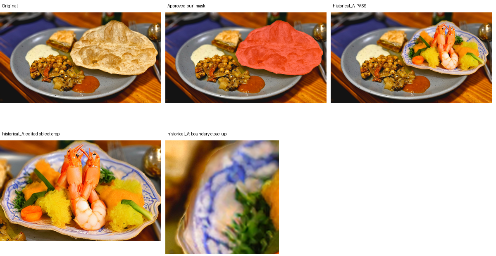

# Controlled SD 1.5 experiments

Research only. All generated-image visual and cultural assessments: PENDING_USER_REVIEW.

A: baseline. B: only steps changed from 20 to 30. C: only object-level prompt changed. Fixed seed 42, guidance 7.5, strength 0.9, 512-square padded processing crop; final 4000 x 2252. Exact prompts, scheduler settings, runtime, VRAM, boundary counts and output hashes are in technical_validation.json and each run/inpainting.json.

Approval and source/mask hashes: approval_record.json. No mask expansion.

The historical A is excluded from this controlled set because its corrected mask was labeled as a SAM candidate. New runs use the refined-mask route.

Execution issue: the relocated virtualenv launcher pointed to a missing old path. Used the bundled Python interpreter with the existing environment packages.

Run A: ERROR; validation N/A; protected changed N/A; runtime {'stage_seconds': 6.478676599999744}; VRAM {'initial_allocated_bytes': 0, 'free_total_before': [5379194880, 6441926656]}

Run B: ERROR; validation N/A; protected changed N/A; runtime {'stage_seconds': 0.13681500000166125}; VRAM {'initial_allocated_bytes': 0, 'free_total_before': [5379194880, 6441926656]}

Run C: ERROR; validation N/A; protected changed N/A; runtime {'stage_seconds': 0.12724749999688356}; VRAM {'initial_allocated_bytes': 0, 'free_total_before': [5379194880, 6441926656]}

Run historical_A: COMPLETED; validation PASS; protected changed 0; runtime {'load_seconds': 10.819693800003733, 'inference_seconds': 12.1113095000037, 'stage_seconds': 31.196515099989483}; VRAM {'initial_allocated_bytes': 0, 'free_total_before': [3459986228, 4294443008], 'peak_allocated_cuda_bytes': 2654782464}

New A/B/C failed before inference: pinned SD1.5 model absent from cache. Online retrieval also failed with Windows socket permission error 10013. No new generated candidates. Historical A is shown separately and independently pixel-validated; it is not a newly generated candidate. Restore the pinned model cache before repeating A/B/C.

D not performed: curry replacement target is unspecified; clarification requested. Separate curry results must precede combined editing.

Model limitations: processing downsamples a large source crop to 512 square; exact protected pixels are enforced by final compositing and do not establish natural boundaries, recognizable tempura or cultural correctness. One seed cannot establish robustness.

Recommended next experiment: after human inspection, specify the curry target and run curry-only before comparing sequential and combined-mask edits at fixed settings.

